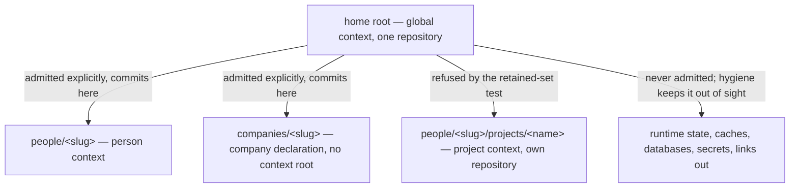

# Home Repository — Design

## Required reads

- @docs/project/spec/feature/reconciliation/home-repository.md
- @docs/project/spec/feature/config/tier-permissions.md
- @docs/project/spec/domain/reconciliation.md

## Purpose

The TeleClaude home holds the durable state of every person and company an
installation serves and versions none of it. Making it one repository is the
approved outcome (`@prd#authorized-horizon`); this design states the shape that
outcome takes once several context roots share one history, and answers the
three questions that shape raises: what reaches history and what keeps it out
(`@prd#success-criteria` SC-1 through SC-4), how a commit taken in one context
root avoids carrying another's work (SC-5 through SC-7), and what a person's own
project is when it sits inside that tree (SC-10, SC-11).

It owns the relationship among the participating contexts and nothing else.
Retained-content eligibility and the tier permission answer resolve to `config`;
convergence of the home to that declaration resolves to `reconciliation`; the
person-to-registry binding to `identity`; the commit surface to `agent_runtime`.
The context-root walk and the project shared-state resolver are consumed from
`config` and `workflow` as published contracts.

## Inputs/Outputs

- **Inputs:** the home directory and its contents; the tier registries that
  define where the home's own configuration, persons, and companies live, and
  the project manifest (`teleclaude/project_manifest.py`) for registered project
  roots; the declared tier at a context root; the repository's tracked set and
  dirty paths.
- **Outputs:** a repository at the home whose tracked set contains only
  explicitly admitted material; a commit scoped to one context root's subtree; a
  permission answer per declared tier; a validated person-to-registry binding or
  a refusal; a breach report over already-tracked content.

## Invariants

### What reaches history is decided by admission, not by exclusion

Nothing enters the home's history except by an explicit act that names it. The
platform already owns that act: the sealed commit surface builds every commit
from an explicit pathspec, and a new untracked file reaches a commit only when
an agent declares it (`project/spec/feature/agent_runtime/sealed-commit`). The
retained-set test is therefore enforced where the platform controls the write —
in the pathspec the commit surface constructs — and a path failing the test is
refused there.

This is what makes `@prd#success-criteria` SC-2 hold in the direction it claims.
Material appearing in the home later is outside history because nothing admitted
it, not because a rule anticipated it. No enumeration has to keep pace with the
home's growth.

Exclusion rules remain, demoted to what they are: hygiene that keeps untracked
runtime state, caches, databases, and links out of status output and out of a
careless broad add. They are generated from the tier registries so a newly
onboarded person or company needs no hand edit. They are not the boundary, and
the design does not lean on them as one.

Already-tracked content is a separate problem with a separate answer. Ignore
rules provably cannot reach it, so SC-4's breach report is produced by testing
the _tracked_ set against the retained-set test and reporting what fails —
never by adding an exclusion and calling it resolved.

#### Prior art and adopt-vs-build

The mechanism above is adopted, not invented. The alternative considered and
rejected was a generated exclusion artifact standing as the containment boundary
for secrets and foreign repositories.

- **Vendor documentation (Git).** The gitignore specification states that a
  gitignore file "specifies intentionally untracked files that Git should
  ignore" and that "Files already tracked by Git are not affected," and that
  "It is not possible to re-include a file if a parent directory of that file is
  excluded." Both sentences disqualify exclusion rules as a containment
  boundary: they do not reach what is already tracked, and re-including a
  directory to retain its authored content necessarily readmits everything
  beneath it, so classification below a retained root degrades to an
  enumeration of known hazards.
- **Reference implementation (chezmoi).** A home-directory manager whose source
  state is populated only by an explicit add, so a file in the home is outside
  version control until someone names it. Secrets are handled by encryption
  (age, GnuPG) or by retrieval from an external secret manager at render time —
  not by ignore rules.
- **Comparable production architecture (yadm).** The same problem, the same
  answer: a git-based home-directory manager whose private-data story is
  encryption and git-crypt integration rather than exclusion.

Both surveyed tools solve exactly this problem — versioning a home directory
that also contains secrets — and neither treats exclusion as the boundary. The
decision is therefore **adopt**: the admission model is the boundary, the
existing sealed-commit pathspec is where it is enforced, and exclusion rules are
kept only for hygiene. Encryption of secrets that must themselves be versioned
is deliberately not adopted here: no approved outcome requires versioning a
secret, and the backup design that might is a triggered deferral
(`@prd#risks-deferrals-and-open-decisions`).

### Isolation between context roots is containment over a preserved two-root coordinate

A commit taken in one context root carries only paths inside that root's
subtree. Containment is decided from the filesystem and holds regardless of how
the acting session's path set was derived.

The missing seam is not upward repository discovery. `resolve_git_root`
(`teleclaude/project_root.py`) already walks ancestors for a checkout root. The
defect is that callers collapse the two roots into one: the code surface passes
the resolved _git_ root as the project root to permission and scope resolution
(`teleclaude/cli/telec/handlers/code.py`), and workspace scoping then joins
repository-relative status paths onto that same root
(`teleclaude/quality/scope.py`). Where context root and repository root coincide
the collapse is invisible; where they differ, the context root is the coordinate
that is lost.

So the resolution result carries **both** roots, and each consumer receives the
one its question needs: the declared context root answers which tier governs,
what the permission question is asked about, which subtree bounds the commit,
and what paths are displayed; the repository root answers where git runs and how
git's own output is expressed. Conversion between the two coordinates happens
once, at that boundary, rather than being re-derived by each caller.

This is deliberate and it is a correction. The existing scope resolution
intersects a transcript-derived path set with the dirty set, and that path set is
not a statement of what the session modified: for one agent runtime it is
dominated by a vendor-owned file-history structure whose membership rule
TeleClaude neither owns nor can narrow, and its shell-derived component
classifies free-text command text by pattern. Isolation resting on that set
rests on someone else's data structure. Containment removes the dependency for
every case where the two roots differ; it does not resolve two sessions working
the same path inside one root, which stays with the attribution contract and is
named under Failure modes.

### Location grants nothing

A tier's permissions follow from its declaration, and the three axes —
invocation context, surface participation, project subscriptions — are answered
independently (`project/spec/feature/config/tier-permissions`). A project inside
a person's space is an ordinary project on every axis. Its owner is a declared
relationship carried in the project's own configuration, exactly as that
configuration already declares an owning company (`ProjectConfig.company`,
`teleclaude/config/schema.py`), and registration validates that declaration
against the person registry rather than reading the enclosing directory. Caller
identity is resolved by `identity` without reference to the enclosing context.

The person-owned project's sublocation is `people/<slug>/projects/<name>/` —
the sibling convention to the tier directories the registries already name,
chosen so the home's generated hygiene rules can address it as a class and so no
new discovery mechanism is introduced: the project registers itself in the
project manifest like every other project.

### Person-scoped authority requires a validated binding

A person root's declaration says what the file is. Before anything person-scoped
follows from it — visibility, or authority to commit into that person's own
material — `identity` (`teleclaude/core/identity.py`) validates that the declared
person is registered. An unknown, ambiguous, or disagreeing claim fails closed
(`project/spec/feature/identity/person-context-binding`).

## Primary flows

**Activating and converging the home.** Convergence compares the home's declared
state against what is observed and brings the repository to it: initializing the
history when absent, regenerating the hygiene rules from the tier registries,
and testing the tracked set against the retained-set test to report breaches. It
configures no remote. It is idempotent because it compares against a derived
target rather than accumulating edits.

Its activation surface is a CLI verb in a new `telec home` namespace, authored
per `software-development/procedure/cli-command-authoring`, so an operator can
initialize, repeat, and inspect it and receive the breach report as its result.
The installer invokes the same verb, so a machine converges without a separate
code path. A CLI surface is required rather than installer-only execution
because the outcome must be inspectable and repeatable on demand
(`software-development/principle/architectural-defaults`, CLI-first agency).

**Committing from a person context.** The commit surface resolves both roots,
expresses the repository's dirty paths in context-root coordinates, restricts
the pathspec to that root's subtree, and applies the retained-set test to every
admitted path. Paths belonging to another person, a company, the home's own
files, or a nested project are absent by construction. The eligible delta shown
before committing is rendered from the same scoped set, so what an agent
inspects is what a commit would carry.

**Answering the permission question.** The caller asks about a root; dispatch
reads that root's declared tier and answers the three axes for it. No tier falls
through to project defaults, and the question does not fail for a tier that is
not a project.

**Creating a project inside a personal space.** The project is created at the
sublocation above, registers in the project manifest, declares its person owner
in its own configuration, and that declaration is validated against the person
registry. Its own repository holds its history; the home's hygiene rules exclude
its path and the retained-set test refuses it, so the home neither versions its
contents nor records a reference to it.

## Failure modes

- **Treating exclusion rules as the boundary.** They do not reach tracked
  content and cannot classify below a re-included directory. A design that
  relies on them reports safety it does not have; admission is the boundary and
  the rules are hygiene.
- **The dangling reference trap.** A repository nested inside another is not
  descended into, but it is still offered as an untracked directory: a broad add
  either refuses it or records a reference the outer repository cannot resolve.
  Excluding and refusing its path is required, not tidy.
- **Attribution inside one context root.** Containment separates different
  roots; it does not separate two sessions editing the same path in the same
  root. That remains governed by the commit surface's attribution contract,
  whose precision is a known weakness. Treating containment as its fix would be
  a false guarantee.
- **A hazard reaching history once.** History retains what it recorded.
  Excluding material afterwards does not unrecord it, so convergence reports the
  breach rather than narrowing future retention and calling it fixed.
- **Hand-editing the generated hygiene rules.** An edit survives until the next
  convergence and then vanishes. Hazards are expressed where the generator reads
  them.
- **Assuming the home root is a project.** It carries the global declaration;
  treating it as a project root yields either a validation failure or fabricated
  subscriptions. Tier-dispatched permission is what prevents it.

## See Also

- ~/.teleclaude/docs/general/design/configuration-tiers.md — the tier model this shape realizes.
- docs/project/design/architecture/config-tier-resolution.md — the context-root and project shared-state resolvers consumed here.
