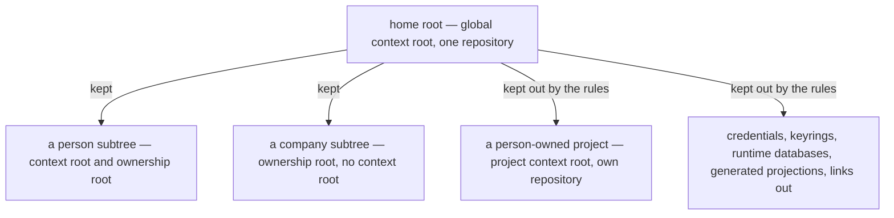

# Home Repository — Design

## Required reads

- @docs/project/spec/feature/reconciliation/home-repository.md
- @docs/project/spec/feature/config/tier-permissions.md
- @docs/project/spec/feature/config/tier-declaration.md
- @docs/project/spec/domain/reconciliation.md

## Purpose

The TeleClaude home is one local-only repository holding the durable state of
every person and company an installation serves. This design states the shape
that takes once several ownership roots share one history: what the home keeps,
how a commit taken in one part of it avoids carrying another part's work, how
commits happen where no project exists, and what a person's own project is when
it sits inside the tree.

It owns the relationship among the participating contexts and nothing else. What
the home keeps resolves to `reconciliation`; permission answers and the schemas
carrying every declaration to `config`; the person-to-registry binding to
`identity`; the commit surface to `agent_runtime`. The context-root walk and the
project shared-state resolver are consumed from `config` and `workflow`.

## Inputs/Outputs

- **Inputs:** the home directory and its contents; the tier registries naming
  where the home's own configuration, persons, and companies live, and the
  project manifest for registered project roots; the declared tier at a context
  root; the repository's dirty paths and live-session dirty-path ownership.
- **Outputs:** a repository whose history holds only what the rules keep; a
  commit scoped to one ownership root; a permission answer per declared tier; a
  validated person-to-registry binding or a refusal.

## Invariants

### Two roots, and neither is the other

Two different questions each yield a root, and conflating them is the failure
this section exists to prevent.

- **The context root** answers _whose authority governs this invocation_ — the
  nearest ancestor carrying an anchoring tier declaration. Global, project, and
  person declarations anchor one; a company declaration does not, and resolution
  terminates at it with no context root.
- **The ownership root** answers _whose material is this path_ — the home's own
  files, one person's subtree, one company's subtree, or a nested project. It is
  registry-backed: the tier registries already name where persons and companies
  live, and membership follows from that naming.

A company has an ownership root and no context root. That asymmetry is why the
coordinates cannot be collapsed, and it is what lets a commit taken elsewhere
recognise company material as not its own.

### What the home keeps is decided before its first commit

The home is a repository and its durable content is committed. What it keeps out
is decided by ignore rules written before anything is added, generated from the
tier registries so a newly onboarded person or company needs no hand edit.

Writing them first is what makes them sufficient. The published git
specification states that files already tracked are unaffected by ignore rules,
so rules added after the fact cannot reach what a repository already holds — but
a repository that has never held them has nothing to reach. Adoption over the
existing populated home therefore establishes the rules before its first commit,
which is also what keeps the credentials, keyrings, runtime databases, generated
projections, and links into other repositories already sitting in that tree from
entering history at all.

The rules keep out material that has not been established as worth keeping,
including material appearing later, and they reach inside the directories the
home does keep — the secrets sit within the person and company trees rather than
beside them. How that is expressed is an implementation reconciliation, not a
design commitment made here.

Material found in history that the rules exclude is reported. Ceasing to track
something does not unrecord it, so the report is the outcome; nothing scans
content to produce it, and no mechanism is adopted for it.

### Isolation is containment over the ownership coordinate

A commit carries only paths inside the ownership root it operates on.
Containment is decided from the filesystem and the registries, so it holds
regardless of how the acting session's own path set was derived.

The existing scope resolution intersects a transcript-derived path set with the
dirty set, and that path set is not a statement of what a session modified: for
one agent runtime it is the key set of a vendor-owned file-history structure this
platform neither owns nor narrows, and its shell-derived component classifies
command text by pattern. A session that only reads a file another session is
editing is recorded as having touched it. Isolation resting on that set rests on
a structure this platform does not control; containment does not.

Containment separates different ownership roots. It cannot separate two sessions
editing one path inside one root, which requires knowing which live session
claims a dirty path. That answer is owned by the commit surface and consumed
whole: it reports the earliest still-uncommitted live claimant or none, and
separately how many live sessions could not be attributed at all. A null claimant
means _no claimant_ only when nothing went unattributed; with attribution
incomplete the commit boundary fails closed rather than reading an unresolved
batch as a clean one.

### Non-project commits compose their own gates

The person and global tiers carry commit permission and acquire no project
subscriptions and no project lifecycle behavior. That distinction is load-bearing
at the commit boundary, because the sanctioned commit path is gated on project
capability and delegates every non-deletion commit to project-native build
targets at the repository root. A home has neither, so a commit there would fail
on machinery that does not apply to it.

Gate composition therefore resolves from the invocation's declared tier: a
project keeps its own native targets unchanged, while the person and global tiers
compose the platform's own configuration and documentation validation over the
committed paths. The home holds configuration and documentation rather than code,
so this is the applicable gate rather than a weaker one, and it grants no project
subscription to a non-project tier.

### Location grants nothing, and ownership is a declaration

A tier's permissions follow from its declaration, and the three axes — invocation
context, surface participation, project subscriptions — are answered
independently. A project inside a person's space is an ordinary project on every
axis.

Whom a project belongs to is one optional declaration naming exactly one owner
when present. A project under no owner stays valid, as it is today:

| Current shape      | Migrated shape                                          | Resulting invariant                                          |
| ------------------ | ------------------------------------------------------- | ------------------------------------------------------------ |
| A declared company | An owner declaration of kind company carrying that slug | Behavior unchanged for every existing company-owned project  |
| No company         | No owner declaration                                    | Ownerless projects stay representable and compose no company |
| —                  | An owner declaration of kind person                     | The person-owned case                                        |

Absent means ownerless; present means exactly one owner of one kind, so two
owners are unrepresentable rather than forbidden. The superseded field is removed
rather than kept beside the new one, and its consumers — the context selector's
company resolution, the app-config company composition with its
unresolved-company warning, and the hook receiver's company lookup — read the
migrated shape.

A person-owned project's declared owner is validated against the person registry
at registration, never inferred from the directory containing it. It lives at
`people/<slug>/projects/<name>/`, registers in the project manifest like any
other project, and its own repository holds its history.

### Person-scoped authority requires a validated binding

A person root's declaration carries its tier. Which person the root belongs to is
a separate declared claim in the person configuration, validated by `identity`
against the canonical person registry before any person-scoped visibility or
write authority follows. An unknown, ambiguous, or disagreeing claim fails
closed. The claim is a statement in a file and never authenticates a caller.

## Primary flows

**Adopting the home.** Adoption establishes the ignore rules, initializes the
history, and commits the durable content. It configures no remote. Repeating it
neither widens what is kept nor introduces a remote. Material found in history
that the rules exclude is reported.

**Committing from a person context.** The commit surface resolves the context
root and the ownership root, expresses the repository's dirty paths in
context-root coordinates, restricts the pathspec to the ownership root's subtree,
and consults the dirty-path ownership answer for every path. Material belonging
to another ownership root is absent by construction; a live claimant that is not
the committing session, or an incomplete attribution batch, fails the commit
rather than combining work.

**Answering the permission question.** The caller asks about a root; dispatch
reads that root's declared tier and answers the three axes for it. No tier falls
through to project defaults, and the question does not fail for a tier that is
not a project.

**Creating a project inside a personal space.** The project is created at its
sublocation, registers in the project manifest, declares its person owner, and
that declaration is validated against the person registry. The home's rules keep
its path out, so the home neither versions its contents nor records a reference
to it.

## Failure modes

- **Adding ignore rules after the fact.** They do not reach what a repository
  already holds, which is why adoption establishes them before its first commit.
- **Reading an unresolved attribution batch as clean.** A null claimant beside a
  positive undetermined count means attribution failed, not that the path is
  free.
- **Assuming a company folder anchors a context.** It does not; a design
  expecting one finds no invocation authority there.
- **Assuming the commit path is project machinery.** It is; a non-project tier
  committing through it without its own gate composition fails on build targets
  that do not exist.
- **The dangling reference trap.** A repository nested inside another is offered
  as an untracked directory: a broad add either refuses it or records a reference
  the outer repository cannot resolve.
- **Hand-editing the generated rules.** An edit survives until the next
  generation and then vanishes.
- **Assuming the home root is a project.** It carries the global declaration;
  treating it as a project root yields a validation failure or fabricated
  subscriptions.

## See Also

- ~/.teleclaude/docs/general/design/configuration-tiers.md — the tier model this shape realizes.
- docs/project/design/architecture/config-tier-resolution.md — the context-root and project shared-state resolvers consumed here.
