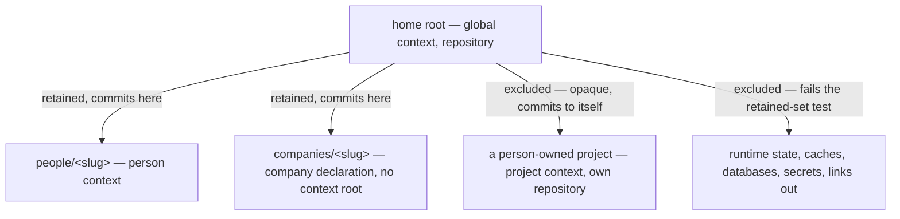

# Home Repository — Design

## Required reads

- @docs/project/spec/feature/reconciliation/home-repository.md
- @docs/project/spec/feature/config/tier-permissions.md
- @docs/project/spec/domain/reconciliation.md

## Purpose

The TeleClaude home holds the durable state of every person and company an
installation serves, and versions none of it. Making it one repository is the
decided outcome; this design states the shape that outcome takes once several
context roots share a single history, and it answers the three questions that
shape raises: what the repository retains, how a commit taken in one context
root avoids carrying another's work, and what happens when a person creates a
project of their own inside that tree.

It owns the relationship among the participating contexts and nothing else.
Every behavior named here resolves to one owner: the retained set and its
convergence to `reconciliation`, permission dispatch to `config`, the
person-to-registry binding to `identity`, and the commit surface to
`agent_runtime`. The context-root walk and the project shared-state resolver are
consumed as published contracts from `config` and `workflow` respectively; this
design adds no second answer to either question.

## Inputs/Outputs

- **Inputs:** the home directory and its current contents; the tier registries
  that already define where persons, companies, and the home's own
  configuration live, and the project manifest for registered project roots;
  the declared tier at a context root; the working tree's dirty paths.
- **Outputs:** a repository at the home whose retained set is a generated
  artifact rather than a hand-maintained list; a commit scoped to one context
  root's subtree; a permission answer per declared tier; a validated
  person-to-registry binding, or a refusal.

## Invariants

### One history, several context roots, one of them nested-repository-bearing

The home is a single repository. The context roots inside it — the home's own
global root, each person root, each company root — are not repositories of
their own and commit into it. A project a person creates inside their space is
the exception that proves the rule: a project is a repository-bearing tier, so
it keeps its own history and the home does not version its contents.

### The retained set is generated, not maintained

What the home versions is derived from the same registries that already define
the tiers, and it is expressed so that anything not positively established as
retainable is excluded. Two properties follow and both are load-bearing:

- **New material is excluded by default.** A credential store, cache, database,
  or generated projection appearing later is outside the retained set without
  anyone naming it. This is the direction the home's growth demands; the
  opposite direction retains each new hazard until someone remembers it.
- **The rule reaches inside what it retains.** Secret material sits within the
  person and company directories the home does version, so exclusion must be
  expressible below a retained directory, not only beside it.

Both are expressible in the repository's own exclusion vocabulary: excluding
everything at the root, re-including the tier directories the registries name,
then carving named hazards back out below them. The artifact is regenerated
from the registries rather than edited, so a newly onboarded person or company
is retained without a hand edit and no edit is where a hazard slips in.

### Isolation between context roots is containment, never attribution

A commit taken in one context root carries only paths inside that root's
subtree. Containment is decided from the filesystem, needs no inference about
who changed what, and holds regardless of how the acting session's own path set
was derived.

This is deliberate and it is a correction. The existing scope resolution
intersects the session's transcript-derived path set with the dirty set, and
that path set is not a reliable statement of what the session modified: for one
agent runtime it is dominated by a vendor-owned file-history structure whose
membership rule TeleClaude neither owns nor can narrow, and its shell-derived
component classifies free-text commands with pattern matching. Isolation that
rests on that set is isolation resting on someone else's data structure. Under
one shared history the consequence is no longer theoretical: work belonging to
another person's home can ride into a commit that never mentions it.

Containment removes the dependency for every case where the two roots differ.
It does not resolve two sessions working the same path inside one context root;
that residual stays with the attribution contract and its owner, and is named
under Failure modes rather than silently absorbed here.

### Location grants nothing

A tier's permissions follow from its declaration, and the three questions —
whether it is an invocation context, whether its material participates in a
surface, whether it carries project subscriptions — are answered
independently. A project inside a person's space is an ordinary project on
every axis; its ownership is a declared relationship and its caller identity is
resolved by `identity` without reference to the enclosing context. The home
containing a thing is a fact about storage and confers no authority.

### Person-scoped authority requires a validated binding

A person root's declaration says what the file is. Before anything person-scoped
follows from it — visibility, or the authority to commit into that person's own
material — `identity` validates that the declared person is a registered one.
An unknown, ambiguous, or disagreeing claim fails closed.

## Primary flows

**Adoption over a populated home.** Convergence compares the retained set the
registries imply against what the repository currently holds, and brings the
repository to that state: initializing the history if absent, regenerating the
exclusion artifact, and reporting rather than absorbing any already-retained
material that the rule excludes. Repeating it changes nothing, because the
comparison is against a derived target rather than an accumulated edit history.
No remote is configured at any point.

**Committing from a person context.** The commit surface resolves the
repository from the context root upward rather than assuming the root is the
repository, expresses the repository's dirty paths relative to that context
root, and restricts the pathspec to the root's own subtree. Paths outside it —
another person, a company, the home's own files, a nested project — are absent
from the scope by construction rather than by exclusion after the fact, and the
same holds for what the session is shown before it commits.

**Answering the permission question.** The caller asks about a root; dispatch
reads that root's declared tier and answers the three axes for that tier. No
tier falls through to another tier's defaults, and the question never fails for
a tier that simply is not a project.

**Creating a project inside a personal space.** The project registers as
projects register, its own repository holds its history, and the home's
retained set excludes its path so the home neither versions its contents nor
records a reference to it.

## Failure modes

- **The gitlink trap.** A repository nested inside another is not descended
  into, but it is still offered as an untracked directory: a broad add either
  refuses it outright or, once it has a commit, records a reference to a commit
  the outer repository cannot resolve. Excluding the nested project's path is
  therefore required, not merely tidy — relying on the outer repository's
  reticence leaves a dangling reference one careless add away.
- **Attribution inside one context root.** Containment separates different
  roots; it does not separate two sessions editing the same path in the same
  root. That case remains governed by the attribution contract owned by the
  commit surface, whose precision is a known weakness. Treating containment as
  a fix for it would be a false guarantee.
- **A hazard reaching history once.** History retains what it recorded, so
  excluding material later does not unrecord it. The convergence path reports
  such a breach rather than quietly narrowing future retention, because a
  silent narrowing reads as a fix and is not one.
- **Hand-editing the exclusion artifact.** An edit survives until the next
  regeneration and then vanishes, so a hazard excluded by hand reappears
  retained. Hazards are expressed where the generator reads them.
- **Assuming the home's own root is a project.** The home root carries the
  global declaration; treating it as a project root produces either a
  validation failure or a fabricated set of project subscriptions. The
  permission dispatch above is what prevents it.

## See Also

- ~/.teleclaude/docs/general/design/configuration-tiers.md — the tier model this shape realizes.
- docs/project/design/architecture/config-tier-resolution.md — the context-root and project shared-state resolvers consumed here.
