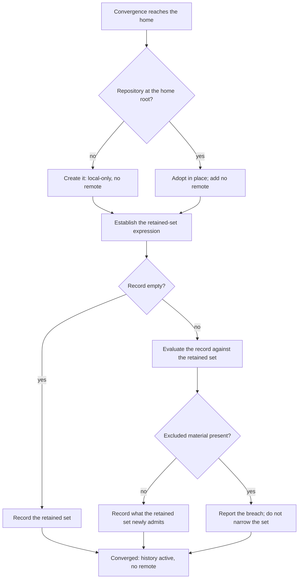

# Home Repository — Design

## Required reads

- @docs/project/spec/feature/reconciliation/home-repository.md

## Purpose

The home-repository contract states what the home keeps and what must never
enter its record. This design states how that contract is realized: how a
fail-closed retained set is expressed in git, in what order activation runs so
that excluded material is never recorded rather than recorded and dropped, and
in what shape membership is published for the commit boundary that asks it.

Its scope is the home's own history and membership. What a commit boundary does
with a membership answer belongs to the surface that asks, not here.

Ownership follows `software-development/policy/domain-ownership`: the retained
set is reconciliation's rule, because its reason to change is a change in what
the home's observed material contains — the same declared-versus-observed
comparison the reconciliation context already owns. Consumers invoke the
published predicate; none restates it.

## Inputs/Outputs

**Inputs**

- The home root, found by the convention in `general/design/configuration-tiers`
  — never by a filesystem scan and never by walking up for a repository.
- The home's observed version-control state, which is one of three: no
  repository; a repository whose record is empty; a repository with a record.
- The declared retained set: the classes of material the feature contract admits.

**Outputs**

- An activated local-only history at the home root, with no remote.
- A **membership predicate**: given any absolute path, whether it belongs to the
  home's retained set. It answers about an arbitrary path at any time, not only
  about the tree being converged.
- A **breach report** naming material found in the record that the retained set
  excludes.

The predicate is the published contract. `project/spec/feature/agent_runtime/sealed-commit`
consumes it as the retained set a repository's owner publishes; a repository that
publishes none is a valid state there, so the predicate is asked, never assumed.

## Invariants

### The retained set is expressed as an allow-list

A deny-list of hazard patterns fails open: material that appears later and
matches no pattern is retained until someone names it. The contract requires the
opposite direction, so the expression excludes everything at the root and
re-includes only what is named.

### Every level between the root and a retained file is re-included

Git does not descend into an excluded directory, so a re-include naming a file
deep inside one matches nothing. Admitting a file therefore re-includes each
directory on its path and re-excludes that directory's contents, level by level,
before naming the file. This is the mechanism reason the expression is
level-by-level rather than a flat list of retained paths, and it is what lets the
retained set reach _inside_ a retained directory — which the contract requires,
because credential-bearing files sit within the directory families the home
keeps.

### Exclusions precede the first record-creating operation

A record cannot be edited afterwards, so keeping material out and removing it
later are different outcomes and only the first satisfies the contract.
Activation therefore establishes the retained-set expression before anything can
enter the record. An order that records first and narrows afterwards fails the
contract permanently, on the first run, with no later correction available.

### No remote is configured, and none is implied

The history is rollback, never resilience. No surface presents it otherwise.

### A foreign nested root is never recorded

Git offers a nested repository to its parent as a single directory entry rather
than as its files. Recording that entry produces a reference to a commit the home
cannot resolve — it stores neither the nested history nor the nested content. So
a nested root is excluded from the retained set, and the predicate answers that
paths beneath it do not belong to the home.

### Membership answers paths, never bytes

The predicate decides whether a path belongs to the retained set. It does not
examine what a version of that path contains. This bound is the feature
contract's; the design adds no content inspection behind it.

### Breach detection reads the record, not the working tree

Ceasing to track a path does not unrecord it, so a breach is established against
the history and reported. Narrowing the retained set in response would convert a
breach into an apparently clean state, which is why the report is the outcome and
exclusion is not.

### Activation converges from any of the three observed states

Re-running activation neither widens the retained set nor introduces a remote,
from an unversioned home, from a repository whose record is empty, and from one
with a record. Detection tests the home root itself; a search that walks upward
would bind the home to an unrelated enclosing repository.

## Primary flows

**Activation**

The single ordering constraint is `E` before `G`: the retained-set expression is
in place before anything enters the record.

**Membership query**

A consumer supplies an absolute path. The predicate answers from the home root,
the retained-set expression, and the foreign-root boundary — never from the state
of a convergence run, and never by inspecting content. A path outside the home is
not the home's to answer for.

**Placement**

The rule and the predicate are core decisions inside the reconciliation context.
Git mechanics execute through the sanctioned seam in `teleclaude.git`, which
resolves the real binary rather than the agent wrapper. The convergence
entrypoint translates an installation run into a call on that core; it decides
nothing itself, per `software-development/principle/architectural-defaults`
layer direction.

## Failure modes

- **Expressing the retained set as a deny-list.** It reads as safe and fails open
  on everything nobody has named yet, which is the failure the fail-closed
  direction exists to prevent. Unioning blessed patterns into an existing
  exclusion file — the shape used when provisioning a project — is this failure
  in reusable form: it is correct for a project, whose default is to track, and
  wrong for the home, whose default is not to.
- **Re-including a deep path without re-including its parents.** The entry
  matches nothing and the file is silently absent from the retained set. The
  symptom is a retained set quietly smaller than intended, which no error
  reports.
- **Recording before excluding.** The record permanently holds what the retained
  set excludes. A later exclusion changes what is tracked, not what is recorded,
  and the contract asks for the second.
- **Detecting the repository by searching parent directories.** A home nested
  under any repository is then read as already versioned, and activation adopts a
  repository that is not the home's.
- **Treating a breach as a retained-set defect.** Adding the offending path to
  the exclusions makes the working tree look correct while the record still holds
  the material, and removes the only signal that it does.
- **Letting a nested root be added.** The result is a reference the home cannot
  resolve, which restores neither the nested content nor its history — a
  restoration failure that surfaces only when someone tries to restore.
- **Presenting local history as backup.** The home has no remote by decision. Any
  surface implying recoverability from machine loss contradicts the contract.

## See Also

- docs/project/spec/domain/reconciliation.md — the context that owns the retained-set rule.
- ~/.teleclaude/docs/general/design/configuration-tiers.md — how the home root is found, and why git plays no part in finding configuration.
- docs/project/spec/feature/agent_runtime/sealed-commit.md — the commit boundary that consumes the published membership answer.
