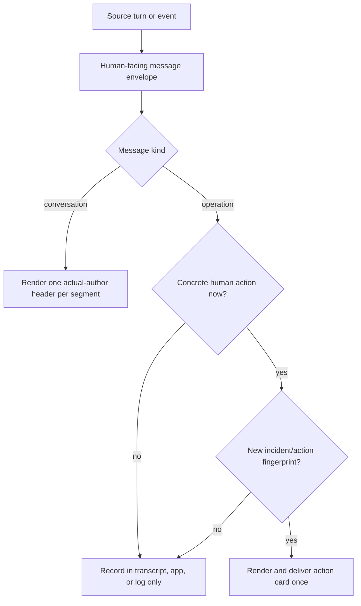

# Human-Facing Message Envelope — Design

## Purpose

Give every human-facing TeleClaude message enough identity and context to be
understood without exposing transport or persistence mechanics as if they were
the message. Conversation turns identify the actual author. Operational pushes
state the action required from the human. Both preserve complete provenance in
structured data while rendering only the information useful on that surface.

The envelope is the shared semantic contract, not a universal output string.
Direct conversation turns and action-required operational events use distinct
renderers because they answer different human questions: who said this, versus
what needs my attention now.

## Inputs/Outputs

**Inputs:**

- The source kind: human, agent, or system operation.
- The TeleClaude session UUID for a session-authored message.
- The human display name, or the agent runtime and thinking mode, for the actual
  author.
- The original occurrence timestamp at full stored precision.
- The human-facing body or incident summary.
- A structured human-action intent when an operation requires interruption:
  audience, concrete action or decision, incident identity, and action revision.
- Technical provenance retained as structured metadata: event type, notification
  identity, source session, delivery attempt, and exact timestamp.

**Outputs:**

- A direct-conversation author header for each human- or agent-authored segment:
  `[TeleClaude - Peer (<session-uuid>) · <human-name> · <utc-minute>]` or
  `[TeleClaude - Peer (<session-uuid>) · <agent>/<mode> · <utc-minute>]`.
- An operational action card only when a human action or decision is currently
  required: `[TeleClaude - Action · <human topic> · <utc-minute>]`, followed by
  an incident summary and a concrete `Action:` line.
- No external message for routine success, automatically handled failure,
  repeated same-state incident activity, or recovery.
- Complete provenance in the transcript, notification record, and delivery
  metadata even when a technical identifier is not rendered in the message body.

## Invariants

- **One actual author, one header.** A conversation segment carries exactly one
  identity header. An outer peer wrapper plus an inner `--- Agent @ ... ---` or
  `--- Human @ ... ---` marker is duplicate identity and is never emitted.
- **Session identity remains visible where it identifies the speaker.** Direct
  conversation headers show the full TeleClaude session UUID. They never
  substitute a native agent transcript id or omit the UUID in favor of a
  computer name.
- **Agent identity includes execution context.** An agent-authored header renders
  runtime and thinking mode together, such as `Codex/slow`; the generic word
  `Agent` is not an adequate author identity.
- **Useful time remains visible.** Human-facing headers render the original
  occurrence timestamp in UTC at minute precision. Exact seconds, subseconds,
  and timezone-bearing source values remain stored in structured provenance.
- **Interruption requires a current human action.** Negative severity and a
  schema-level actionable classification are insufficient. A push requires an
  occurrence-level, structured action or decision for a human audience.
- **Repeated state does not repeatedly interrupt.** The same incident and action
  revision is delivered at most once. A later push requires a material escalation
  that changes the requested human action.
- **Persistence mechanics are never message content.** Event type, notification
  row identity, and create/update verbs remain available in details and metadata;
  `[event.type] Notification #123 updated` is never a human-facing message.
- **DRY applies to meaning, not presentation.** Producers populate one semantic
  envelope. Surface renderers consume that envelope and may use native cards or
  text fallbacks without reconstructing identity, actionability, or provenance.

## Primary flows



For a direct bundle containing a human turn followed by an agent response, the
bundle remains one transport handoff but renders two authored segments:

```text
[TeleClaude - Peer (<session-uuid>) · <human-name> · 2026-08-05T20:48Z]
<human body>

[TeleClaude - Peer (<session-uuid>) · Codex/slow · 2026-08-05T20:49Z]
<agent body>
```

For an operational interruption, the text fallback is:

```text
[TeleClaude - Action · Docs watcher · 2026-08-06T14:45Z]

Docs sync is blocked on <computer>: <actual reason>.
Action: <specific remedy, decision, command, or details link>.
```

## Failure modes

- **Stacked identity frames** force the receiver to reconcile a generic outer
  source with an inner author marker and still omit runtime or mode.
- **Technical identifiers promoted to copy** make a durable row mutation look
  like the incident while hiding the reason and required response.
- **Schema actionability used as occurrence actionability** interrupts humans for
  failures the platform is already handling or for recurring telemetry that has
  no new decision.
- **One renderer for every surface** produces a technically DRY but semantically
  useless lowest-common-denominator string.
- **Dropping provenance to simplify copy** makes later diagnosis impossible.
  Provenance is retained structurally even when the normal rendering omits it.

## See Also

- docs/project/design/architecture/conversation-delivery.md
- docs/project/design/architecture/notification-delivery.md
