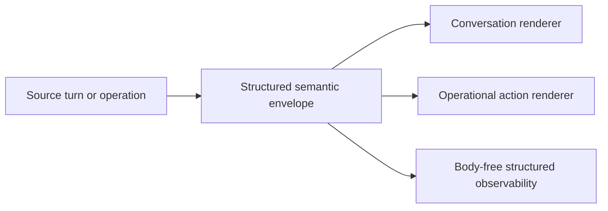

# Human-Facing Message Envelope — Design

## Purpose

Give every human-facing TeleClaude message enough identity and context to be
understood without promoting transport or persistence mechanics into message
copy. The envelope carries shared meaning; conversation and operational
surfaces apply their own renderer contracts.

## Inputs/Outputs

**Inputs:**

- The actual author or operation responsible for the message.
- Stable source identity and session provenance where a session is involved.
- Original occurrence time at full stored precision.
- Human-facing content or action summary.
- Surface-independent presentation identity.

**Outputs:**

- Structured provenance retained independently of rendered text.
- A surface-specific rendering produced by the conversation-delivery or
  operational-action contract.
- Human-visible time only where it helps interpret the message; exact time
  remains available in structured state.

## Invariants

- **Meaning precedes rendering.** Producers supply author, provenance, time,
  and content once. Renderers never reconstruct those facts from display text.
- **Lineage is not authorship.** Account lineage never substitutes for the
  human, agent, or machine that actually authored a message.
- **One source of truth.** Structured fields are authoritative. Headers,
  aliases, cards, and notification text are presentation.
- **Occurrence survives relay.** Forwarding preserves the original author,
  source, and occurrence time while recording relay progress separately.
- **Persistence metadata stays metadata.** Row identifiers, event types,
  attempts, cursors, and create/update verbs do not become message copy.
- **Privacy survives observability.** Operational logs carry structured,
  body-free metadata at policy-defined levels and never copy conversation
  bodies, credentials, or personal payloads.

## Primary flows

Conversation rendering answers who spoke and from where. Operational action
rendering answers what requires human attention. Both consume the same shared
provenance principles without sharing a universal output string.

## Failure modes

- Parsing rendered copy to recover provenance creates a second, ambiguous
  source of truth.
- Treating lineage as authorship attributes autonomous work to the account
  owner rather than its actual author.
- Logging message bodies leaks conversation content without improving delivery
  diagnosis.
- Reusing one renderer across conversation and operational surfaces hides the
  question each surface must answer.

## See Also

- docs/project/design/architecture/conversation-delivery.md
- docs/project/design/architecture/operational-action-cards.md
