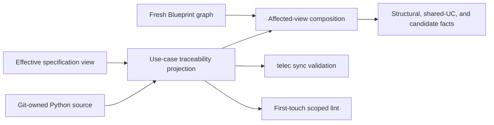

# Implementation Behavior Map — Design

## Purpose

Define the physical ownership and data flow for function-level use-case
traceability. The Context domain owns the identity catalog and declaration
grammar; the Blueprint consumes that projection alongside its existing graph;
synchronization and scoped quality gates consume the same mechanical facts.

## Inputs/Outputs

| Boundary             | Inputs                                                                                              | Outputs                                                                                      |
| -------------------- | --------------------------------------------------------------------------------------------------- | -------------------------------------------------------------------------------------------- |
| Effective catalog    | Canonical main checkout, composed global documentation, project documentation, optional todo target | Use-case identity, effective revision, defining specification ID, authored location          |
| Python inventory     | Active workspace's Git-owned Python files                                                           | Qualified function name, source span, terminal footer identities                             |
| Structural view      | Fresh `graph.json`, changed-file arguments                                                          | Seed nodes, dependent nodes, and direct dependency edges with relation provenance            |
| Affected composition | Catalog, Python inventory, structural view when available                                           | Existing structural report plus one-hop shared-use-case locations and direct-edge candidates |
| Validation           | Full authored catalog and every existing Python declaration                                         | Mechanical findings with source locations                                                    |
| First-touch quality  | Scoped Python paths and their `HEAD` versions                                                       | New or body-changed functions whose footer contract is unsatisfied                           |

The traceability projection uses typed records for definitions, function
declarations, source locations, and findings. It is computed in memory and is
never written into the Blueprint cache or documentation indexes.

## Invariants

- **One grammar owner.** A cohesive Context-owned traceability module parses
  specification headings and Python footers once. Blueprint, synchronization,
  and lint consume its typed results; none reimplements the grammar.
- **Two roots, two roles.** Documentation resolves from the canonical main
  checkout and composed global corpus. Python resolves from the active Git
  workspace.
- **Effective-view fidelity.** Agent-facing resolution reuses the existing
  planned-section and companion transforms for the active todo target. Full
  validation also reserves identities introduced by pending carriers, while a
  planned-change replacement may retain its own current identity as a later
  revision.
- **AST-defined source facts.** Python functions and docstrings are read with
  the standard-library AST. A declaration is recognized only from the final
  line of the function's docstring; comments, string literals elsewhere, and
  textual matches outside a function never become declarations.
- **Mechanical validation only.** Code checks grammar, uniqueness, existence,
  and revision currency. Whether an identity aptly governs a function remains
  agent judgment against the defining and domain specifications.
- **Structural truth stays structural.** Graph-derived dependents and edges are
  never inferred from use-case co-location. Missing or stale graph state keeps
  its existing fallback and does not suppress source-resolvable behavioral
  facts.
- **One-hop expansion.** Only identities declared by changed-file functions or
  structurally reached functions seed the reverse lookup. Identities found only
  on added shared-use-case functions do not expand the result again.
- **No legacy completeness gate.** Full validation checks every declaration
  that exists but does not reject an untouched function for having none.
  Scoped lint compares function bodies and gates only new or body-changed
  functions.
- **No durable acceleration by default.** Repository scanning remains
  ephemeral while it satisfies the approved latency budget. Crossing the
  measured budget reopens the architecture; it never silently creates a cache.

## Primary flows

### Effective catalog construction

The traceability module enumerates specification snippets from the same global
and project sources used by context retrieval, derives each specification ID
from its path, applies the requested todo view with the existing document-body
transforms, and parses use-case headings outside fenced examples. An unsuffixed
heading materializes revision one; a suffixed heading materializes that explicit
revision.

For full synchronization, the live catalog and every pending carrier are
validated as authored source. Pending additions and replacements reserve their
identities against other carriers. The old and replacement halves of one
planned-change carrier are alternatives in the same identity lineage rather
than duplicate definitions.

### Python declaration inventory

The active workspace supplies tracked Python files plus explicitly named
untracked changed files. One AST walk records nested functions and methods by
qualified name and source span. The terminal docstring line is parsed as the
sole `UC:` footer; the parser returns facts or a precise grammar finding rather
than normalizing malformed input.

### Affected-view composition

The CLI builds the catalog and Python inventory before evaluating graph
freshness. Every function defined by a changed-file argument is a conservative
behavioral seed, matching the command's existing file-level input contract.
When the graph is fresh, graph nodes from the changed-file seed set and reverse
traversal are resolved to AST functions by source file and containing source
span.

The declared identities on those seed and structural functions select all
source declarations with the same identities. Matches outside the structural
set are emitted as shared-use-case locations. For structurally reached
unannotated functions, only annotated functions connected by one direct graph
edge supply candidate identities; the edge relation and direction are retained
as provenance.

The existing structural report remains first and unchanged. Separate sections
then report resolved identities with defining specification IDs and declaring
locations, followed by candidate gaps with their direct-edge evidence. When the
graph is unavailable, the structural fallback prints first and only changed-file
seeds participate in the behavioral section.

### Synchronization validation

The synchronization validation sequence calls the shared traceability
projection after snippet structure is available and before any deploy. Catalog
collisions identify every authored definition. Footer findings identify the
function and line for malformed grammar, an unknown identity, or a revision
that is not current in the effective live catalog. Any finding joins the
existing blocking validation result; no validator edits source or documentation.

### First-touch quality enforcement

The scoped lint lane compares the active Python AST with the same path at
`HEAD`. It ignores the leading docstring when comparing executable bodies, so a
metadata-only correction does not recursively count as another body change.
Every new function and every function whose executable body changed must finish
with at least one well-formed, current identity. The lane reuses catalog and
footer facts and performs no semantic aptness scoring. Repo-wide lint retains
the declaration-integrity checks but does not reinterpret every historical
missing footer as a first-touch change.

### Availability mapping example

The existing TUI availability use case is declared at the functions that merge
a live single-agent event into the retained availability map, apply the
bootstrap map to views, pass that map into the footer and selection surfaces,
and render an individual availability pill. These are metadata-only mappings:
the availability state flow and rendering behavior are not changed by this
delivery.

## Failure modes

- **Catalog unavailable:** emit a factual traceability-unavailable section with
  the failing documentation source; never return an empty behavioral result as
  though no declarations exist.
- **Python parse failure:** report the source location and exclude that file's
  declarations from behavioral claims; synchronization and scoped quality fail.
- **Malformed or stale declaration:** report the function, line, and exact
  mechanical reason. Never guess a correction or silently repoint a revision.
- **Graph unavailable:** retain the established structural fallback and produce
  only source-backed changed-file behavioral facts.
- **Graph node cannot resolve to a function:** keep the structural node visible
  and omit function-level claims for it; unmatched-node counts remain factual
  diagnostics, not inferred candidates.
- **Latency budget exceeded:** record the measured breach and return the
  acceleration decision to architecture. Do not add a persistent index as an
  incidental optimization.
