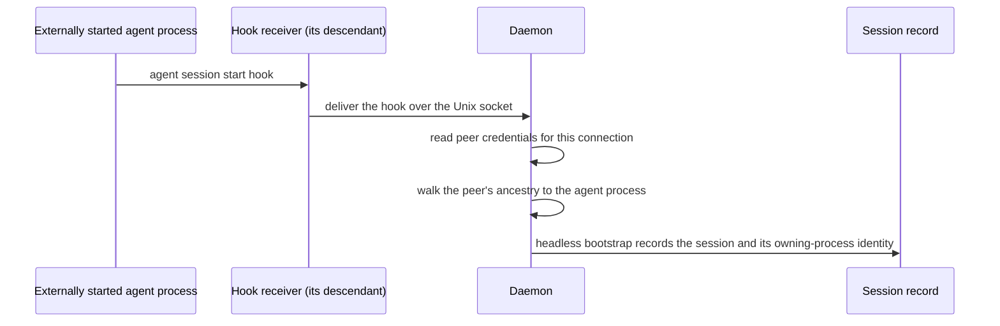

# Local Caller Attestation — Design

## Required reads

- @docs/project/design/architecture/api-server.md

## Purpose

Give the identity context a way to authenticate a caller that has no pane on
TeleClaude's own tmux server, and to determine which session that caller belongs
to without the caller asserting it.

Caller verification's dual-factor path pairs a client-supplied session id with a
tmux session name read from TeleClaude's own server. A caller with no such pane
supplies no second factor, so a session-id claim stands alone — a bearer
assertion any local process could make. Handing an externally hosted session a
session id to present would therefore not authenticate it; it would only move the
unverifiable claim.

Two kernel-supplied facts close this. The daemon's request surface is a Unix
domain socket, so the kernel knows which process is connected. That process's
ancestry is likewise an operating-system fact, not a harness feature. Together
they let the daemon **derive** the calling session from evidence the caller
cannot author, rather than accept a claim about it.

The session is never named by the caller. It is resolved from the attested
process tree, so there is nothing for a caller to forge and nothing to install in
the session for it to carry.

## Inputs/Outputs

**Inputs**

- The connected peer socket for each request on the daemon's Unix socket, from
  which the kernel supplies the peer process id and user id.
- The process ancestry of that peer process, read through the platform process
  interface.
- The owning-process identity recorded on the session record — the agent process
  that hosts an externally started session, captured with the start time that
  makes the process id unambiguous.

**Outputs**

- An attested caller fact for the request being served: peer process identity,
  peer user, and the session derived from ancestry — each distinguishable from
  every client-supplied signal.
- Authorization proceeding under the derived session's existing principal and
  role, through the existing clearance path.
- On failure: refusal. No session-scoped operation falls back to machine-global
  terminal identity.

## Invariants

- **Kernel evidence is never client-supplied.** Peer process identity and user
  are read from the connected socket; ancestry is read from the platform process
  interface. Neither is accepted from a header, an environment variable, or a
  request body.
- **The session is derived, never claimed.** Authorization resolves the session by
  matching the attested process ancestry against the owning-process identity
  recorded on the session. A caller-supplied session reference is never the basis
  for establishing a binding, so presenting another session's identifier gains
  nothing.
- **The recorded owner is captured from attested evidence.** The owning-process
  identity is derived by the daemon from an attested connection, never reported by
  the process that wishes to be recorded.
- **The owner is the agent process, not an enclosing shell.** Recording an
  ancestor that hosts unrelated processes would authorize every one of them, so
  the recorded owner is the agent process itself.
- **A process identity includes its start time.** A process id alone is
  ambiguous once reused. Every recorded and compared process identity carries the
  start time that disambiguates it, and a mismatch is a refusal.
- **Attestation authenticates; it does not elevate.** The derived session carries
  the principal and role it already has. Attestation grants no role, widens no
  clearance, and mints no new authority.
- **No credential is issued and none is stored.** Because every call re-derives
  the session from live kernel evidence, there is no token to mint for these
  sessions, no identity file to write, and no directory to allocate — and
  therefore no credential that could be read by the user's other processes.
- **Inheritance is structural.** A descendant of the agent process is inside the
  attested tree by construction, so child processes authenticate with no
  propagation step and nothing to inherit.
- **Failure is refusal.** Absent peer credentials, unreadable ancestry, no
  matching session, a start-time mismatch, a user mismatch, or a terminal session
  all refuse. Nothing degrades to honoring an unattested claim.

## Primary flows

### 1. Recording the owning process at bootstrap



The hook receiver runs as a descendant of the agent process, so the daemon
reaches the agent process by walking the ancestry of a connection it attested
itself. The receiver reports nothing about its own lineage that the daemon trusts.

### 2. Deriving the session on an authenticated call

```mermaid
sequenceDiagram
    participant C as Any process in the session
    participant K as Kernel
    participant D as Daemon request surface
    participant I as Identity context

    C->>D: request over the Unix socket
    D->>K: read peer credentials for this connection
    K-->>D: peer process id, peer user
    D->>I: request + attested peer fact
    I->>I: walk ancestry; match against recorded owning-process identities
    I->>I: resolve the matched session's principal and role
    I-->>C: response under that session, or refusal
```

A top-level agent process and a subagent three levels down follow the same path;
neither carries anything, and the second is authorized because it is inside the
first's tree.

### 3. Self-identification

Asking who the caller is answers from the session derived in flow 2, so an
externally hosted session identifies itself rather than reporting the
machine-global last-login record.

## Failure modes

- **Peer credentials unavailable on the platform or transport.** No attested
  fact, so no derivation. Refusal; never a fallback to the bare claim.
- **Ancestry unreadable, or the chain is truncated before a recorded owner.** The
  caller is not provably inside any session. Refusal.
- **The peer process exits and its process id is reused before inspection.** The
  start time carried with every process identity fails to match and the request is
  refused. The attested fact is valid only for the connection it was read from and
  is never carried forward.
- **The recorded owning process has exited.** The session's tree no longer exists;
  no caller can match it. Session close continues to govern the record itself.
- **A process outside the tree — a detached or re-parented descendant.** Refused.
  This is a deliberate limit: attestation authenticates membership in the tree it
  can prove, and a process that has left it is indistinguishable from an unrelated
  one.
- **Two sessions whose recorded owners are ancestor and descendant of each other.**
  The nearest matching owner wins, so a nested session authenticates as itself
  rather than as its host.
- **A caller presents a session id.** Unchanged behavior for pane-attached
  callers. For a caller with no pane it establishes nothing, because derivation
  never consults it.

## See Also

- docs/project/spec/feature/identity/headless-session-identity.md — the behavioral contract this design realizes.
- docs/project/spec/feature/identity/caller-verification.md — the resolution precedence this path joins.
- docs/project/spec/feature/integration/headless-session-bootstrap-from-hook.md — the bootstrap that records the owning process.
- docs/project/spec/session-identity-truth.md — the route classification that names these callers.
