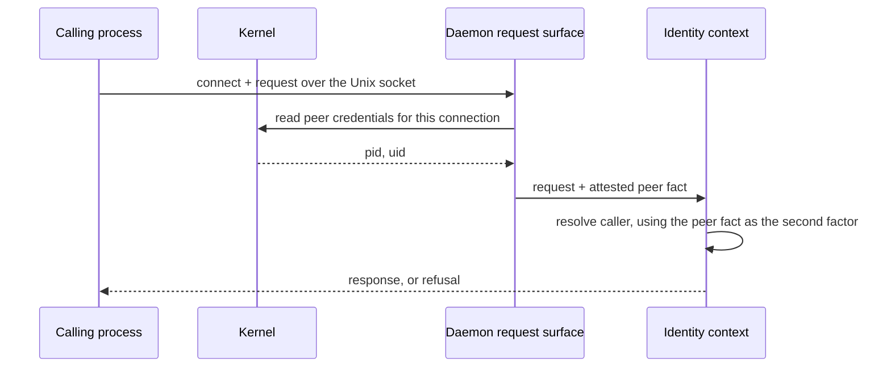
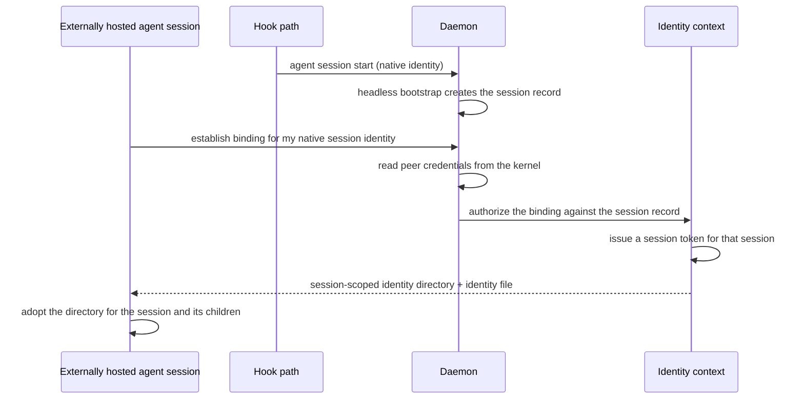

# Local Caller Attestation — Design

## Required reads

- @docs/project/design/architecture/api-server.md

## Purpose

Give the identity context a second authentication factor for callers that have
no pane on TeleClaude's own tmux server, and define how an agent session hosted
outside the daemon's launch flow establishes a session credential.

Caller verification's dual-factor path pairs a client-supplied session id with a
tmux session name read from TeleClaude's own server. A caller with no such pane
supplies no second factor, so the session-id claim stands alone — a bearer
assertion any local process could make. That is why an externally hosted session
cannot simply be handed a session id to present: the claim would be unverifiable
by construction, and honoring it would weaken the guarantee for every caller.

The daemon's request surface is a Unix domain socket, so the kernel already
knows which process is on the other end. Peer credentials replace the missing
factor with evidence the caller cannot author: the connecting process's pid and
uid, supplied by the kernel at connect time rather than by the request.

## Inputs/Outputs

**Inputs**

- The connected peer socket for each request on the daemon's Unix socket.
- A session reference presented by a process seeking to bind — the agent-native
  session identity the hook path already maps to a TeleClaude session.
- The existing session record and native-session map owned by `agent_runtime`.

**Outputs**

- An attested peer fact — pid and uid — available to the identity context for
  the request being served, distinguishable from every client-supplied signal.
- On successful binding: a session credential minted through existing session
  token issuance, plus a session-scoped identity directory holding the identity
  file the CLI already reads.
- On failure: refusal. No partial binding, and no fallback to machine-global
  terminal identity for a session-scoped operation.

## Invariants

- **Kernel evidence is never client-supplied.** The attested pid and uid are
  read from the peer socket, never from a header, an environment variable, or a
  request body. A caller can set every header it likes and change neither.
- **Attestation authenticates a process, not an intent.** It answers which local
  process is calling. Which session that process may bind to is a separate
  authorization decision made from the session record, never inferred from the
  peer fact alone.
- **Binding mints the existing credential.** Establishment issues a session token
  through the existing issuance capability and writes the existing session
  identity file. It introduces no second credential type, no parallel ledger, and
  no new verification path — revocation at session close continues to govern it.
- **The identity file is session-scoped or it is not written.** A credential
  written into a directory shared by the user's other processes would be readable
  by every one of them, so establishment allocates a directory private to the
  session and fails rather than writing into a shared temporary directory.
- **Peer identity bounds who may bind.** The attested uid is the discriminator
  for which person's sessions a caller may bind to. Ambient environment state is
  never that discriminator.
- **Establishment is idempotent per session.** A session that is already bound
  re-reads its existing binding; it does not accumulate credentials.
- **Failure is refusal.** An unresolvable session reference, a uid mismatch, or a
  terminal session refuses the binding. The caller stays unauthenticated.

## Primary flows

### 1. Peer attestation on the request path

The peer fact travels with the request as attested evidence, alongside — and
distinguishable from — the client-supplied identity signals.

### 2. Establishing a binding for an externally hosted session

The session record already exists: the hook path bootstraps it from the agent's
own session-start signal. Establishment does not create the session; it binds the
running process tree to the session the daemon already knows about.

### 3. Authenticated calls after binding

Subsequent calls follow the existing token path unchanged: the CLI reads the
token from the identity file, presents it, and caller verification validates it
against the ledger and the live session. Child processes inherit the directory
and therefore the identity, which is the existing inheritance contract rather
than a new one.

## Failure modes

- **Peer credentials unavailable on the platform or transport.** Attestation
  yields nothing, so the second factor is absent and binding is refused. This
  fails closed by construction; it never degrades to honoring the bare claim.
- **A shared temporary directory is all that is available.** Establishment
  refuses rather than writing a credential where the user's other processes
  would read it.
- **The session reference resolves to no session.** Refusal. Establishment never
  creates a session record to satisfy a claim; session creation stays with the
  hook path that observes a real agent start.
- **The attested uid does not match the person owning the session.** Refusal.
- **The session is closed or closing.** Refusal, and any existing token for it is
  already invalid through the established revocation path.
- **Pid reuse between connect and inspection.** A pid is only meaningful while the
  process behind it is the one that connected. Attestation treats the peer fact as
  valid for the connection it was read from and does not carry it forward.
- **A caller presents a session id with no attestation.** Unchanged current
  behavior for pane-attached callers; for callers without a pane the claim carries
  no second factor and grants nothing beyond what the session record already
  authorizes.

## See Also

- docs/project/spec/feature/identity/headless-session-identity.md — the behavioral contract this design realizes.
- docs/project/spec/feature/identity/session-identity-file.md — the identity file and inheritance contract reused here.
- docs/project/spec/feature/identity/session-token-issuance.md — the credential this binding mints.
- docs/project/spec/feature/integration/headless-session-bootstrap-from-hook.md — how the session record comes to exist.
- docs/project/spec/session-identity-truth.md — the route classification that names these callers.
