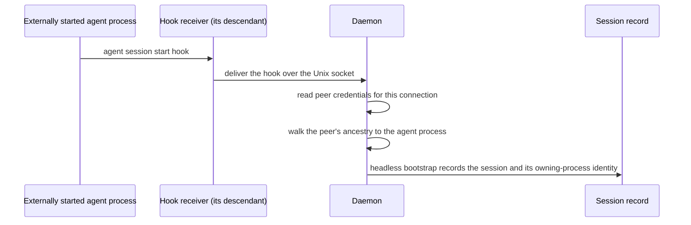

# Local Caller Attestation — Design

## Required reads

- @docs/project/design/architecture/api-server.md

## Purpose

Authenticate a caller that has no pane on TeleClaude's own tmux server, and
determine which session it belongs to without the caller asserting it.

Caller verification's dual-factor path pairs a client-supplied session id with a
tmux session name read from TeleClaude's own server. A caller with no such pane
supplies no second factor. This design supplies one from two kernel-held facts:
the identity of the process connected to the daemon's Unix socket, and that
process's ancestry. The session is derived from those facts; the caller names
nothing.

## Inputs/Outputs

**Inputs**

- The connected peer socket for each request on the daemon's Unix socket,
  carrying the peer process identity and peer user.
- The ancestry of that peer process, read through the platform process interface.
- The owning-process identity recorded on the session record — the agent process
  hosting an externally started session, carried with its start time.

**Outputs**

- An attested caller fact for the request being served: peer process identity,
  peer user, and the derived session — each distinguishable from every
  client-supplied signal.
- Authorization under the derived session's existing principal and role, through
  the existing clearance path.
- On failure: refusal. No session-scoped operation falls back to machine-global
  terminal identity.

## Invariants

- **Kernel evidence is never client-supplied.** Peer process identity and peer
  user come from the connected socket; ancestry comes from the platform process
  interface. Neither is read from a header, an environment variable, or a request
  body.
- **The session is derived, never claimed.** Authorization matches the attested
  ancestry against the owning-process identity recorded on the session. A
  caller-supplied session reference never establishes a binding.
- **The recorded owner is captured from attested evidence.** The daemon derives
  the owning-process identity from a connection it attested; no process reports
  its own lineage for recording.
- **The recorded owner is the agent process, never an enclosing shell.** An
  ancestor hosting unrelated processes would authorize all of them.
- **Every process identity carries its start time**, in both recording and
  comparison. A start-time mismatch is a refusal.
- **Attestation authenticates; it does not elevate.** The derived session carries
  the principal and role it already has. No role is granted, no clearance widened,
  no authority minted.
- **No credential is issued and none is stored.** Each call re-derives the session
  from live kernel evidence: no token for these sessions, no identity file, no
  allocated directory, and so no credential at rest.
- **Inheritance is structural.** A descendant of the agent process is inside the
  attested tree, so child processes authenticate with no propagation step.
- **Failure is refusal.** Absent peer credentials, unreadable ancestry, no
  matching session, a start-time mismatch, a peer-user mismatch, or a terminal
  session each refuse.

## Primary flows

### 1. Recording the owning process at bootstrap



The hook receiver runs as a descendant of the agent process, so the daemon
reaches that process by walking the ancestry of a connection it attested itself.

### 2. Deriving the session on an authenticated call

```mermaid
sequenceDiagram
    participant C as Any process in the session
    participant K as Kernel
    participant D as Daemon request surface
    participant I as Identity context

    C->>D: request over the Unix socket
    D->>K: read peer credentials for this connection
    K-->>D: peer process identity, peer user
    D->>I: request + attested peer fact
    I->>I: walk ancestry; match against recorded owning-process identities
    I->>I: resolve the matched session's principal and role
    I-->>C: response under that session, or refusal
```

A top-level agent process and a subagent several levels down follow this same
path.

### 3. Self-identification

Asking who the caller is answers from the session derived in flow 2.

## Failure modes

- **Peer credentials unavailable on the platform or transport** — no attested
  fact; refusal.
- **Ancestry unreadable, or the chain ends before any recorded owner** — refusal.
- **The peer process exits and its process id is reused before inspection** — the
  start time fails to match; refusal. An attested fact is valid only for the
  connection it was read from and is never carried forward.
- **The recorded owning process has exited** — no caller matches that session.
  Session close governs the record itself.
- **A process outside the tree, detached or re-parented** — refusal. Attestation
  authenticates membership in the tree it can prove; a departed process is
  indistinguishable from an unrelated one.
- **Nested sessions whose recorded owners are ancestor and descendant** — the
  nearest matching owner wins, so a nested session authenticates as itself.
- **A caller presents a session id** — unchanged behavior for pane-attached
  callers; for a caller with no pane it establishes nothing, as derivation never
  consults it.

## See Also

- docs/project/spec/feature/identity/headless-session-identity.md — the behavioral contract this design realizes.
- docs/project/spec/feature/identity/caller-verification.md — the resolution precedence this path joins.
- docs/project/spec/feature/integration/headless-session-bootstrap-from-hook.md — the bootstrap that records the owning process.
- docs/project/spec/session-identity-truth.md — the route classification that names these callers.
