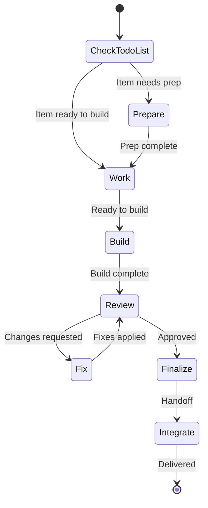
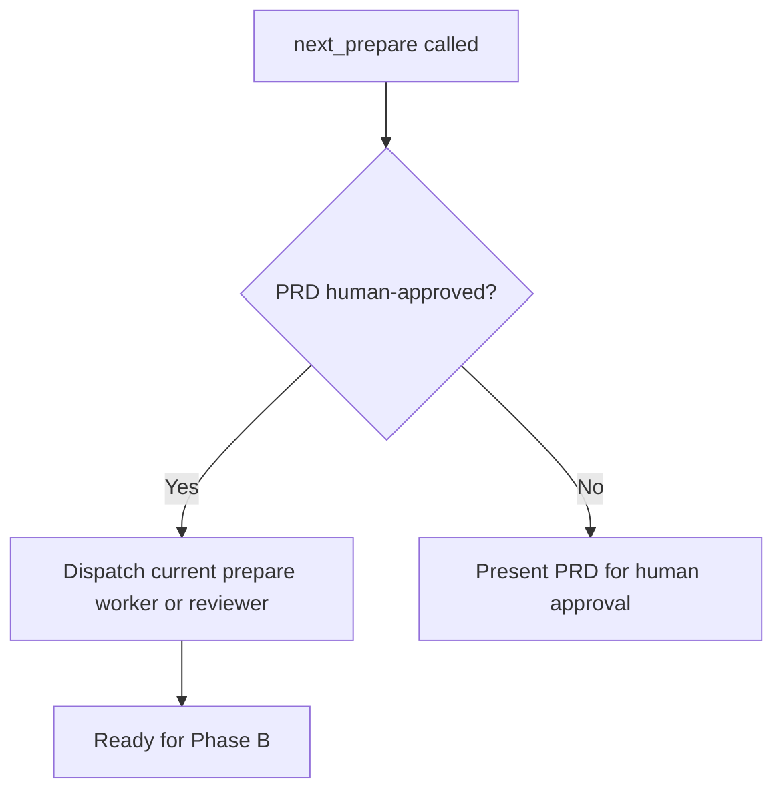
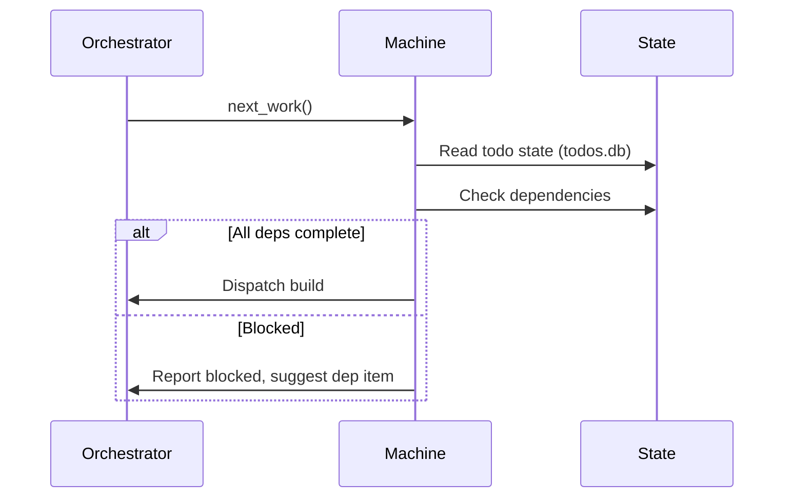

# Next Machine — Design

> **Detailed state machine documentation:**
>
> - [Lifecycle State Machines — Overview](lifecycle-state-machines.md) — end-to-end flow, roles, how the three phases connect
> - [Prepare Flow (Phase A)](prepare-flow.md) — PRD → Architecture → Test specs → Plan with PRD-only human approval and downstream review gates
> - [Work State Machine (Phase B)](work-state-machine.md) — build/review/fix/finalize routing
> - [Integration State Machine (Phase C)](integration-state-machine.md) — 12 states, lease-serialized merge-to-main delivery

## Purpose

The Next Machine orchestrates complex development cycles (Phase A: Prepare, Phase B: Build/Review/Fix, Phase C: Integrate) without maintaining internal state.

1. **Canonical phase pointer**: It reads the persisted `lifecycle_phase` pointer and routes from that state:
   - todo list (`todos.db`) (item discovery)
   - prepared workflow artifacts: `prd`, optional `architecture` / `test-specs`,
     and `implementation-plan` (preparation check)
   - `todo state (todos.db)` (build/review phase tracking)
2. **Phases**:
   - **Phase A (Prepare)**: Sequential artifact production with PRD-only human approval and downstream review gates.
   - **Phase B (Work)**: Deterministic, autonomous implementation and verification.
   - **Phase C (Integrate)**: Lease-serialized, crash-recoverable merge-to-main delivery. 12-state machine.
3. **Execution**: It returns explicit instructions or tool calls for the calling AI to execute.

- Blocks claiming items with incomplete dependencies.
- Requires project files to be tracked by git for worktree accessibility.



## Inputs/Outputs

**Inputs:**

- `todos.db` todo list - Work item registry with priorities
- `telec todo artifacts read {slug} prd` - Product intent and requirements contract
- `telec todo artifacts read {slug} architecture` - Optional technical brief
- `telec todo artifacts read {slug} test-specs` - Optional behavioral specs
- `telec todo artifacts read {slug} implementation-plan` - Execution plan
- `todos.db` state - Phase tracking (build, review)
- `telec todo artifacts read {slug} deferrals` - Identified technical debt
- `config.yml` (via `app_config.agents`) - Agent availability and strengths

**Outputs:**

- Explicit tool calls to execute (start_session, run_agent_command) with placeholders for agent/mode
- Human-in-the-loop guidance for preparation phase
- Agent selection guidance block derived from machine config and runtime availability
- One authoritative `lifecycle_phase` stored in todos.db; `telec todo stamp`, `telec todo mark-phase`, explicit `telec todo reconcile`, and the machine-owned `prepared -> build_started` work entry handoff are the only write paths that may change it
- Dependency resolution via set_dependencies tool

## Invariants

- **Canonical Lifecycle State**: Current phase is read from stored `lifecycle_phase`.
- **Stamp-Owned Progression**: `telec todo stamp` is the natural worker-completion authority. The machine dispatches the current phase and owns only transparent handoffs that can be proven locally, such as `prepared -> build_started` on first work entry.
- **Artifact Immutability**: Machine never modifies artifacts directly; delegates to workers.
- **Dependency Blocking**: Cannot claim item until all dependencies complete.
- **Phase Ordering**: Phases progress sequentially; no phase skipping.
- **Git Requirement**: All work items must be in git for worktree accessibility.
- **Finalize Serialization**: Only one finalize may run at a time across all orchestrators, enforced by the singleton integrator's lease system.
- **Conditional Prep**: Worktree prep is required on new worktree creation or prep-input drift; unchanged known-good worktrees skip prep.
- **Per-Repo+Slug Single-Flight**: Concurrent `/todos/work` calls for the same slug share one ensure/prep/sync critical section only within the same project root.
- **Remote Prerequisite**: Todo artifacts must exist on `origin/main` before worktree creation. `_ensure_todo_on_remote_main` commits and pushes scaffolded artifacts; failure is a hard error.
- **Phase Observability**: `/todos/work` emits per-phase timing logs with stable `NEXT_WORK_PHASE` markers.

## Primary flows

### 1. Phase A: Preparation



### 2. Phase B: Build Cycle

```mermaid
flowchart TD
    Start[next_work called]
    ReleaseLock{Caller holds<br/>finalize lock<br/>for done item?}
    CheckState{Read todo state (todos.db)}
    Build{Build<br/>complete?}
    Review{Review<br/>status?}
    Fix{Fix<br/>needed?}
    AcquireLock{Acquire<br/>finalize lock}
    Finalize[Dispatch Finalize]

    Start --> CheckState
    CheckState --> Build
    Build -->|No| DispatchBuilder[Dispatch builder AI]
    Build -->|Yes| Review
    Review -->|Pending| DispatchReviewer[Dispatch reviewer AI]
    Review -->|Changes| Fix
    Review -->|Approved| Finalize
    Fix --> DispatchFixer[Dispatch fixer AI]
```

### Worktree Prep Policy

For each `/todos/work` request, Next Machine applies deterministic prep decisions:

1. **Ensure todo artifacts on origin/main**
   - `_ensure_todo_on_remote_main` commits and pushes scaffolded artifacts.
   - If push fails after rebase fallback, the request returns a hard error.
   - Worktrees branch from `origin/main` — this is the single source of truth.
2. **Ensure worktree exists**
   - If missing: create `trees/{slug}` and branch.
3. **Prep decision**
   - Run prep when:
     - worktree was newly created
     - prep-state marker is missing/corrupt
     - prep input digest changed (`tools/worktree-prepare.sh`, dependency manifests/lockfiles)
   - Skip prep when inputs are unchanged and previous prep succeeded.
4. **Single-flight**
   - Ensure/prep is guarded by a per-repo+slug async lock.
   - Same-slug concurrent calls in the same repo wait and reuse resulting ready state.
   - Same-slug calls in different repos run independently.

### `/todos/work` Phase Logs

`next_work(...)` logs timing for major phases with a grep-stable marker:

- `NEXT_WORK_PHASE slug=<slug> phase=slug_resolution ...`
- `NEXT_WORK_PHASE slug=<slug> phase=preconditions ...`
- `NEXT_WORK_PHASE slug=<slug> phase=ensure_prepare ...`
- `NEXT_WORK_PHASE slug=<slug> phase=gate_execution ...`
- `NEXT_WORK_PHASE slug=<slug> phase=dispatch_decision ...`

Each entry includes:

- `decision` (`run`, `skip`, `error`, `wait`)
- `reason` (deterministic reason code)
- `duration_ms` (phase duration)

For the worktree setup boundary specifically:

- `next_work()` emits context logs before entering the ensure section so failures can be pinned to worktree setup vs later phases.
- Unexpected exceptions in `ensure_prepare` are surfaced as `reason=unexpected_<ExceptionType>` instead of disappearing behind a generic API 500.

### 3. Dependency Resolution



### 4. Worker Dispatch Pattern

| Phase    | Worker Role  | Command Example                                                                  |
| -------- | ------------ | -------------------------------------------------------------------------------- |
| Prepare  | Orchestrator | `/prime-orchestrator` then route with `telec todo prepare` / `telec todo work`   |
| Build    | Builder      | `/next-build` in worktree                                                        |
| Review   | Reviewer     | `/next-review-build` - evaluate against PRD and prepared artifacts               |
| Fix      | Fixer        | `/next-fix-review` - address findings                                            |
| Finalize | Finalizer    | `/next-finalize` - prepare and emit FINALIZE_READY (apply is orchestrator-owned) |

## Failure modes

- **Missing todo list**: Cannot discover work items. Returns error instructing user to create a todo.
- **Malformed State JSON**: Cannot read phase status. Treats as pending and restarts build phase.
- **Dependency Cycle**: Circular dependencies detected. Logs error, refuses to dispatch.
- **No Selectable Agents**: All agents are disabled in `config.yml` or marked unavailable in DB. Next Machine returns a hard error. If some agents are available but degraded, it notes this in the guidance and lets the orchestrator choose whether to proceed.
- **Git Not Available**: Worktree commands fail. Machine returns error; manual git setup required.
- **Stale Artifacts**: PRD or prepared context updated but plan not regenerated. Reviewer catches mismatch; fix manually.
- **Worker Crash**: Dispatched AI never completes. Orchestrator must timeout and retry or escalate.
- **Stamp Failure**: `telec todo stamp` fails due to validation (e.g., uncommitted changes for finalize-ready). Worker must resolve before stamping.
- **Finalize Contention**: Multiple orchestrators reach finalize simultaneously. Serialized by the singleton integrator's lease; each candidate is queued and processed in order.
