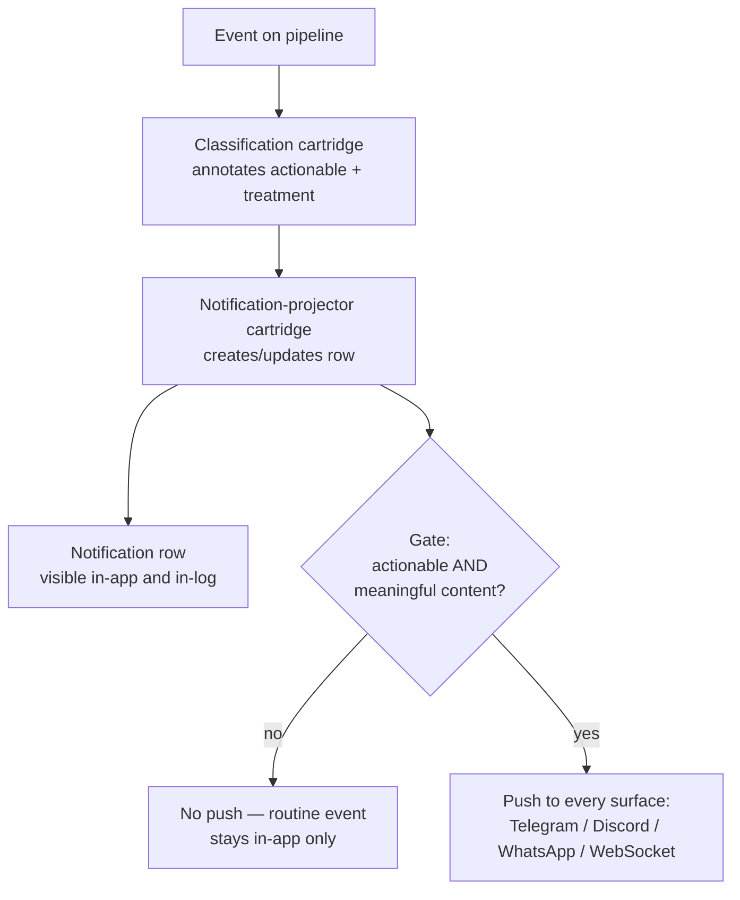
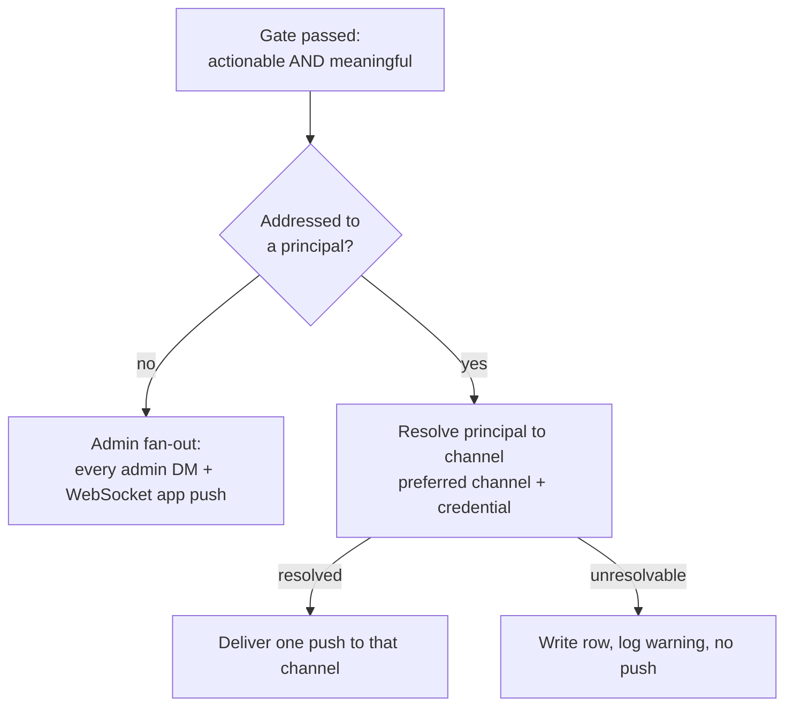

# Notification Delivery — Design

## Required reads

@docs/project/design/process-lifecycle.md

## Purpose

The platform emits a broad stream of events; only a fraction should interrupt a
human. This design defines the push gate: the single rule that separates
**remarkable** events — errors, failures, and things needing a human decision —
which are delivered to the interrupting push surfaces, from **routine** events —
successful, standard lifecycle telemetry — which project a notification row that
stays visible in-app and in-log but never fires a push.

The gate keys on the event's declared **actionability**, not on its
`EventLevel`. Level orders events for routing and display; it does not decide
whether a human is interrupted. Successful lifecycle events and remarkable events
can share a level, so level cannot be the discriminator — actionability is.

## Inputs/Outputs

**Inputs:**

- The `EventSchema.actionable` flag declared per event type in the event catalog
  (`teleclaude/events/catalog.py`, registered under
  `teleclaude/events/schemas/`). `actionable=True` marks errors, failures, and
  decision-needed events; the default `False` marks routine and successful
  operations.
- The projected notification change produced by the notification-projector
  cartridge: whether the projection **created** a new notification and whether the
  projected update was **meaningful** (a schema-declared meaningful field
  changed).

- The `EventSchema.delivery_debounce_s` window declared per event type in the
  event catalog. `None` inherits the platform default trailing window of 15
  seconds; a positive value sets a custom window; a value `<= 0` disables
  debounce so the event delivers immediately.
- The grouping identity the projector resolves for each change: the lifecycle
  group key's value when the schema declares one, otherwise the notification id.

- The optional recipient principal an actionable notification carries. An
  actionable notification may address a specific human principal; when it does,
  that principal is the intended audience for the push. An actionable
  notification that addresses no one has the admin set as its audience.

**Outputs:**

- A push delivered to each configured interrupting surface — Telegram, Discord,
  and WhatsApp admin DMs, and the WebSocket app-client push — **only** for events
  that pass the gate.

<!-- planned:queue-external-dm-deliveries -->

- External DM pushes enter a shared outbound delivery queue before provider I/O.
  Channel workers serialize delivery, apply provider rate limits, and retry
  transient provider rejections without discarding the durable notification.

<!-- /planned:queue-external-dm-deliveries -->

- A notification row written for every projected event regardless of the gate, so
  routine events remain queryable in-app and in-log; the gate suppresses the
  interruption, not the record.

- For an actionable notification addressed to a principal, a single push
  delivered to that principal's resolved channel instead of the admin fan-out.
  The channel is resolved from the same per-person channel configuration the
  platform already uses for person-addressed delivery — the person's preferred
  channel, then the per-channel credential — and may be any configured channel
  (Telegram, Discord, WhatsApp, or email), each delivered through its existing
  send primitive.
- The persisted notification row retains the addressed recipient, so the stored
  projection distinguishes a targeted notification from a broadcast one and the
  global operator surfaces exclude it from the broadcast view.

## Invariants

- **The push gate is keyed on actionability, never on level.** An event is
  delivered to a push surface only when its schema is `actionable`. A
  non-actionable event never interrupts, whatever its `EventLevel`.
- **A push requires meaningful content.** Beyond actionability, a push fires only
  when the projected change carries meaningful content — a newly created
  notification, or an update whose changed fields the schema declares meaningful.
  An actionable event that produces no meaningful projected change does not
  interrupt.
- **Every push surface honours the same gate.** The interrupting-DM adapters and
  the WebSocket app push apply one shared decision; no surface forwards
  unconditionally. The in-app notification list is fed by the notification table,
  not by the push path, so it is unaffected by the gate.
- **The gate suppresses interruption, not the record.** A routine event still
  projects its notification row; only the push is withheld.

- **External push delivery is debounced on a trailing quiet window.** After the
  gate passes, delivery to the external channels — Telegram, Discord, and
  WhatsApp — is coalesced per `(recipient, event type, grouping identity)` over a
  trailing quiet window (default 15 seconds). A later matching change inside the
  window replaces the pending payload and restarts the window; exactly one push
  is delivered once the window elapses with no further matching change. The
  WebSocket app push is not debounced and delivers immediately.
- **Debounce coalesces delivery, never the record.** The projector writes or
  updates the durable notification row before any push is scheduled, so the
  trailing window delays only the external push, never the row.
- **The debounce window is a per-event override.** An event schema sets its own
  `delivery_debounce_s` to widen, narrow, or disable its window; a disabled
  window delivers that event's push immediately.

<!-- planned:queue-external-dm-deliveries -->

- **External DM provider calls are queued and rate-limited.** Every Telegram,
  Discord, and WhatsApp delivery that survives debounce enters the same
  channel-specific queue used by both broadcast and targeted notifications.
  One worker per channel controls provider concurrency and retries retryable
  throttling or transient failures with bounded backoff; a failed attempt never
  erases or resolves the durable notification row.

<!-- /planned:queue-external-dm-deliveries -->

- **An addressed notification reaches only its principal, across every delivery
  surface.** When the projected change carries an addressed recipient, the push
  goes to that principal's resolved channel alone; the admin fan-out is bypassed
  on **every** surface it spans. The external DM adapters, the WebSocket app
  push, and the global notification list all carry only recipient-less broadcast
  notifications, so an addressed notification is never shown to the admin set on
  any of them. When the change carries no recipient, delivery is the admin
  fan-out unchanged. Addressing is opt-in per notification and additive — an
  existing producer that addresses no one keeps the broadcast audience.
- **The addressed row is retained but withheld from the operator broadcast.** The
  durable notification row records the recipient so the projection stays
  faithful, but the shared operator surfaces — the WebSocket push and the
  unfiltered notification list — exclude addressed rows; the addressed
  notification is delivered through its principal's channel rather than shown on
  the shared console.
- **Recipient routing reuses the existing person-to-channel resolution and covers
  every configured channel.** The channel for an addressed principal comes from
  the per-person preferred-channel configuration and per-channel credential, and
  may be any channel that configuration allows — Telegram, Discord, WhatsApp, or
  email — each delivered through its existing send primitive. Delivery stays
  inside the event → projection → durable-row → push model rather than the
  person-addressed messaging send path.
- **The addressed-versus-broadcast decision is made at the push dispatch, not at
  the admin adapters.** The recipient is resolved once per projected change and
  routes the whole delivery; it is not a per-adapter filter over the
  pre-registered admin set, so a principal who is not an admin still receives a
  targeted push.
- **An unresolvable recipient withholds the targeted push and never falls back
  to the admin fan-out.** When an addressed principal resolves to no usable
  channel — including a preferred channel that has no notification delivery
  path — the durable notification row is still written and an operator-visible
  warning is logged, but no push is delivered; a targeted notification is never
  redirected to the admin set.

## Primary flows

The projector carries the actionability and meaningful-content signals to the
push callbacks; each callback applies the shared gate before delivering to its
surface.

When a projected change that passes the gate carries an addressed recipient, the
push forks from the broadcast path to a single targeted delivery:

## Failure modes

- **Gate keyed on level instead of actionability** re-admits the original defect:
  routine successful lifecycle events at a shared level flood the push surfaces
  and success telemetry becomes indistinguishable from remarkable events.
- **A surface bypassing the gate** — most easily the WebSocket app push, which
  forwards to subscribed clients — re-floods that surface with routine events even
  after the DM adapters are gated. Every surface applies the same decision or none
  is protected.
- **Gating the notification row instead of the push** hides routine events from
  the in-app list and log, losing the record the operator relies on for
  diagnosis. The gate belongs on the push, not on the projection.

- **Falling back to the admin fan-out on an unresolvable recipient** re-admits
  the leak the addressing exists to prevent: a per-person notification meant for
  one principal sprays every admin. An unresolvable recipient withholds the push
  and logs a warning; it never broadcasts.
- **Deciding the target by filtering the per-admin push adapters** fails for any
  recipient who is not a pre-registered admin — a targeted notification to a
  non-admin principal would reach no one, because no adapter is registered for
  them. The addressed-versus-broadcast decision is made where the recipient is
  resolved, not by selecting among the admin adapter set.
- **Leaking an addressed notification through a surface the targeting decision
  did not cover** — the WebSocket app push or the unfiltered notification list —
  re-admits the very leak targeting removes: a per-person notification becomes
  visible to every operator. The single-recipient guarantee holds across every
  push and list surface, not only the external DM adapters.

<!-- planned:queue-external-dm-deliveries -->

- **Calling provider DM primitives directly from debounce callbacks** lets a
  burst create concurrent channel-open or send requests, so provider throttling
  becomes a silently dropped push. Debounce callbacks enqueue; only the
  channel worker performs provider I/O, and retry exhaustion remains observable.

<!-- /planned:queue-external-dm-deliveries -->
