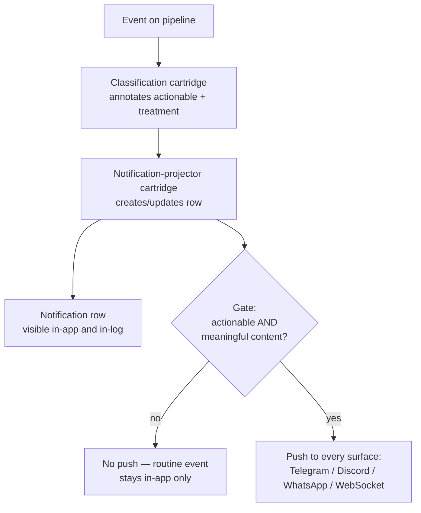

# Notification Delivery — Design

## Required reads

@docs/project/design/process-lifecycle.md

## Purpose

The platform emits a broad stream of events; only a fraction should interrupt a
human. This design defines the push gate: the single rule that separates
**remarkable** events — errors, failures, and things needing a human decision —
which are delivered to the interrupting push surfaces, from **routine** events —
successful, standard lifecycle telemetry — which project a notification row that
stays visible in-app and in-log but never fires a push.

The gate keys on the event's declared **actionability**, not on its
`EventLevel`. Level orders events for routing and display; it does not decide
whether a human is interrupted. Successful lifecycle events and remarkable events
can share a level, so level cannot be the discriminator — actionability is.

## Inputs/Outputs

**Inputs:**

- The `EventSchema.actionable` flag declared per event type in the event catalog
  (`teleclaude/events/catalog.py`, registered under
  `teleclaude/events/schemas/`). `actionable=True` marks errors, failures, and
  decision-needed events; the default `False` marks routine and successful
  operations.
- The projected notification change produced by the notification-projector
  cartridge: whether the projection **created** a new notification and whether the
  projected update was **meaningful** (a schema-declared meaningful field
  changed).

<!-- planned:typed-notification-delivery-debounce -->

- The `EventSchema.delivery_debounce_s` window declared per event type in the
  event catalog. `None` inherits the platform default trailing window of 15
  seconds; a positive value sets a custom window; a value `<= 0` disables
  debounce so the event delivers immediately.
- The grouping identity the projector resolves for each change: the lifecycle
  group key's value when the schema declares one, otherwise the notification id.

<!-- /planned:typed-notification-delivery-debounce -->

**Outputs:**

- A push delivered to each configured interrupting surface — Telegram, Discord,
  and WhatsApp admin DMs, and the WebSocket app-client push — **only** for events
  that pass the gate.
- A notification row written for every projected event regardless of the gate, so
  routine events remain queryable in-app and in-log; the gate suppresses the
  interruption, not the record.

## Invariants

- **The push gate is keyed on actionability, never on level.** An event is
  delivered to a push surface only when its schema is `actionable`. A
  non-actionable event never interrupts, whatever its `EventLevel`.
- **A push requires meaningful content.** Beyond actionability, a push fires only
  when the projected change carries meaningful content — a newly created
  notification, or an update whose changed fields the schema declares meaningful.
  An actionable event that produces no meaningful projected change does not
  interrupt.
- **Every push surface honours the same gate.** The interrupting-DM adapters and
  the WebSocket app push apply one shared decision; no surface forwards
  unconditionally. The in-app notification list is fed by the notification table,
  not by the push path, so it is unaffected by the gate.
- **The gate suppresses interruption, not the record.** A routine event still
  projects its notification row; only the push is withheld.

<!-- planned:typed-notification-delivery-debounce -->

- **External push delivery is debounced on a trailing quiet window.** After the
  gate passes, delivery to the external channels — Telegram, Discord, and
  WhatsApp — is coalesced per `(recipient, event type, grouping identity)` over a
  trailing quiet window (default 15 seconds). A later matching change inside the
  window replaces the pending payload and restarts the window; exactly one push
  is delivered once the window elapses with no further matching change. The
  WebSocket app push is not debounced and delivers immediately.
- **Debounce coalesces delivery, never the record.** The projector writes or
  updates the durable notification row before any push is scheduled, so the
  trailing window delays only the external push, never the row.
- **The debounce window is a per-event override.** An event schema sets its own
  `delivery_debounce_s` to widen, narrow, or disable its window; a disabled
  window delivers that event's push immediately.

<!-- /planned:typed-notification-delivery-debounce -->

## Primary flows

The projector carries the actionability and meaningful-content signals to the
push callbacks; each callback applies the shared gate before delivering to its
surface.

## Failure modes

- **Gate keyed on level instead of actionability** re-admits the original defect:
  routine successful lifecycle events at a shared level flood the push surfaces
  and success telemetry becomes indistinguishable from remarkable events.
- **A surface bypassing the gate** — most easily the WebSocket app push, which
  forwards to subscribed clients — re-floods that surface with routine events even
  after the DM adapters are gated. Every surface applies the same decision or none
  is protected.
- **Gating the notification row instead of the push** hides routine events from
  the in-app list and log, losing the record the operator relies on for
  diagnosis. The gate belongs on the push, not on the projection.
