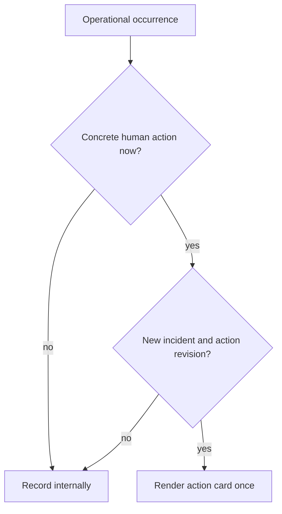

# Operational Action Cards — Design

## Required reads

@docs/project/design/architecture/human-message-envelope.md

## Purpose

Interrupt a human only when an operational occurrence requires a concrete
current action or decision, while keeping technical delivery and persistence
details out of the primary message.

## Inputs/Outputs

**Inputs:**

- A human audience.
- A current occurrence-level action or decision.
- Incident identity and action revision.
- A concise incident summary and exact occurrence time.
- Technical provenance retained in structured metadata.

**Outputs:**

- One action card headed `[TeleClaude - Action · <human topic> ·
<utc-minute>]` with a concrete `Action:` line.
- No external action card for routine success, automatically handled failure,
  repeated same-state activity, or recovery.
- Complete provenance in the notification record and delivery metadata.

## Invariants

- **Current human action is required.** Severity and schema-level actionability
  alone never justify interruption.
- **One action revision, one interruption.** Repeated state does not repeatedly
  notify; a later card requires a material change to the requested action.
- **Human copy explains the situation.** Event types, notification row IDs,
  attempts, and persistence verbs remain metadata.
- **Presentation may vary, meaning may not.** Native cards and text fallbacks
  render the same structured action envelope.
- **Useful time stays visible.** The card shows occurrence time at minute
  precision while exact time remains stored.

## Primary flows



The text fallback is:

```text
[TeleClaude - Action · <human topic> · <utc-minute>]

<incident summary>
Action: <specific remedy, decision, command, or details link>.
```

## Failure modes

- Treating every negative event as actionable creates alert fatigue.
- Repeating the same requested action makes persistence churn look like new
  incidents.
- Promoting technical identifiers into copy hides the human decision.
- Rendering recovery as another alert interrupts after the need has ended.

## See Also

- docs/project/design/architecture/notification-delivery.md
