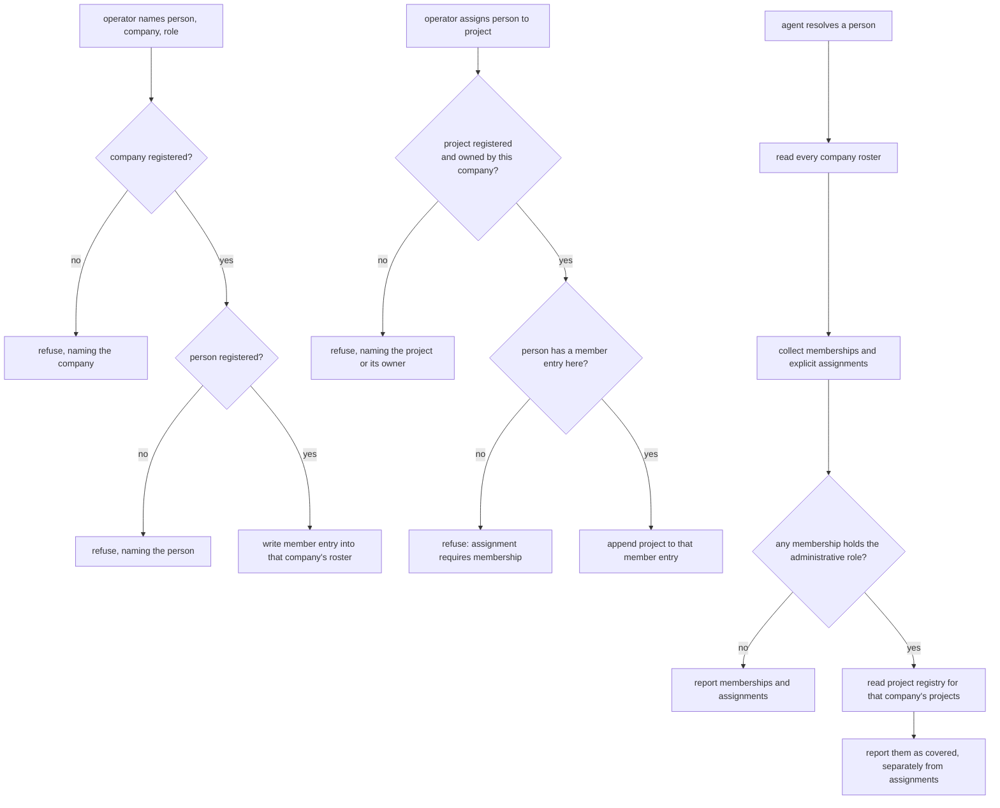

# Organizational Membership — Design

## Required reads

- @docs/project/spec/domain/config.md
- @docs/project/spec/domain/identity.md
- @docs/project/spec/feature/config/organizational-membership.md
- @docs/project/spec/feature/identity/organizational-membership.md

## Purpose

Give the platform one authoritative place to state who operates a business and
who works on its projects, and one contract for reading those facts back. This
snippet carries the technical shape behind the two feature contracts: where the
roster lives, what enforces its rules, and how resolution answers questions
about it.

## Inputs/Outputs

**Inputs.**

- The company tier — a company's own configuration, folder-discovered under the
  companies root. It carries the roster.
- The project registry — registered project roots, each project's own
  configuration declaring the company that owns it.
- The person registry — the global people list, which is what a roster entry's
  person reference must resolve to.

**Outputs.**

- For a person: the companies they belong to with the role held in each, the
  projects they are assigned to, and — for an administrative role — the projects
  that role covers.
- For an operator: acceptance or a refusal naming what could not be resolved.

## Invariants

**The roster's locality makes both settled rules structural.** An assignment is
recorded inside the member's entry, inside the company that owns the project.
An assignment naming a project of another company therefore has nowhere to be
written, and an assignment without a membership has no entry to live in. Both
rules the product contract settles are enforced by shape rather than by a check
that could be forgotten, which is the strongest layer available for them.

**One home per fact.** The company tier is the only place a membership or
assignment is declared. The person tier declares no company relationship, and
the pre-existing per-company owner reference is subsumed by the administrative
role rather than kept beside it. A relationship readable from two places is a
relationship that will eventually disagree with itself.

**Config declares, identity resolves, one way.** The configuration models and
their operator surface are config's; what the facts mean and what resolution
reports are identity's. Identity reads config's published models and
reinterprets nothing. Nothing flows back the other way.

**Coverage is derived, never stored.** The projects an administrative role
covers are computed from each project's own declaration of its owning company at
the moment the question is asked. Storing that set would create a second home
for project ownership, which the project tier already owns.

**Resolution reports; it never permits.** No consumer's authorization decision
lives here. Explicit assignment and derived coverage are reported as separate
facts so a consumer may read one without the other.

## Primary flows

**Declaration** is an operator act on the company tier, reached through the
configuration surface an administrator already uses for people. The surface is
person-shaped because that is how an administrator thinks about it; the storage
is company-side because that is where the human placed it. Surface shape and
storage shape need not match, and here they deliberately do not.

**Resolution** walks the company tier. The set is small and folder-discovered,
so the walk is cheap; no index is introduced for a scan of this size, and adding
one later is a change with its own evidence rather than a precaution taken now.

## Failure modes

- **A second home for the owner fact.** Keeping the existing per-company owner
  reference alongside an administrative role in the roster produces two answers
  to one question. The reference is subsumed, not paralleled.
- **Folding coverage into assignments.** Reporting an administrative role's
  covered projects as though they were explicit assignments destroys the
  distinction a consuming context depends on, and cannot be undone by that
  consumer.
- **Validating what the shape already prevents.** Adding a runtime check that an
  assignment's project belongs to the enclosing company restates the structure
  rather than enforcing anything, and invites the structure to be loosened later
  because "the check will catch it."
- **Reading ownership from location.** A project's owner is its own declaration.
  Inferring it from the directory containing the project, or from who is
  assigned to it, produces coverage answers that change when files move.
- **Extending this into authorization.** Deriving command clearance or
  documentation visibility here would place another context's rule in this one
  and would carry the v1 maintenance boundary into replacement architecture.

## See Also

- docs/project/design/architecture/config-tier-resolution.md — how a tier is resolved for an invocation.
- ~/.teleclaude/docs/general/design/configuration-tiers.md — the tier model this roster sits inside.
