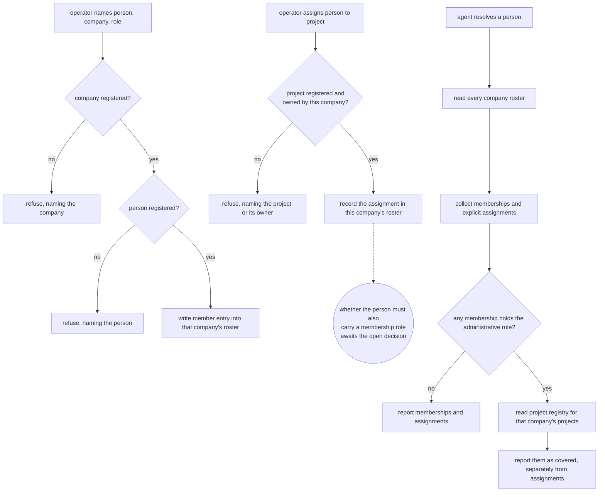

# Organizational Membership — Design

## Required reads

- @docs/project/spec/domain/config.md
- @docs/project/spec/domain/identity.md
- @docs/project/spec/feature/config/organizational-membership.md
- @docs/project/spec/feature/identity/organizational-membership.md

## Purpose

Give the platform one authoritative place to state who operates a business and
who works on its projects, and one contract for reading those facts back. This
snippet carries the technical shape behind the two feature contracts: where the
roster lives, what enforces its rules, and how resolution answers questions
about it.

## Inputs/Outputs

**Inputs.**

- The company tier — a company's own configuration, folder-discovered under the
  companies root. It carries the roster.
- The project registry — registered project roots, each project's own
  configuration declaring the company that owns it.
- The person registry — the global people list, which is what a roster entry's
  person reference must resolve to.

**Outputs.**

- For a person: the companies they belong to with the role held in each, the
  projects they are assigned to, and — for an administrative role — the projects
  that role covers. Explicit assignments and derived coverage are separate fields
  of that answer, never merged.
- For an operator: acceptance or a refusal naming what could not be resolved.

**The agent-facing surface is a CLI query.** An agent asks for a named person's
organizational membership through the configuration command namespace that
already lists people, and receives the answer above in a machine-readable shape.
This is the observable half of the product outcome: without a published command
the resolution exists only in-process and no agent can reach it. The query is
identity-owned and read-only; it resolves declarations and writes nothing.

## Invariants

**A roster only ever carries its own company's projects.** The declaration lives
with the company whose projects it concerns, so an assignment recorded in a
company's roster names a project that company owns. This holds under either
answer to the open decision and is not conditional on it: the open question is
about the person's standing in the business, never about which projects a roster
may reference.

**That alignment is dynamic referential integrity, not locality.** Nesting a
project slug under a company constrains nothing about that project — ownership is
a separate, mutable declaration on the project itself, so a raw document can name
any project and a project's owner can change after an assignment is written. The
alignment is read through the project owner's published contract and verified at
two boundaries: when an assignment is written, and when a roster is loaded for
domain use.

**What the open decision controls is the entry shape.** Under the recommended
reading — an assignment requires membership — every entry carries a role, and an
assignment without a membership has no entry to live in, which that shape does
enforce. Under the other answer an entry exists without a role, carrying
assignments alone, because a person assigned to this company's project without
belonging to it still needs somewhere to be recorded. Both variants stand until
the decision lands; the storage shape is a consequence of the answer, not an
input to it.

**A load-time assignment whose project no longer resolves to the enclosing
company fails loudly** rather than resolving as though it held. Silence there
would let a roster answer questions from a relation that has since dissolved.

**One home per fact.** The company tier is the only place a membership or
assignment is declared. The person tier declares no company relationship, and
the pre-existing per-company owner reference is subsumed by the administrative
role rather than kept beside it. A relationship readable from two places is a
relationship that will eventually disagree with itself.

**Config declares, identity resolves, one way.** The configuration models and
their operator surface are config's; what the facts mean and what resolution
reports are identity's. Identity reads config's published models and
reinterprets nothing. Nothing flows back the other way.

**Coverage is derived, never stored.** The projects an administrative role
covers are computed from each project's own declaration of its owning company at
the moment the question is asked. Storing that set would create a second home
for project ownership, which the project tier already owns.

**Resolution reports; it never permits.** No consumer's authorization decision
lives here. Explicit assignment and derived coverage are reported as separate
facts so a consumer may read one without the other.

**Roster writes are gated where they act, not where they are declared.** The
maintenance surface declares an administrator-only human band, but the executed
handler for that surface enforces only a customer exclusion, so every other human
role reaches it today. Extending that surface with roster mutation without
closing the gap would let a non-administrator rewrite company roles and project
assignments. The write path therefore carries its own point-of-action check
enforcing the declared human band, while preserving the agent band the surface
already admits. Reusing a surface is not inheriting the boundary it advertises.

**Removal is a forward migration, not a rejection.** Both configuration models
accept and preserve unknown keys, so deleting a typed attribute does not stop the
old key being read, kept, and written back — it converts it into a silent extra.
The owned-data contract answers that by bringing the stored shape forward before
domain consumption rather than refusing it: the migration removes an empty legacy
declaration outright, and domain models then see only the roster shape. A
non-empty legacy value cannot be converted while the company-role vocabulary is
undecided, so the migration stops with an explicit blocker naming that decision
rather than guessing a role. No installation holds such a value today, which
makes the migration simple; it does not license a breaking parser boundary. Absence of the attribute is not absence of
the field.

## Primary flows

The assignment path shows what holds under either answer: the project exists and
this company owns it. What awaits the decision is only whether the person must
also carry a membership role in that company, or may hold an assignment-only
entry.

**Declaration** is an operator act on the company tier, reached through the
configuration surface an administrator already uses for people. The surface is
person-shaped because that is how an administrator thinks about it; the storage
is company-side because that is where the human placed it. Surface shape and
storage shape need not match, and here they deliberately do not.

**The structured roster stays out of the reflected editor.** Company
configuration is rendered schema-driven in the configuration TUI's companies
tab, so a new structured field acquires an editing surface by reflection alone.
An empty roster would reflect as a single generic leaf and a populated one as
indexed fields the company save path cannot traverse safely — an accidental
mutation surface nobody designed. The roster is therefore excluded from that
reflection and is written only through the designed maintenance command. A
member-by-member editor is a later change with its own write semantics, not a
side effect of adding a field.

**Resolution** walks the company tier. The set is small and folder-discovered,
so the walk is cheap; no index is introduced for a scan of this size, and adding
one later is a change with its own evidence rather than a precaution taken now.

## Failure modes

- **A second home for the owner fact.** Keeping the existing per-company owner
  reference alongside an administrative role in the roster produces two answers
  to one question. The reference is subsumed, not paralleled.
- **Folding coverage into assignments.** Reporting an administrative role's
  covered projects as though they were explicit assignments destroys the
  distinction a consuming context depends on, and cannot be undone by that
  consumer.
- **Mistaking locality for enforcement.** Believing that nesting an assignment
  under a company constrains which project it may name, and skipping the
  ownership check on that belief. Nesting says where the fact is stored and
  nothing about what it may reference.
- **Checking ownership only on write.** A project's owner can change after an
  assignment is recorded, so a write-time check alone leaves a roster that was
  valid once and silently is not.
- **Conditionalizing the ownership rule on the membership question.** They are
  separate rules. Treating them as one would, under the permissive answer, let a
  project owned by another company be written into this roster.
- **Reading ownership from location.** A project's owner is its own declaration.
  Inferring it from the directory containing the project, or from who is
  assigned to it, produces coverage answers that change when files move.
- **Extending this into authorization.** Deriving command clearance or
  documentation visibility here would place another context's rule in this one
  and would carry the v1 maintenance boundary into replacement architecture.

## See Also

- docs/project/design/architecture/config-tier-resolution.md — how a tier is resolved for an invocation.
- ~/.teleclaude/docs/general/design/configuration-tiers.md — the tier model this roster sits inside.
