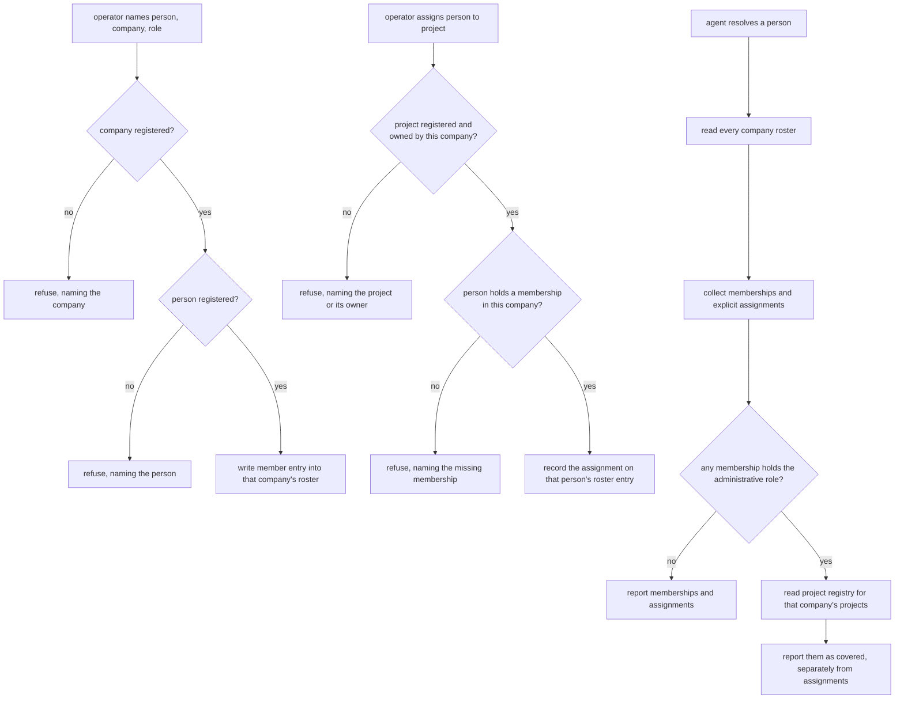

# Organizational Membership — Design

## Required reads

- @docs/project/spec/domain/config.md
- @docs/project/spec/domain/identity.md
- @docs/project/spec/feature/config/organizational-membership.md
- @docs/project/spec/feature/identity/organizational-membership.md

## Purpose

Give the platform one authoritative place to state who operates a business and
who works on its projects, and one contract for reading those facts back. This
snippet carries the technical shape behind the two feature contracts: where the
roster lives, what enforces its rules, and how resolution answers questions
about it.

## Inputs/Outputs

**Inputs.**

- The company tier — a company's own configuration, folder-discovered under the
  companies root. It carries the roster.
- The project registry — registered project roots, each project's own
  configuration declaring the company that owns it.
- The person registry — the global people list, which is what a roster entry's
  person reference must resolve to.

**Outputs.**

- For a person: the companies they belong to with the role held in each, the
  projects they are assigned to, and — for an administrative role — the projects
  that role covers. Explicit assignments and derived coverage are separate fields
  of that answer, never merged.
- For an operator: acceptance or a refusal naming what could not be resolved.

**The agent-facing surface is a CLI query.** An agent asks for a named person's
organizational membership through the configuration command namespace that
already lists people, and receives the answer above in a machine-readable shape.
This is the observable half of the product outcome: without a published command
the resolution exists only in-process and no agent can reach it. The query is
identity-owned and read-only; it resolves declarations and writes nothing.

## Invariants

**A roster only ever carries its own company's projects.** The declaration lives
with the company whose projects it concerns, so an assignment recorded in a
company's roster names a project that company owns. This constrains which projects a
roster may reference, and is a separate rule from the person's standing in the
business.

**That alignment is dynamic referential integrity, not locality.** Nesting a
project slug under a company constrains nothing about that project — ownership is
a separate, mutable declaration on the project itself, so a raw document can name
any project and a project's owner can change after an assignment is written. The
alignment is read through the project owner's published contract and verified at
two boundaries: when an assignment is written, and when a roster is loaded for
domain use.

**Every roster entry carries a role.** An assignment presupposes membership in
the company owning the project, so an entry is a person mapped to a company role,
and the projects that person is assigned to hang off that entry. An
assignment-only entry is not representable. The refusal is still enforced
explicitly at the write path, because an entry can be created first and have its
assignments extended afterwards, and the shape alone does not order those acts.

**The prerequisite is relational, and imposes nothing platform-wide.** It binds
an assignment to the company owning the project it names. A person belonging to
no company is not thereby invalid, and a platform on which no company is
registered carries no roster, refuses nothing, and needs no default or implicit
company to hold anyone. Such a platform relies on the platform role alone, which
this design never touches — and the sole-user administrator default is
unreachable from here for the same reason: it derives from the count of
registered people and never consults a company.

**An assignment whose project the company no longer owns is inert, not fatal.**
A project's owner is its own declaration in its own file, and changing it is a
routine edit that cannot reach into company rosters. An assignment left behind
by such a change is never reported as access, never blocks the company's
configuration from loading — that would break every session in every project
the company still owns — and is surfaced as stale by the load log, the
resolution query, and the wizard, until an administrator removes it through the
maintenance surface. Silent dropping is the failure this guards against: the
stale entry stays visible precisely so that the dissolved relation is seen.

**One home per fact.** The company tier is the only place a membership or
assignment is declared. The person tier declares no company relationship, and
the pre-existing per-company owner reference is subsumed by the administrative
role rather than kept beside it. A relationship readable from two places is a
relationship that will eventually disagree with itself.

**Config declares, identity resolves, one way.** The configuration models and
their operator surface are config's; what the facts mean and what resolution
reports are identity's. Identity reads config's published models and
reinterprets nothing. Nothing flows back the other way.

**Coverage is derived, never stored.** The projects an administrative role
covers are computed from each project's own declaration of its owning company at
the moment the question is asked. Storing that set would create a second home
for project ownership, which the project tier already owns.

**Resolution reports; it never permits.** No consumer's authorization decision
lives here. Explicit assignment and derived coverage are reported as separate
facts so a consumer may read one without the other.

**Roster writes are gated where they act, not where they are declared.** The
maintenance surface declares an administrator-only human band, but the executed
handler for that surface enforces only a customer exclusion, so every other human
role reaches it today. Extending that surface with roster mutation without
closing the gap would let a non-administrator rewrite company roles and project
assignments. The write path therefore carries its own point-of-action check
enforcing the declared human band, while preserving the agent band the surface
already admits. Reusing a surface is not inheriting the boundary it advertises.

**The two inert declarations are deleted, not migrated.** `PersonConfig.companies`
and `CompanyConfig.owner` are removed from the schema outright. No file on any
installation carries either key, so there is no owned data to bring forward and
the owned-data migration rule has nothing to act on; a key that appears in a
file after this change fails at load under the closed-overlay rule like any
other undeclared key. This is deliberate simplicity over file-backed
migration machinery the human declined: proper CLI create, read, update, and
delete is the contract, and a file edited into an invalid state does not load.

## Primary flows

The assignment path carries two independent checks. The project must exist and
this company must own it — a constraint on which projects a roster may reference.
The person must already hold a membership entry in this company — a constraint on
that person's standing. Neither implies the other, and a refusal names which one
failed.

**Declaration** is an operator act on the company tier, reached through the
configuration surface an administrator already uses for people. The surface is
person-shaped because that is how an administrator thinks about it; the storage
is company-side because that is where the human placed it. Surface shape and
storage shape need not match, and here they deliberately do not.

**The wizard does not edit company configuration.** The configuration wizard
has no Companies tab. Company configuration, the roster included, is written
only through the designed maintenance command, and the People tab carries no
company membership field. A schema-reflected editor over a nested roster would
render an empty roster as a generic leaf and a populated one as indexed fields
the company save path cannot traverse safely; keeping the roster out of every
reflected surface is what makes the maintenance command the single write path.
A company-scoped wizard editor is separate work.

**A membership entry owns what is nested in it.** Withdrawing a membership
removes the assignments it carried; removing a registered person removes their
entry from every roster. Neither refuses until the nested declarations are
cleared by hand, because the administrator performing the withdrawal is the
same one who could clear them, so a refusal protects nothing and adds steps.
Both report what was removed. The person-removal cascade is what keeps the
roster's person reference an invariant rather than a write-time check that
later drifts.

**Resolution** walks the company tier. The set is small and folder-discovered,
so the walk is cheap; no index is introduced for a scan of this size, and adding
one later is a change with its own evidence rather than a precaution taken now.

## Failure modes

- **A second home for the owner fact.** Keeping the existing per-company owner
  reference alongside an administrative role in the roster produces two answers
  to one question. The reference is subsumed, not paralleled.
- **Folding coverage into assignments.** Reporting an administrative role's
  covered projects as though they were explicit assignments destroys the
  distinction a consuming context depends on, and cannot be undone by that
  consumer.
- **Mistaking locality for enforcement.** Believing that nesting an assignment
  under a company constrains which project it may name, and skipping the
  ownership check on that belief. Nesting says where the fact is stored and
  nothing about what it may reference.
- **Checking ownership only on write.** A project's owner can change after an
  assignment is recorded, so a write-time check alone leaves a roster that was
  valid once and silently is not. Resolution reads ownership at the moment of
  the question, and a stale assignment is shown, not hidden and not fatal.
- **Collapsing the ownership check into the membership check.** They are separate
  rules answering different questions — which projects this roster may reference,
  and whether this person has standing in the business. Satisfying one is never
  evidence for the other, and a single merged check would let a project owned by
  another company be written into this roster whenever the person happened to be
  a member of it.
- **Reading the prerequisite as platform-wide enrollment.** It binds an
  assignment to the company owning its project. Turning it into a requirement
  that every person belong to some company would force an operator with no use
  for a company to register one, and would break a platform that legitimately
  carries none.
- **Reading ownership from location.** A project's owner is its own declaration.
  Inferring it from the directory containing the project, or from who is
  assigned to it, produces coverage answers that change when files move.
- **Extending this into authorization.** Deriving command clearance or
  documentation visibility here would place another context's rule in this one
  and would carry the v1 maintenance boundary into replacement architecture.

## See Also

- docs/project/design/architecture/config-tier-resolution.md — how a tier is resolved for an invocation.
- ~/.teleclaude/docs/general/design/configuration-tiers.md — the tier model this roster sits inside.
