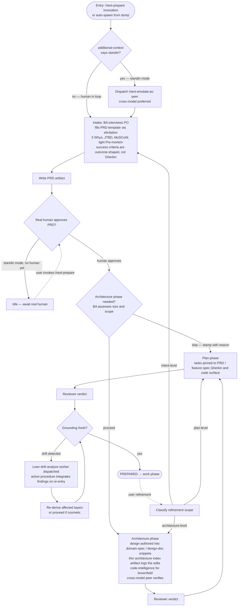

# Prepare Flow — Design

## Purpose

Codify the prepare phase as a deterministic chain of artifact-derivation steps where the PRD is the only human approval gate, lean enough that small work skips phases that don't earn their place, and capable of running autonomously in standin mode until real human intent approval is required.

The flow replaces the prior pair-driven prepare model. One session drives the whole lifecycle, loading a phase-scoped procedure for each step (intake, architecture, plan) and doing the phase's work itself. Each derived artifact is verified by a cross-model reviewer running in a separately-dispatched session. The active procedure dispatches the reviewer and tails it. The human approves the PRD because only the human owns intent. Architecture and plan advance on reviewer approval because the reviewer is the independent authority for derived artifacts.

## Inputs/Outputs

**Inputs:**

- A todo slug, with or without an existing `input` artifact (dumped earlier or written in-session).
- Session `additional_context`, carrying `human_in_loop: true | false`. Default `true`.
- User proficiency from PersonDTO injection (or asked at session start when absent).
- Codebase HEAD for drift detection.
- The platform-quality-flavors set (where applicable to architecture phase).

**Outputs (per surviving phase):**

| Phase        | Artifact                                                             | Authority gate                                        |
| ------------ | -------------------------------------------------------------------- | ----------------------------------------------------- |
| Intake       | `prd` (+ feature spec snippet for Category A)                        | `prd_approved`                                        |
| Architecture | domain-spec / design-doc snippet updates + thin `architecture` index | `architecture_review` verdict `approve`               |
| Plan         | `implementation-plan`                                                | `plan_review` verdict `approve`                       |
| Terminal     | —                                                                    | `PREPARED` (derived from all gates + fresh grounding) |

The confirmed plan is the handoff input to the work phase.

## Invariants

**Deterministic structure:**

- Intake produces `prd` (and, for Category A work, the feature spec snippet with Gherkin); no downstream phase begins until `prd_approved` is stamped by a real human.
- Each subsequent phase produces its output and advances on reviewer verdict. There is no downstream human approval stamp.
- The `architecture_skipped` stamp carries a reason and lets the chain proceed without the architecture phase.
- Plan phase is non-skippable; PRD is non-skippable.
- `PREPARED` requires: PRD human-approved, plan reviewer-approved, architecture reviewer-approved unless skipped, grounding fresh.

**Standin mode:**

- When session `additional_context` indicates `human_in_loop: false`, intake dispatches a Product Owner emulator via `/next-emulate-po {slug}`.
- A standin-produced PRD cannot be stamped `prd_approved` — that gate requires the real human.
- Downstream phases do not begin until the real human approves the standin-produced PRD.

**Refinement:**

- Human refinement at any layer invalidates downstream authority: PRD approval for intent changes, reviewer verdicts for derived artifact changes.
- The agent classifies refinement scope (intent / architecture / plan) and re-enters the appropriate phase.

**Drift:**

- Drift is a multi-class derivation. The full taxonomy and per-artifact coverage matrix live in `@spec/feature/workflow/drift-detection` (code, upstream-artifact, owned-snippet, upstream-snippet, dependency-graph, age). Per-artifact status collapses by `substantive > pending > cosmetic > fresh`.
- The same shared `derive_lifecycle_drift` function runs at every lifecycle entry point where prepared artifacts must reflect current truth: during the prepare BLOCKED branch AND at the work state machine's entry boundary before the `prepared → build_started` handoff.
- Drift surfacing dispatches a lean drift-analysis worker to ascertain impact; the active procedure integrates findings on re-entry.
- Substantive drift triggers re-derivation of affected layers and clears every downstream review verdict; cosmetic drift is recorded with an evidence anchor and expires lazily per class when current evidence moves past the anchor.
- Work-entry drift triggers a bounce to `telec todo prepare {slug}` — the prepare BLOCKED branch handles the drift, and the PREPARED terminal script tail bounces the orchestrator back to `telec todo work {slug}` automatically. No human gate on either cosmetic or substantive verdicts; intent-level PRD refinement is the only human-gated path and is orthogonal to drift.

**Cross-model verification:**

- The independent verification of derived artifacts (architecture, plan) comes from cross-model reviewers dispatched per phase. The active procedure dispatches the reviewer, tails it, and integrates the verdict.
- The PRD has no automated reviewer — the human is the sole authority on intent, so the human verifies the PRD directly.

## Primary flows

### The chain

### Use cases (numbered)

**Use case 1 — new work item, human in the loop (default).**

Trigger: user invokes `/next-prepare` (with or without slug), or asks an active agent to load the prepare procedure.

Mode: human_in_loop.

Flow: agent talks with human; fills PRD template; writes PRD; presents for approval. Human approves. BA assesses size and stamps skip decisions for downstream phases as warranted. Each surviving phase runs through draft → reviewer verdict. Reaches PREPARED when the plan reviewer approves and grounding is fresh.

**Use case 2 — dumped work, auto-spawned, no human present.**

Trigger: `telec todo create <slug> <description> --kind <kind>` without `--silent`. Daemon writes input artifact and auto-spawns an orchestrator with `additional_context: human_in_loop: false`.

Mode: standin.

Flow: orchestrator dispatches a Product Owner emulator via `/next-emulate-po {slug}` (cross-model preferred). BA interviews the emulator, fills PRD template, writes PRD artifact. Does NOT stamp `prd_approved` (requires real human). Agent goes idle. When the human later invokes `/next-prepare {slug}`, the state machine reports "PRD authored in standin mode, awaiting your approval." Agent presents PRD to human: "we role-played you and worked this through — here's what we landed on." Human approves or refines. Flow proceeds from there.

**Use case 3 — refinement / resume of existing todo.**

Trigger: user invokes `/next-prepare {slug}` on an existing todo.

Flow: agent queries the state machine; gets current layer + outstanding stamps + drift state. Agent presents state to user at proficiency-appropriate register. User indicates direction:

- Continue → proceed with the next outstanding step.
- Refine an artifact → agent clears the relevant downstream approvals and re-enters that artifact's phase with the delta.
- Re-open intake → substantial new thinking; agent restarts at PRD with delta as new input.

Also covers the silent-create case: human comes back to a slug created with `--silent` that has an `input` artifact but no auto-spawn happened; the resume is use case 1's intake conversation applied to the existing input.

## Failure modes

- **PRD authored in standin mode but human never returns.** Todo sits idle indefinitely. The system does not auto-proceed past `prd_approved` gate. Human's eventual return triggers the approval flow.
- **Drift detected mid-chain or at work entry.** Per-class derivation across the six drift classes (see `@spec/feature/workflow/drift-detection`) flags pending or substantive drift. Lean drift-analysis worker dispatched from the prepare BLOCKED branch. If substantive, the affected artifact's review verdict and every downstream review verdict are cleared, and the active procedure re-enters drafting. If cosmetic, the verdict is recorded with an evidence anchor and the chain continues; the verdict expires lazily when evidence later moves past the anchor on any anchored dimension. The same derivation runs at work entry (`telec todo work`); pending/substantive there returns a bounce-to-prepare script and the orchestrator continues through the existing script-driven loop without a human gate.
- **Reviewer verdict `changes_requested` cannot be addressed by auto-remediation.** Surface to the human as a blocker requiring direction. Do not grind through endless revision rounds.
- **Work item is too large.** BA at intake recommends breakdown in plain register. Uses `telec todo split` to spawn children. Each child gets its own track through the chain. Parent becomes a container.
- **Standard scaffold doesn't exist for a needed surface.** Architecture phase surfaces this as a blocking finding. Options: defer this work until the flavor is built; split the flavor-build as its own todo first; ask the human whether the product constraint permits a documented one-off.
- **Architecture and PRD disagree post-derivation.** When architecture surfaces something the PRD didn't anticipate (a hidden dependency, an unexpected scope expansion), the Architect surfaces the gap to the human as an open question. May trigger PRD refinement before architecture is finalized.
- **Active procedure drifts into orchestrator-shaped action.** If a procedure dispatches new sessions for its sub-work (instead of doing it itself), that's a regression — the design is one session loading procedures, not many sessions dispatched. The only legitimate dispatches in prepare are the PO emulator (intake standin) and the cross-model reviewers.
- **No `additional_context` mode marker.** Default to `human_in_loop: true`. Better to under-trigger standin mode than to standin-mode a real-human session.

### Open design choices still being prototyped

- **Standin-mode coverage of downstream phases.** Currently standin mode applies only to intake. Whether standin can also run downstream derivation after a real human approves the PRD is an open question. Conservative default: standin produces PRD only; downstream work waits for PRD human approval, then reviewer gates own derived artifacts.
- **Brownfield code-intelligence dependency.** Architecture phase ideally uses a code-intelligence blueprint (graph of services, events, dependencies). When that blueprint doesn't exist yet, the agents fall back to manual grounding. The architecture procedure notes this fallback explicitly.

## See Also

- ~/.teleclaude/docs/software-development/procedure/lifecycle/prepare/intake.md
- ~/.teleclaude/docs/software-development/procedure/lifecycle/prepare/architecture.md
- ~/.teleclaude/docs/software-development/principle/architectural-defaults.md
- ~/.teleclaude/docs/software-development/concept/intake-frameworks.md
