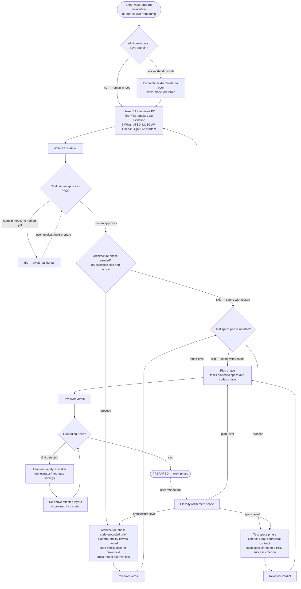

# Prepare Flow — Design

## Purpose

Codify the prepare phase as a deterministic chain of artifact-derivation steps where the PRD is the only human approval gate, lean enough that small work skips phases that don't earn their place, and capable of running autonomously in standin mode until real human intent approval is required.

The flow replaces the prior pair-driven prepare model. The orchestrator is the agent the user (or the standin) talks to; one cross-model peer is dispatched per derivation phase for independent verification; existing reviewer agents validate each downstream artifact. The human approves the PRD because only the human owns intent. Architecture, test specs, and plan advance on reviewer approval because the reviewer is the independent authority for derived artifacts.

## Inputs/Outputs

**Inputs:**

- A todo slug, with or without an existing `input` artifact (dumped earlier or written in-session).
- Session `additional_context`, carrying `human_in_loop: true | false`. Default `true`.
- User proficiency from PersonDTO injection (or asked at session start when absent).
- Codebase HEAD for drift detection.
- The platform-quality-flavors set (where applicable to architecture phase).

**Outputs (per surviving phase):**

| Phase | Artifact | Authority gate |
| --- | --- | --- |
| Intake | `prd` | `prd_approved` |
| Architecture | `architecture` | `architecture_review` verdict `approve` |
| Test specs | `test-specs` (or per-spec files) | `test_spec_review` verdict `approve` |
| Plan | `implementation-plan` | `plan_review` verdict `approve` |
| Terminal | — | `PREPARED` (derived from all gates + fresh grounding) |

The confirmed plan is the handoff input to the work phase.

## Invariants

**Deterministic structure:**

- Intake produces `prd`; no downstream phase begins until `prd_approved` is stamped by a real human.
- Each subsequent phase produces an artifact and advances on reviewer verdict. There is no downstream human approval stamp.
- Skip stamps (`architecture_skipped`, `test_specs_skipped`) carry a reason and let the chain proceed without that phase's artifact.
- Plan phase is non-skippable; PRD is non-skippable.
- `PREPARED` requires: PRD human-approved, plan reviewer-approved, all non-skipped intermediate phases reviewer-approved, grounding fresh.

**Standin mode:**

- When session `additional_context` indicates `human_in_loop: false`, intake dispatches a Product Owner emulator via `/next-emulate-po {slug}`.
- A standin-produced PRD cannot be stamped `prd_approved` — that gate requires the real human.
- Downstream phases do not begin until the real human approves the standin-produced PRD.

**Refinement:**

- Human refinement at any layer invalidates downstream authority: PRD approval for intent changes, reviewer verdicts for derived artifact changes.
- The agent classifies refinement scope (intent / architecture / specs / plan) and re-enters the appropriate phase.

**Drift:**

- Drift is detected by reconciliation: `current main SHA != artifact.codebase_sha_at_write` AND at least one referenced path changed between.
- Drift surfacing dispatches a lean drift-analysis worker to ascertain impact; orchestrator integrates findings.
- Substantive drift triggers re-derivation of affected layers; cosmetic drift is noted, not acted on.

**One persistent peer for the chain:**

- After intake, the orchestrator's cross-model peer is reused across the architecture, specs, and plan phases for continuity. Reviewers (existing `review-*` agents) provide the independent verification per artifact.
- Final cross-check at `PREPARED` may dispatch a fresh different-model peer when the cumulative architectural decisions warrant a cold read.

## Primary flows

### The chain

### Use cases (numbered)

**Use case 1 — new work item, human in the loop (default).**

Trigger: user invokes `/next-prepare` (with or without slug), or asks an active agent to load the prepare skill.

Mode: human_in_loop.

Flow: agent talks with human; fills PRD template; writes PRD; presents for approval. Human approves. BA assesses size and stamps skip decisions for downstream phases as warranted. Each surviving phase runs through draft → reviewer verdict. Reaches PREPARED when the plan reviewer approves and grounding is fresh.

**Use case 2 — dumped work, auto-spawned, no human present.**

Trigger: `telec todo dump <description>` without `--draft`. Daemon writes input artifact and auto-spawns an orchestrator with `additional_context: human_in_loop: false`.

Mode: standin.

Flow: orchestrator dispatches a Product Owner emulator via `/next-emulate-po {slug}` (cross-model preferred). BA interviews the emulator, fills PRD template, writes PRD artifact. Does NOT stamp `prd_approved` (requires real human). Agent goes idle. When the human later invokes `/next-prepare {slug}`, the state machine reports "PRD authored in standin mode, awaiting your approval." Agent presents PRD to human: "we role-played you and worked this through — here's what we landed on." Human approves or refines. Flow proceeds from there.

**Use case 3 — refinement / resume of existing todo.**

Trigger: user invokes `/next-prepare {slug}` on an existing todo.

Flow: agent queries the state machine; gets current layer + outstanding stamps + drift state. Agent presents state to user at proficiency-appropriate register. User indicates direction:

- Continue → proceed with the next outstanding step.
- Refine an artifact → agent clears the relevant downstream approvals and re-enters that artifact's phase with the delta.
- Re-open intake → substantial new thinking; agent restarts at PRD with delta as new input.

Also covers the `--draft` dump case: human comes back to a slug with an `input` artifact but no auto-spawn happened; the resume is use case 1's intake conversation applied to the existing input.

## Failure modes

- **Peer dispatch fails or returns unusable output.** Orchestrator continues solo at that phase; notes the missing peer perspective in the artifact. Reviewer still runs and verifies independently.
- **PRD authored in standin mode but human never returns.** Todo sits idle indefinitely. The system does not auto-proceed past `prd_approved` gate. Human's eventual return triggers the approval flow.
- **Drift detected mid-chain.** Reconciliation flags drift in artifact-referenced paths. Lean drift-analysis worker dispatched. If substantive, the affected layer's approval is invalidated and the layer re-enters drafting. If cosmetic, drift is noted in artifact metadata and the chain continues.
- **Reviewer verdict `changes_requested` cannot be addressed by auto-remediation.** Surface to the human as a blocker requiring direction. Do not grind through endless revision rounds.
- **Work item is too large.** BA at intake recommends breakdown in plain register. Uses `telec todo split` to spawn children. Each child gets its own track through the chain. Parent becomes a container.
- **Standard scaffold doesn't exist for a needed surface.** Architecture phase surfaces this as a blocking finding. Options: defer this work until the flavor is built; split the flavor-build as its own todo first; ask the human whether the product constraint permits a documented one-off.
- **Architecture and PRD disagree post-derivation.** When architecture surfaces something the PRD didn't anticipate (a hidden dependency, an unexpected scope expansion), the orchestrator surfaces the gap to the human as an open question. May trigger PRD refinement before architecture is finalized.
- **No `additional_context` mode marker.** Default to `human_in_loop: true`. Better to under-trigger standin mode than to standin-mode a real-human session.

### Open design choices still being prototyped

- **Cross-model peer rotation across phases.** Currently the persistent peer is one model across all phases. Whether to rotate models per phase (Codex for architecture, Gemini for specs, etc.) for additional cognitive diversity is open. May add cost; may add value.
- **Standin-mode coverage of downstream phases.** Currently standin mode applies only to intake. Whether standin can also run downstream derivation after a real human approves the PRD is an open question. Conservative default: standin produces PRD only; downstream work waits for PRD human approval, then reviewer gates own derived artifacts.
- **Brownfield code-intelligence dependency.** Architecture phase ideally uses a code-intelligence blueprint (graph of services, events, dependencies). When that blueprint doesn't exist yet, the agents fall back to manual grounding. The architecture procedure notes this fallback explicitly.

## See Also

- ~/.teleclaude/docs/software-development/procedure/lifecycle/prepare/intake.md
- ~/.teleclaude/docs/software-development/procedure/lifecycle/prepare/architecture.md
- ~/.teleclaude/docs/software-development/principle/architectural-defaults.md
- ~/.teleclaude/docs/software-development/concept/intake-frameworks.md
