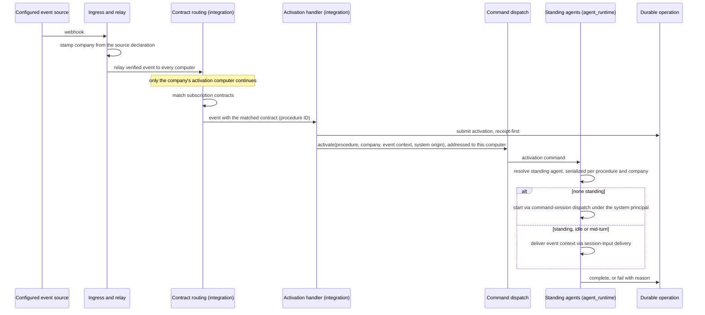

# Procedure Activation — Design

## Purpose

Connect a procedure's declared event subscriptions to the agent that answers
them, without a per-scenario command and without a business workflow engine. A
procedure declares which events concern it; a matching event starts that
procedure's standing agent for the event's company, or wakes the one already
standing.

This document owns only the relationship among the participating contexts. Each
rule it relies on is stated by its owner:

| Concern                                                                   | Owner           | Contract                                                                                                                                             |
| ------------------------------------------------------------------------- | --------------- | ---------------------------------------------------------------------------------------------------------------------------------------------------- |
| The activation declaration, its validation, and the catalogue consequence | `context`       | `project/spec/domain/context`, `project/spec/feature/context/snippet-frontmatter-validation`, `project/spec/feature/context/agents-master-inflation` |
| A source's company and a company's activation computer                    | `config`        | `project/spec/domain/config`                                                                                                                         |
| Matching an event to a subscription and producing an activation           | `integration`   | `project/spec/feature/integration/procedure-subscription-routing`                                                                                    |
| The standing agent and each session's company context                     | `agent_runtime` | `project/spec/feature/agent_runtime/procedure-standing-agent`, `project/spec/feature/agent_runtime/company-scoped-session-context`                   |
| Membership facts and the session identity document                        | `identity`      | `project/spec/domain/identity`                                                                                                                       |

## Inputs/Outputs

**Inputs:**

- A verified, normalized event reaching every computer through the existing
  ingress relay and inbound webhook framework, stamped at the ingress with the
  company its source declares.
- Each published procedure's declared subscriptions and publication tier, from
  the publication index.
- Each configured source's company, and each company's activation computer.

**Outputs:**

- One durable operation per activation, completing when the agent is started or
  woken and failing visibly when neither is possible.
- A standing agent session for the procedure and company, started under the
  system principal, or an existing one woken with the event's context.

## Invariants

- **Declaration is registration.** A published subscription becomes a routing
  contract with no further act. There is no enabling step between declaring and
  receiving.
- **Identity is the procedure and the company.** A standing agent is identified
  by the procedure's canonical ID and the company. Its declared event list is
  membership only, so overlapping lists never merge procedures and editing a
  list never forks a second agent. The principal is not an identity dimension:
  every event-started agent runs under the same system principal.
- **One computer per company.** A company declares the one computer that runs
  its activations. Every computer receives the relayed event, but only the
  company's activation computer matches procedure subscriptions for it,
  whichever of the company's sources emitted it. The activation is a command
  addressed to that computer, so exactly one computer consumes it, and single
  holding is that computer's resolve-or-create serialized per procedure and
  company. Computer is a routing fact, not an identity dimension.
- **No contract without its handler.** Procedure-subscription contracts are
  derived and registered in the same step that registers the activation
  handler, so a matched procedure contract always reaches its handler.
- **One route per activation.** An activation reaches its standing agent through
  command dispatch and session-input delivery. The process-local event bus is not
  on this path.
- **Attention, not effect.** An activation directs the agent's attention.
  Duplicate, late, and superseded events reach it and are reconciled against
  its domain's durable work record. No acknowledgement, replay, or de-duplication
  engine is added around delivery, and missed or due attention is recovered by
  the platform's timer and periodic activation.
- **Failure stays with its owner.** The activation handler's first act submits
  the activation with a durable operation receipt, so every activation has an
  operation before any step that can fail. An activation that cannot be
  fulfilled fails that operation; a submission that itself fails is emitted as a
  platform error event. Neither is reported as success, and the responsibility
  does not move to another agent.

## Primary flows

### Reused mechanisms

Every step reuses an existing platform contract; nothing here is new
infrastructure.

| Step                                   | Existing mechanism                                                                             | Relation                                                                                       |
| -------------------------------------- | ---------------------------------------------------------------------------------------------- | ---------------------------------------------------------------------------------------------- |
| Event reaches every computer           | Single-ingress relay and inbound webhook framework                                             | Reused unchanged                                                                               |
| Company travels with the event         | Inbound normalization at the ingress                                                           | Adapted: stamps the source's declared company                                                  |
| Subscription becomes routable          | Contract-routing model with programmatic contracts, as the built-in contracts already register | Adapted: contracts are derived from published subscriptions                                    |
| Match reaches the activation           | Contract `handler` target                                                                      | Adapted: the handler receives the matched contract, which carries the procedure's canonical ID |
| Start or wake crosses into the runtime | Computer-addressed command dispatch                                                            | Reused unchanged                                                                               |
| Find or create the standing agent      | Inbound resolve-or-create seam used by WhatsApp and Discord                                    | Adapted: serialized per key, which the seam currently is not                                   |
| Start                                  | Canonical command-session dispatch used by scheduled agent jobs                                | Reused with the procedure and company supplied                                                 |
| Wake                                   | Session-input delivery                                                                         | Reused unchanged                                                                               |
| Outcome record                         | Durable operation outcomes, receipt-first                                                      | Reused as a caller-less operation opened at submission                                         |
| Company across restart                 | Session record                                                                                 | Extended with company, origin, and resolution state                                            |
| Company for tools inside the session   | Session identity document                                                                      | Extended with company fields reconstructed from the session record                             |

### Activation

### Company context on a human-directed session

A session created or dispatched with an explicit company selection operates
under that company once `agent_runtime` validates it against `identity`'s
membership resolution. Without a selection it inherits the dispatching
session's company, then falls back to the requester's sole eligible company.
The established company, its origin, and its resolution state are recorded on
the session record and written from it to the session identity document, so a
tool running inside the session reads them without re-deriving anything and a
restart reconstructs them.

Startup context is composed from the same facts. The project's declared owning
company remains a project fact shown as such; the operating company is the
established one.

### Catalogue

The catalogue build reads each procedure's activation declaration from the
publication index. A triggered procedure is listed among the self-service
activatable procedures. A subscribed procedure is listed as a configured
responsibility with the events it answers to, so an agent sees that the work is
owned without being offered it.

## Failure modes

- **No standing agent can be started or reached** — the agent runtime is
  unavailable or the computer cannot resolve the procedure or company. The
  activation's durable operation fails with its reason, readable as an
  operation outcome. Nothing retries on another agent's behalf.
- **Activation submission fails** — no operation can be opened. The failure is
  emitted as a platform error event; nothing is reported as activated.
- **The company's activation computer is offline** — it receives nothing, like
  a daemon restart. The standing agent reconciles on its next activation and periodic
  activation covers attention no event triggers. No other computer acts in its
  place.
- **A company declares no activation computer** — no computer matches its
  events, so none of its procedures activate. Declaring the computer is part of
  configuring the company, not a per-procedure step.
- **Concurrent activations for one procedure and company** — serialized
  resolve-or-create leaves one agent; each later activation is delivered to it.
  An activation arriving while the agent is still starting is delivered after
  the session is ready rather than starting a second one.
- **A procedure declares both activation modes** — publication fails
  validation, so no contract is derived from it.
- **A source with no company** — its events are stamped with no company and
  match no procedure subscription. The absence of a match is not a failure.
- **An event is missed, for example during a daemon restart** — no activation
  occurs for it. The standing agent reconciles against its domain's durable
  work record on the next activation, and periodic activation covers attention
  that no event triggers.
- **A requested company outside the requester's memberships** — refused at
  session creation. No session operates under it.
- **Company context required but ambiguous** — the request is answered with the
  eligible companies and how to select one. Nothing is guessed.

## See Also

- docs/project/design/architecture/hook-service.md — the contract-routing model this design adds a subscriber to.
- docs/project/adr/0062-commands-carry-target-computer.md — computer-addressed command dispatch.
- docs/project/spec/feature/agent_runtime/durable-operation-outcomes.md — the outcome record each activation uses.
- docs/project/spec/feature/agent_runtime/scheduled-agent-command-dispatch.md — the schedule-driven sibling that starts a session per run.
