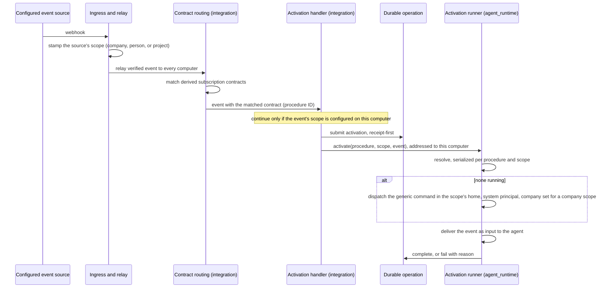

# Procedure Activation — Design

## Purpose

Connect a procedure's declared event subscriptions to the agent that answers
them, without a per-scenario command and without a business workflow engine. A
procedure declares which events concern it; on each computer that hosts the
event's activation scope, a matching event starts that procedure's standing
agent for that scope, or wakes the one already running.

An activation scope is the one thing an event is about: a company, a person, or
a project. It decides which agent answers and where that agent works — the
company's home, the person's folder, or the project's checkout.

This document owns only the relationship among the participating contexts. Each
rule it relies on is stated by its owner:

| Concern                                                                            | Owner           | Contract                                                                                                                                             |
| ---------------------------------------------------------------------------------- | --------------- | ---------------------------------------------------------------------------------------------------------------------------------------------------- |
| The activation declaration, its validation, and the catalogue consequence          | `context`       | `project/spec/domain/context`, `project/spec/feature/context/snippet-frontmatter-validation`, `project/spec/feature/context/agents-master-inflation` |
| A source's declared scope, and whether a company, person, or project is configured | `config`        | `project/spec/domain/config`                                                                                                                         |
| Stamping the source's scope onto its events at the ingress                         | `integration`   | `project/spec/feature/integration/inbound-webhook-endpoint-framework`                                                                                |
| Matching an event to a subscription and producing an activation                    | `integration`   | `project/spec/feature/integration/procedure-subscription-routing`                                                                                    |
| The activation runner, the scope's home, and each session's company                | `agent_runtime` | `project/spec/feature/agent_runtime/procedure-standing-agent`, `project/spec/feature/agent_runtime/company-scoped-session-context`                   |
| Membership facts and the company context tools read inside a session               | `identity`      | `project/spec/domain/identity`, `project/spec/feature/identity/whoami-resolution`                                                                    |

## Inputs/Outputs

**Inputs:**

- A verified, normalized event reaching every computer through the existing
  ingress relay and inbound webhook framework, stamped at the ingress with the
  activation scope its source declares — a company, a person, or a project.
- Each published procedure's declared subscriptions and publication tier, from
  the publication index.
- Whether the event's company, person, or project is configured on the
  receiving computer.

**Outputs:**

- On each computer that hosts the scope: one durable operation per activation,
  completing when an agent is started or woken and failing visibly when neither
  is possible.
- A standing agent session for the procedure and scope, started under the
  system principal in the scope's home — with the session's company set when
  the scope is a company — or an existing one woken with the event.

## Invariants

- **Declaration is registration.** A published subscription becomes a routing
  contract with no further act. There is no enabling step between declaring and
  receiving.
- **An event has one activation scope.** The scope is the event's company when
  it carries one, otherwise its person, otherwise its project. A configured
  source declares at most one of the three, and the ingress replaces every
  scope value a payload supplies with the source's declaration, so an external
  sender never chooses which agent answers or where it works
  (`sdlc/policy/security-awareness`).
- **Identity is the procedure and the scope.** A standing agent is identified by
  the procedure's canonical ID and the scope — its kind and its slug — so a
  company, a person, and a project that share a slug are three different
  scopes. The declared event list is membership only, so overlapping lists
  never merge procedures and editing a list never forks a second agent. The
  principal is not an identity dimension: every event-started agent runs under
  the same system principal.
- **The publication tier bounds the reach.** A procedure published at global
  tier answers every scope; one published in a company's tier answers that
  company's events only; one published in a person's tier answers that person's
  events only.
- **Each computer decides for itself.** The event names no consumer. Every
  computer receives it and first looks up whether its scope is configured
  there: a company by its configuration, a person by their registered folder, a
  project by the project registry. A computer that does not host the scope does
  nothing and records no failure, and an event with no scope activates nothing.
  No mechanism coordinates computers, and running one scope on two computers,
  each pointed at its own instance, is the operator's configuration.
- **The runner starts no second agent; nothing else is guarded.** On a computer
  that hosts the scope, the runner's resolve-or-create is serialized per
  procedure and scope. It wakes a session already running the procedure for the
  scope under the system principal when it finds one or more, and starts one
  only when it finds none; a human-lineage session is never adopted. Starting
  such a session by hand is never refused.
- **One thin command starts every activated agent.** The generic
  procedure-activation command carries the procedure's identity and the scope,
  runs in the scope's home, and loads the procedure with its required reads as
  the agent's complete instruction set. It says nothing about lifecycle or about
  later events; the loaded procedure owns both.
- **One delivery path for events.** The triggering event reaches a new agent as
  its first input, through the session-input delivery that wakes an existing
  agent. No event travels as additional startup context.
- **Company is explicit.** A session has a company only when created with
  `--company`, started from a session that has one, or activated for a company
  scope, and only then carries a company profile. Location never supplies a
  company or a profile: an agent activated for a person or a project works in
  that home and carries no company.
- **No contract without its handler.** Procedure-subscription contracts are
  derived state: held in memory only, never persisted or restored at startup,
  derived when the activation handler registers, and keyed to the digest of the
  publication index they came from. Before matching an event the router
  compares that digest with the currently published index and re-derives on a
  difference, so additions, edits, and removals take effect at the next event
  with no restart and no separate trigger.
- **Attention, not effect.** An activation directs the agent's attention.
  Duplicate, late, and superseded events reach it and are reconciled by its
  procedure against its domain's durable work record. No acknowledgement,
  replay, or de-duplication engine is added around delivery, and missed or due
  attention is recovered by the platform's timer and periodic activation.
- **Failure stays with its owner.** The activation handler's first act submits
  the activation with a durable operation receipt, so every activation has an
  operation before any step that can fail. An activation that cannot be
  fulfilled fails that operation; a submission that itself fails is emitted as a
  platform error event. Neither is reported as success, and the responsibility
  does not move to another agent.

## Primary flows

### Reused mechanisms

| Step                                   | Existing mechanism                                                                      | Relation                                                                                                     |
| -------------------------------------- | --------------------------------------------------------------------------------------- | ------------------------------------------------------------------------------------------------------------ |
| Event reaches every computer           | Single-ingress relay and inbound webhook framework                                      | Reused unchanged                                                                                             |
| Scope travels with the event           | Inbound normalization at the ingress                                                    | Adapted: stamps the source's declared company, person, or project                                            |
| Subscription becomes routable          | Contract-routing model                                                                  | Adapted: contracts are derived from the publication index, held in memory, and rebuilt rather than persisted |
| Match reaches the activation           | Contract `handler` target                                                               | Adapted: the handler receives the matched contract, which carries the procedure's canonical ID               |
| Start or wake crosses into the runtime | Command dispatch addressed to the receiving computer                                    | Reused unchanged                                                                                             |
| Find or create the standing agent      | Inbound resolve-or-create seam used by WhatsApp and Discord                             | Adapted: serialized per procedure and scope                                                                  |
| Start                                  | Canonical command-session dispatch, as the scheduled-job runner's generic command uses  | Reused with a sibling generic command carrying procedure and scope                                           |
| Event delivery on start and wake       | Session-input delivery                                                                  | Reused unchanged                                                                                             |
| Outcome record                         | Durable operation outcomes, receipt-first                                               | Adapted: a new operation kind with its own `agent_runtime.procedure_activation` completed/failed event pair  |
| Company on the session                 | Session record                                                                          | Extended with the session's company                                                                          |
| Company for tools inside the session   | Caller resolution from the session identity document's session id (`telec auth whoami`) | Extended: resolves the company context from the session record that id names; the document is unchanged      |

### Activation

### Company on a human-directed session

A session created with `--company` operates for that company once
`agent_runtime` validates it against `identity`'s membership resolution; an
unknown company is an error and a foreign one is refused. The company is
recorded on the session record and set on every session it starts. Only such a
session, or one activated for a company scope, carries a company profile in its
startup context; standing in a company's project adds none.

The company lives on the session record and nowhere else. A tool inside a
session reads it through the session id: the session identity document names
the session, and `identity` resolves the context from the record that id names
when the tool asks — the session's company when set, otherwise a sole eligible
company as resolved, otherwise an unresolved answer naming the eligible
companies — and publishes it through `telec auth whoami`, which any tool can
run whatever its language. Nothing company-related is written into the session
identity document.

### Catalogue

The catalogue build reads each procedure's activation declaration from the
publication index. A triggered procedure is listed among the self-service
activatable procedures. A subscribed procedure is listed as a configured
responsibility with the events it answers to, so an agent sees that the work is
owned without being offered it.

## Failure modes

- **No standing agent can be started or reached** on a hosting computer — the
  activation's durable operation fails with its reason, readable as an
  operation outcome. Nothing retries on another agent's behalf.
- **Activation submission fails** — no operation can be opened. The failure is
  emitted as a platform error event; nothing is reported as activated.
- **The scope is not configured on a computer** — that computer does nothing
  and records nothing. This is the normal case on every computer that does not
  serve the company, person, or project.
- **An event carries no scope** — no computer activates anything for it.
- **A payload names a company, person, or project** — the ingress replaces it
  with the source's declaration; a source that declares no scope produces
  events with none.
- **A source declares more than one scope** — configuration validation refuses
  it, so no event from it carries an ambiguous scope.
- **Concurrent activations for one procedure and scope** — serialized
  resolve-or-create leaves one agent; each later activation is delivered to it.
- **Two computers host the same scope** — each runs its own agent. The operator
  points each at its own instance; the platform does not intervene.
- **A person-scoped agent works in a person's folder** — it runs under the
  system principal and carries no human identity; what a procedure may do there
  is that procedure's and its domain's contract, never something activation
  grants.
- **A procedure declares both activation modes** — publication fails
  validation, so no contract is derived from it.
- **A subscription is added, edited, or removed while the daemon runs** — the
  next event finds the published index's digest changed and the router
  re-derives before matching; the edit changes event membership, never which
  agent continues the procedure and scope.
- **A daemon restarts with procedure subscriptions published** — derived
  contracts are not restored from storage; they are rebuilt from the
  publication index when the activation handler registers, so none can match
  before its handler exists.
- **An event is missed, for example during a daemon restart** — no activation
  occurs for it. The procedure reconciles against its domain's durable work
  record on the next activation, and periodic activation covers attention no
  event triggers.
- **A requested company does not exist, or the requester is not a member** —
  refused at session creation. No session operates under it.

## See Also

- docs/project/design/architecture/hook-service.md — the contract-routing model this design adds a subscriber to.
- docs/project/adr/0062-commands-carry-target-computer.md — computer-addressed command dispatch.
- docs/project/spec/feature/agent_runtime/durable-operation-outcomes.md — the outcome record each activation uses.
- docs/project/spec/feature/agent_runtime/scheduled-agent-command-dispatch.md — the generic-command dispatch the activation command mirrors.
