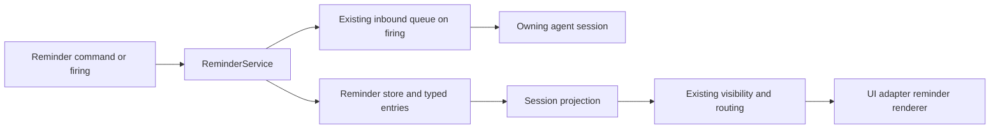

# Reminder Service — Design

## Required reads

@docs/project/spec/domain/agent_runtime.md
@docs/project/design/architecture/layer-ownership.md
@docs/project/spec/feature/agent_runtime/reminder-service.md
@docs/project/spec/session-projection.md

## Purpose

Provide one `agent_runtime` capability for durable future-self intent without
turning reminder execution into a second message-delivery system. The service
owns reminder identity, state, occurrence selection, prescribed-profile
formatting, and typed reminder source entries. It submits a firing occurrence
through the existing session-input acceptance boundary and stops making claims
there.

Infrastructure heartbeat mechanisms, transport priority, runtime wake
detection, processing confirmation, and adapter-owned source truth remain
unchanged.

## Inputs/Outputs

### Ownership and layer placement

| Behavior                                                                                                             | Bounded-context owner                               | Layer                           | Published seam                                                                               |
| -------------------------------------------------------------------------------------------------------------------- | --------------------------------------------------- | ------------------------------- | -------------------------------------------------------------------------------------------- |
| Reminder aggregate, prescribed profiles, scheduling, event activation, occurrence recovery, and session-end clearing | `agent_runtime`                                     | Core service                    | Typed reminder commands, queries, events, and source entries                                 |
| Caller session authentication evidence                                                                               | `identity`                                          | Injection/API boundary          | Existing authenticated caller-session principal                                              |
| Agent CLI hook normalization                                                                                         | `integration` transport for an `agent_runtime` fact | Process edge                    | Existing `AgentEventContext` with `AgentHookEvents.AGENT_STOP` and `AgentStopPayload`        |
| Reminder persistence and wakeable clock mechanics                                                                    | `agent_runtime` implementation over infrastructure  | Store and daemon task           | Reminder store methods; no direct DB access from CLI, API, projector, or adapters            |
| Input acceptance and agent delivery                                                                                  | `agent_runtime`                                     | Existing command/input pipeline | `InboundQueueManager.enqueue`; reminder code adds no downstream acknowledgement              |
| Recipient locale facts                                                                                               | `config`                                            | Configuration resolver          | Validated configured IANA location/time-zone value; no host, browser, or transport inference |
| Reminder visibility and source ordering                                                                              | `agent_runtime`                                     | Session projection              | Typed reminder source entry plus the existing recipient visibility and cursor contracts      |
| Human-facing Markdown dialect and field layout                                                                       | `integration` presentation                          | UI adapter                      | Typed reminder presentation payload with an already-resolved recipient zone                  |

The current v1 configuration schema exposes `TeleclaudeConfig.computer.timezone`
as the configured IANA location/time-zone authority. Reminder presentation reads
that value through the config model. It does not call the host locale, inspect a
browser, infer from transport metadata, or create a reminder-local locale store.

### Commands

The CLI is a client of the daemon API. The injection boundary supplies the
authenticated caller session; neither CLI arguments nor request bodies accept a
target session. The API translates valid input into these `agent_runtime`
commands:

- set a generic relative or absolute reminder;
- set a prescribed reminder through its formatter;
- list live reminders for the caller session;
- cancel one caller-owned slug; or
- cancel every reminder owned by the caller session.

Command-shape validation accepts only the documented reminder surface. Intent
remains opaque prose. The core service, not the handler, enforces reserved-name,
replacement, recurrence, and ownership invariants.

### Aggregate and durable records

`Reminder` is the aggregate root. Its public identity is exactly
`(session_id, slug)`. One durable row holds the current aggregate generation:

- authenticated owning `session_id` and intent-revealing `slug`;
- generic or prescribed profile identity;
- agent-authored `intent`;
- typed trigger: relative/absolute instant or registered agent-event anchor;
- recurrence mode and interval where applicable;
- `armed_at`, `next_fire_at` where concrete, and monotonically increasing
  aggregate generation;
- stable private occurrence key for acceptance deduplication; and
- an optional claimed occurrence marker while submission is in progress.

The occurrence key is infrastructure identity only and never appears as a
public reminder ID. A same-session same-slug set replaces the row in one store
transaction and increments its generation. Distinct slugs are distinct
aggregates and no session-level singleton or numeric cap exists.

An append-only typed reminder-entry record carries each material transition:
armed, replaced, cancelled, and firing. It stores the aggregate identity,
generation, transition, structured trigger/schedule fields, canonical instant,
intent, and next occurrence where applicable. The command response renders the
same record for the invoking agent inside the prescribed opening and closing
reminder envelope. Projection consumes the structured record; it never parses
that envelope.

### Prescribed registries

The executable registry contains only reserved slug identity and minimal
formatter metadata. `PrescribedReminderSlug` is a closed `StrEnum`; arbitrary
valid slugs remain strings outside that enum. A module-level dispatch table maps
each prescribed enum member to a named formatter. The formatter accepts only
that profile's declared varying inputs and returns a normal typed set command.

Event activation uses a second module-level typed dispatch table. Its keys are
closed event-anchor values and its values are named predicates with the common
signature `(Reminder, AgentEventContext) -> bool`. Callers cannot submit code,
lambdas, or predicate names. A false result returns before mutation, event
publication, Redis interaction, source-entry creation, or input submission.

Adaptive cadence is caller-owned replacement, not a scheduler policy engine.
Only a prescribed profile whose local definition allows adaptive cadence may
accept its declared interval override. Its owning coordinator or integrator
computes the next interval and resets the same slug; the service atomically
replaces the schedule without an unarmed gap.

## Invariants

### One semantic owner

- `agent_runtime` is the only owner of reminder rules and state.
- Integration supplies typed hook facts and transports output; it does not
  decide reminder eligibility, recurrence, or acceptance.
- Config resolves the configured zone. Adapters receive it and do not resolve
  locale context themselves.
- The scheduler hosts timing mechanics only; every state transition goes
  through the reminder aggregate and store.

### Serialized aggregate mutation

All set, cancel, scheduled-fire, event-fire, and session-clear operations enter
one reminder-service mutation gate. The gate spans generation validation,
durable occurrence claim, input acceptance, and aggregate advance. Therefore a
replacement that has returned successfully cannot be followed by a firing from
the superseded generation. A firing already accepted before replacement may be
observed before the replacement entry, which is the truthful order.

### Existing acceptance is the terminal boundary

A firing occurrence is submitted as a normal durable inbound row with
`origin=reminder`, a typed reminder `message_type` and payload, the compact
agent envelope as content, and the stable occurrence key as the existing source
deduplication key. A returned row ID means the existing input surface accepted
the occurrence. A duplicate result means that same occurrence was already
accepted. Either result lets the reminder service consume a one-shot or advance
a recurring schedule.

Delivery failure before acceptance leaves the same occurrence pending. Nothing
after acceptance is observed or redefined by this service. Existing inbound
queue ordering, retry, prompt delivery, and transcript binding remain
authoritative.

### Source truth and presentation stay separate

- Reminder entries are typed session-source records. The envelope is agent
  presentation and carries no authority.
- Firing is one transition and the reminder acting now; there is no `due` or
  `activated` transition.
- Projection merges typed reminder entries into session source order, applies
  existing recipient/context visibility and per-consumer cursor rules, and
  hands eligible entries to the normal adapter delivery routine.
- The adapter receives structured fields plus the resolved zone, omits the
  bracketed agent envelope, and renders Markdown key-value fields. Only exact
  slugs, event names, and displayed times use inline code; prose intent remains
  prose.
- Canonical instants remain stored data and agent-facing evidence. Human UI copy
  uses an unambiguous localized form with the configured IANA zone visible.

## Primary flows

### Set or replace

1. CLI parsing validates only the public command shape and sends the request.
2. The injection boundary resolves the authenticated caller session.
3. The handler creates a typed command and invokes `ReminderService`.
4. The service resolves a prescribed formatter or validates an arbitrary
   non-reserved slug, enters the mutation gate, and writes a new aggregate
   generation atomically.
5. The same operation appends the armed or replaced typed source entry.
6. The scheduler wake event is set so an earlier new deadline is observed.
7. The API returns the typed record; CLI renders the agent envelope.

### Scheduled firing and recovery

1. One daemon-owned scheduler task queries the store for the earliest concrete
   occurrence.
2. It waits on either that deadline, a service wake event, or daemon shutdown;
   every mutation wakes it to recalculate.
3. At a deadline it enters the mutation gate, claims the current generation,
   appends the firing entry, and submits the typed inbound occurrence.
4. On acceptance it deletes a one-shot or advances a recurring next instant.
   Recurrence advances from the accepted recovered firing, never by replaying
   every missed interval.
5. On restart the same loop sees future rows normally and selects at most one
   overdue occurrence per aggregate. The stable occurrence key makes a crash
   between queue acceptance and aggregate advance idempotent.

### Event-triggered firing

1. Existing hook processing produces an `AgentEventContext`; no reminder event
   transport is added.
2. After the canonical `agent_stop` fast-path state write, the agent coordinator
   passes the typed context to `ReminderService.handle_agent_event`.
3. The service selects event-anchored reminders for that same owning session and
   invokes the registered predicate.
4. False exits without observable work. True enters the mutation gate, consumes
   the one-shot anchor, appends the firing entry, and uses the same input
   acceptance helper as scheduled firing.

### Cancellation and session end

One-slug and all-session cancellation enter the mutation gate and delete only
the authenticated session's aggregates. Existing rows make cancellation
idempotent; only actual removals append cancelled entries. Session cleanup calls
the same all-session clear operation in cleanup mode after input workers are
expired. Cleanup emits body-free structured operational evidence and does not
append or submit input to the ended session.

### Projection and UI rendering

Projection delivers the typed entry once per eligible consumer in source order.
The adapter's shared reminder renderer creates the semantic field set; each
adapter's existing Markdown conversion and send/edit mechanics produce its
platform dialect. This adds neither a reminder delivery lane nor
reminder-specific QoS.

## Failure modes

- **Public opaque IDs:** exposing occurrence or row identity violates the
  session-plus-slug aggregate contract.
- **Timer-per-reminder tasks:** in-memory sleepers become authority, lose restart
  state, and race replacement. The single scheduler task always recalculates
  from the durable store.
- **Replacement outside the mutation gate:** a claimed old generation can fire
  after replacement returns.
- **Envelope parsing:** rendered brackets become a second authority for
  identity, state, or projection classification.
- **Post-acceptance tracking:** runtime activity or processing is mistaken for a
  reminder responsibility and reinvents message-delivery success semantics.
- **Integration ownership leak:** the hook bridge or Redis consumer decides
  whether `halt-to-respond` fires.
- **Locale inference at the adapter:** host, browser, or transport metadata
  silently overrides configured time-zone authority.
- **Catch-up iteration:** recurrence emits every missed interval after restart
  instead of one overdue occurrence.
- **Lifecycle input injection:** armed, replaced, or cancelled audit records are
  sent as new agent turns. They are typed source records and synchronous command
  results; only firing uses session-input delivery.

## See Also

- docs/project/spec/feature/agent_runtime/reminder-service.md
- docs/project/spec/session-projection.md
- docs/project/spec/message-headers.md
- docs/project/spec/feature/agent_runtime/session-input-delivery.md
- docs/project/spec/feature/integration/agent-cli-hook-reception.md
- docs/project/design/architecture/layer-ownership.md
- docs/project/design/architecture/ui-adapter.md
