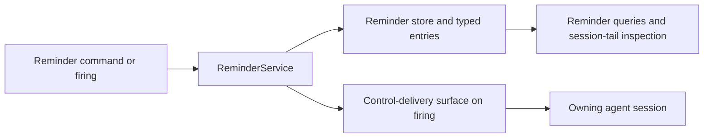

# Reminder Service — Design

## Required reads

@docs/project/spec/domain/agent_runtime.md
@docs/project/design/architecture/layer-ownership.md
@docs/project/spec/feature/agent_runtime/reminder-service.md
@docs/project/spec/session-projection.md

## Purpose

Provide one `agent_runtime` capability for durable future-self intent without
turning reminder execution into a second message-delivery system. The service
owns reminder identity, state, occurrence selection, prescribed-profile
formatting, and typed reminder source entries. It hands a firing occurrence to
the platform's control-delivery surface and stops making claims there.

Infrastructure heartbeat mechanisms, transport priority, runtime wake
detection, processing confirmation, and adapter-owned source truth remain
unchanged.

## Inputs/Outputs

### Ownership and layer placement

| Behavior                                                                                                             | Bounded-context owner                               | Layer                    | Published seam                                                                               |
| -------------------------------------------------------------------------------------------------------------------- | --------------------------------------------------- | ------------------------ | -------------------------------------------------------------------------------------------- |
| Reminder aggregate, prescribed profiles, scheduling, event activation, occurrence recovery, and session-end clearing | `agent_runtime`                                     | Core service             | Typed reminder commands, queries, events, and source entries                                 |
| Caller session authentication evidence                                                                               | `identity`                                          | Injection/API boundary   | Existing authenticated caller-session principal                                              |
| Agent CLI hook normalization                                                                                         | `integration` transport for an `agent_runtime` fact | Process edge             | Existing `AgentEventContext` with `AgentHookEvents.AGENT_STOP` and `AgentStopPayload`        |
| Reminder persistence and wakeable clock mechanics                                                                    | `agent_runtime` implementation over infrastructure  | Store and daemon task    | Reminder store methods; no direct DB access from CLI, API, projector, or adapters            |
| Firing handoff and agent delivery                                                                                    | `agent_runtime`                                     | Control-delivery surface | Durable control-outbox enqueue; claim, injection, wake, and expiry owned downstream          |
| Recipient locale facts                                                                                               | `config`                                            | Configuration resolver   | Validated configured IANA location/time-zone value; no host, browser, or transport inference |
| Reminder record visibility                                                                                           | `agent_runtime`                                     | Service durable records  | Typed reminder records readable through the reminder inspection surfaces                     |

### Commands

The CLI is a client of the daemon API. The injection boundary supplies the
authenticated caller session; neither CLI arguments nor request bodies accept a
target session. The API translates valid input into these `agent_runtime`
commands:

- set a generic relative or absolute reminder;
- set a prescribed reminder through its formatter;
- list live reminders for the caller session;
- cancel one caller-owned slug; or
- cancel every reminder owned by the caller session.

Command-shape validation accepts only the documented reminder surface. Intent
remains opaque prose. The core service, not the handler, enforces reserved-name,
replacement, recurrence, and ownership invariants.

### Aggregate and durable records

`Reminder` is the aggregate root. Its public identity is exactly
`(session_id, slug)`. One durable row holds the current aggregate generation:

- authenticated owning `session_id` and intent-revealing `slug`;
- generic or prescribed profile identity;
- agent-authored `intent`;
- typed trigger: relative/absolute instant or registered agent-event anchor;
- recurrence mode and interval where applicable;
- `armed_at`, `next_fire_at` where concrete, and monotonically increasing
  aggregate generation;
- stable private occurrence key for acceptance deduplication; and
- an optional claimed occurrence marker while submission is in progress.

The occurrence key is infrastructure identity only and never appears as a
public reminder ID. A same-session same-slug set replaces the row in one store
transaction and increments its generation. Distinct slugs are distinct
aggregates and no session-level singleton or numeric cap exists.

<!-- planned:reminder-lifecycle-mechanisms -->
The current aggregate generation also carries a monotonically increasing firing
count. Claiming a previously unclaimed occurrence increments that count in the
same transaction that appends the firing entry, and the entry snapshots the
resulting firing number. Retrying the claimed occurrence reuses that number.
Same-slug replacement starts a new generation with a zero count, so both the
ordinal and elapsed-since-armed presentation restart at the replacement.
<!-- /planned:reminder-lifecycle-mechanisms -->

An append-only typed reminder-entry record carries each material transition:
armed, replaced, cancelled, and firing. It stores the aggregate identity,
generation, transition, structured trigger/schedule fields, canonical instant,
intent, and next occurrence where applicable. Its monotonic `entry_id` defines
source order inside one session's reminder stream. The command response renders
the same record for the invoking agent inside the prescribed opening and closing
reminder envelope. Projection consumes the structured record; it never parses
that envelope or treats the command's tool-result text as UI authority.

### Immutable reminder-entry reads

The append-only reminder stream is archive truth and cannot be rewritten when
the executable prescribed-profile registry changes. Stored profile identity is
therefore an open string on every read. The closed prescribed-slug type validates
new writes and registry lookup only; an unknown or retired stored value follows
the generic reminder presentation path.

The store decodes rows independently into an ordered read item: either a typed
entry or a record-local permanent failure carrying the stable entry identity and
best available occurrence time. One failed row never aborts the window. Archive
readers omit only the item that cannot be rendered and never mutate source or
delivery cursors.

### Prescribed registries

The executable registry contains only reserved slug identity and minimal
formatter metadata. `PrescribedReminderSlug` is a closed `StrEnum`; arbitrary
valid slugs remain strings outside that enum. A module-level dispatch table maps
each prescribed enum member to a named formatter. The formatter accepts only
that profile's declared varying inputs and returns a normal typed set command.

Event activation uses a second module-level typed dispatch table. Its keys are
closed event-anchor values and its values are named predicates with the common
signature `(Reminder, AgentEventContext) -> bool`. Callers cannot submit code,
lambdas, or predicate names. A false result returns before mutation, event
publication, Redis interaction, source-entry creation, or input submission.

Adaptive cadence is caller-owned replacement, not a scheduler policy engine.
Only a prescribed profile whose local definition allows adaptive cadence may
accept its declared interval override. Its owning coordinator or integrator
computes the next interval and resets the same slug; the service atomically
replaces the schedule without an unarmed gap.

A sliding schedule anchors each occurrence to the session's last activity
instead of the arm instant. The scheduler evaluates it lazily at fire time:
when the deadline arrives but session activity occurred within the interval,
the occurrence is re-anchored to that activity plus the interval and does not
fire; no per-activity store write exists. Profiles declare sliding behavior in
their prescribed definition; callers cannot select it for profiles that do not
declare it.

Profiles may declare auto-cancel. The firing envelope of a declaring profile
states that answering with `NOOP` cancels this reminder. The detection
predicate is runtime-uniform: the answering turn contains no tool actions and
no authored content beyond the `NOOP` sentinel. On a match the service cancels
the aggregate and records the cancellation with its auto-cancel reason in its
durable reminder records. Only firings use delivery; reminder-command
responses acknowledge minimally.

<!-- planned:reminder-lifecycle-mechanisms -->
Profiles may independently declare cancellation protection. Public one-slug and
all-session cancellation consult that registry metadata inside the service's
mutation gate. If any selected live reminder is protected, the whole public
cancellation operation fails before mutation; cancellation is never partially
applied. Same-slug set remains replacement, not cancellation, and session-end
cleanup deliberately bypasses profile protection so an ended session retains no
live reminder.
<!-- /planned:reminder-lifecycle-mechanisms -->

The answering turn is resolved from the firing entry's occurrence-specific
registered header. The shared cutter then extracts assistant messages until the
next real user entry; resolution never queries a receipt binding or body equality.
Evaluation rides
the established `agent_stop` dispatch point — after the canonical stop-state
write, the service receives the typed event for the owning session — but the
fast path's existing last-message extraction is text-only and skips tool-use
blocks, so it cannot answer the two-part predicate. The turn-shape judgment is
owned by the session-output contract's existing bare-`NOOP` predicates, which
already accept raw normalized assistant messages and reject any tool-use part;
a small new extraction returns the answering turn's raw content blocks from
the agent transcript for that call. The predicate's existing consumers sit
above this service in the session-output path and are not the caller. No new
hook is installed, no envelope text is parsed, and nothing is evaluated for a
session with no outstanding delivered auto-cancel firing.

A firing is correlated to its answer at reminder identity. The aggregate is
`(session, slug)`, so one slug holds at most one outstanding correlation, and
an accepted later firing of that slug replaces the correlation an earlier
firing left behind. Other slugs in the same session are untouched by that
replacement. A recurring reminder is one idempotent aggregate whose
occurrences supersede one another, never a backlog of independently durable
obligations awaiting individual answers.

## Invariants

### One semantic owner

- `agent_runtime` is the only owner of reminder rules and state.
- Integration supplies typed hook facts and transports output; it does not
  decide reminder eligibility, recurrence, or acceptance.
- Config resolves the configured zone. Adapters receive it and do not resolve
  locale context themselves.
- The scheduler hosts timing mechanics only; every state transition goes
  through the reminder aggregate and store.

### Serialized aggregate mutation

All set, cancel, scheduled-fire, event-fire, and session-clear operations enter
one reminder-service mutation gate. The gate spans generation validation,
durable occurrence claim, input acceptance, and aggregate advance. Therefore a
replacement that has returned successfully cannot be followed by a firing from
the superseded generation. A firing already accepted before replacement may be
observed before the replacement entry, which is the truthful order.

### Control-delivery handoff is the terminal boundary

A firing occurrence is enqueued as one durable control-outbox row carrying the
typed payload, the compact agent envelope as content, and the stable occurrence
key as the deduplication key. Acceptance by the control-outbox store is the
reminder service's terminal boundary: a returned row means the occurrence was
handed off; a duplicate result means that same occurrence was already handed
off. Either result lets the reminder service consume a one-shot or advance a
recurring schedule.

Claim, in-turn injection, idle wake, retry, staleness expiry, and ordering are
owned by the control-delivery surface. Nothing after the handoff is observed or
redefined by this service.

### Source truth and presentation stay separate

- Reminder entries are typed records in the owning session's composite source:
  the native transcript stream plus the append-only reminder stream. The
  envelope is agent presentation and carries no authority.
- Firing is one transition and the reminder acting now; there is no `due` or
  `activated` transition.
- Reminder records are the service's durable state, readable through the
  reminder inspection surfaces and the session listing's next-reminder
  summary.
- Canonical instants remain stored data and agent-facing evidence.

## Primary flows

### Set or replace

1. CLI parsing validates only the public command shape and sends the request.
2. The injection boundary resolves the authenticated caller session.
3. The handler creates a typed command and invokes `ReminderService`.
4. The service resolves a prescribed formatter or validates an arbitrary
   non-reserved slug, enters the mutation gate, and writes a new aggregate
   generation atomically.
5. The same operation appends the armed or replaced typed source entry.
6. The scheduler wake event is set so an earlier new deadline is observed, and
   the existing scheduled projection path is signalled for the new source entry.
7. The API returns the typed record; CLI renders the agent envelope. That tool
   result is agent presentation only and is not a second UI source entry.

### Cursor-bounded reminder projection

The projection consumer reads ordered entry-or-failure items after the oldest
durable consumer cursor. It settles them in source order and preserves the
existing global reminder block across independently cursorred lanes:

1. A readable entry is handed to every eligible lane. Successful handoff
   advances that lane; a failed handoff holds the cursor and blocks later
   reminder items for the pass.
2. A record-local permanent decode failure is recorded with its stable row
   identity. When no earlier reminder item is blocked, every eligible lane
   advances past that entry without a handoff, so later entries remain reachable.
3. A batch/store failure or unexpected reminder-projection exception is contained
   at the reminder projection boundary, recorded, and leaves affected cursors
   unchanged. Native polling and native-source delivery continue.

Archive reads use the same tolerant entry reader but never mutate delivery
cursors. No reminder interpretation failure escapes into the polling
coordinator or becomes user-facing polling feedback.

### Scheduled firing and recovery

1. One daemon-owned scheduler task queries the store for the earliest concrete
   occurrence.
2. It waits on either that deadline, a service wake event, or daemon shutdown;
   every mutation wakes it to recalculate.
3. At a deadline it enters the mutation gate, claims the current generation,
   appends the firing entry, signals projection, and enqueues the typed
   occurrence on the control-delivery surface.
4. On handoff acceptance it deletes a one-shot or advances a recurring next instant.
   Recurrence advances from the accepted recovered firing, never by replaying
   every missed interval.
5. On restart the same loop sees future rows normally and selects at most one
   overdue occurrence per aggregate. The stable occurrence key makes a crash
   between queue acceptance and aggregate advance idempotent.

### Event-triggered firing

1. Existing hook processing produces an `AgentEventContext`; no reminder event
   transport is added.
2. After the canonical `agent_stop` fast-path state write, the agent coordinator
   passes the typed context to `ReminderService.handle_agent_event`.
3. The service selects event-anchored reminders for that same owning session and
   invokes the registered predicate.
4. False exits without observable work. True enters the mutation gate, consumes
   the one-shot anchor, appends the firing entry, and uses the same
   control-delivery handoff as scheduled firing.

### Cancellation and session end

One-slug and all-session cancellation enter the mutation gate and delete only
the authenticated session's aggregates. Existing rows make cancellation
idempotent; only actual removals append cancelled entries. Session cleanup calls
the same all-session clear operation in cleanup mode after input workers are
expired. Cleanup emits body-free structured operational evidence and does not
append or submit input to the ended session.

<!-- planned:reminder-lifecycle-mechanisms -->
Before public deletion, the service resolves the selected live profiles and
rejects the operation atomically if any declares cancellation protection. The
rejection records a typed protected outcome and the protected slugs without
creating lifecycle entries. Cleanup mode remains an unconditional session clear
and therefore removes protected reminders as part of ownership teardown.
<!-- /planned:reminder-lifecycle-mechanisms -->

### Agent delivery and inspection

A material transition is one typed reminder-service record. Only a firing
crosses the control-delivery contract into the owning agent session, carrying
the compact agent envelope; set, replace, and cancel return minimal mutation
acknowledgements. Reminder records remain inspectable through reminder queries
and the agent session-tail projection, and the session listing retains its
next-reminder summary. No reminder record enters session-output routing or a
human UI adapter. Subsequent agent-authored output remains ordinary session
output outside reminder-service presentation.

## Failure modes

- **Public opaque IDs:** exposing occurrence or row identity violates the
  session-plus-slug aggregate contract.
- **Timer-per-reminder tasks:** in-memory sleepers become authority, lose restart
  state, and race replacement. The single scheduler task always recalculates
  from the durable store.
- **Replacement outside the mutation gate:** a claimed old generation can fire
  after replacement returns.
- **Envelope parsing:** rendered brackets become a second authority for
  identity, state, or projection classification.
- **Post-acceptance tracking:** runtime activity or processing is mistaken for a
  reminder responsibility and reinvents message-delivery success semantics.
- **Integration ownership leak:** the hook bridge or Redis consumer decides
  whether a reminder occurrence fires.
- **Catch-up iteration:** recurrence emits every missed interval after restart
  instead of one overdue occurrence.
- **Lifecycle input injection:** armed, replaced, or cancelled audit records are
  sent as new agent turns. They are typed source records and synchronous command
  results; only firing uses session-input delivery.

- **Closed-type history coercion:** a stored profile is rejected because the
  current prescribed registry no longer contains it. Historical profile values
  are open strings on read and resolve through generic presentation.
- **Permanent poison retry:** an immutable record-local decode failure holds the
  cursor and is attempted forever. Permanent failure advances after a diagnostic;
  only downstream delivery failure holds it.
- **Projection escape:** one reminder read or projection failure terminates the
  wider polling iteration or becomes a user-facing polling error. The reminder
  projection boundary contains it while preserving native polling.

## See Also

- docs/project/spec/feature/agent_runtime/reminder-service.md
- docs/project/spec/session-projection.md
- docs/project/spec/message-headers.md
- docs/project/spec/feature/agent_runtime/session-input-delivery.md
- docs/project/spec/feature/integration/agent-cli-hook-reception.md
- docs/project/design/architecture/layer-ownership.md
- docs/project/design/architecture/ui-adapter.md
- ~/.teleclaude/docs/software-development/policy/event-log-discipline.md
