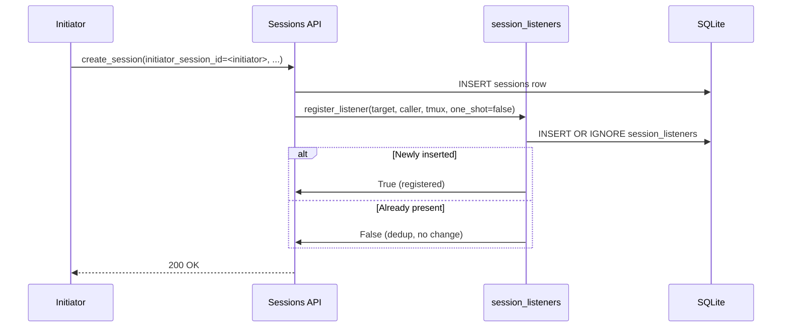
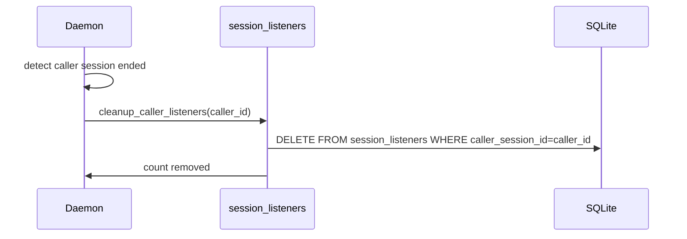
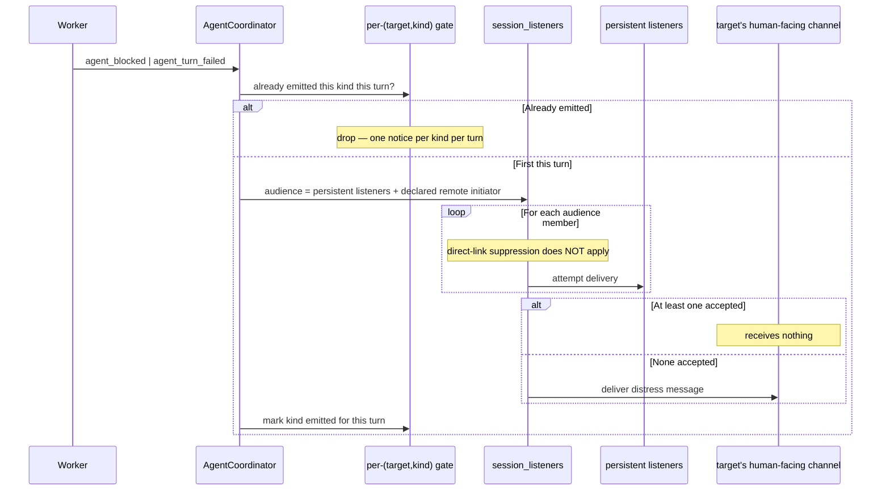

# Session Listeners — Design

## Required reads

- @docs/project/spec/session-subscriptions.md

## Purpose

Persist caller-target subscriptions for passive turn-completion notification, and deliver those notifications into caller tmux sessions — subject to the link-aware suppression rule defined in `session-subscriptions`.

This design owns the listener axis. It does not own the direct-link axis (see `conversation-delivery`) and is not the place to learn the cross-axis contract — see `session-subscriptions` for that.

The fan-out carries more than one notification kind. Turn-end says the target
finished; the distress kinds say it is stuck or broken. They share the listener
registry, the delivery path, and the message shape, and differ in three
decisions the fan-out makes per kind: whether an active direct link suppresses
delivery, which listener rows form the audience, and what happens when that
audience is empty.

## Inputs/Outputs

**Inputs:**

- Listener registration requests from session command handlers:
  - persistent (`one_shot=false`) at orchestrator dispatch time (`create_session` with `initiator_session_id`)
  - one-shot (`one_shot=true`) at non-direct `send_message` time, so the sender hears back when the target's turn completes
- Session stop events from `AgentCoordinator`
- Session distress events from `AgentCoordinator` — `agent_blocked` and
  `agent_turn_failed`, normalized per `hook-normalized-events`
- Forwarded distress from another computer, naming the target, its computer,
  the distress kind, and the initiator session to deliver to
- Unsubscribe requests via `POST /sessions/{id}/unsubscribe`
- Cleanup triggers when caller sessions end

**Outputs:**

- Rows in `session_listeners` (SQLite table)
- Injected notification messages to caller tmux sessions via `deliver_listener_message`
- Boolean confirmations on register / unregister
- A distress message delivered to the target session's own human-facing
  channel when no persistent listener is watching it

## Invariants

- **Durable storage.** Listeners are persisted in SQLite (`session_listeners` table). They survive daemon restart; callers do not need to re-register after a restart.
- **One-shot delivery for `one_shot=true` rows.** These fire once on stop event and are auto-removed.
- **Persistent rows for `one_shot=false`.** Registered at dispatch time. Survive across many turn boundaries. Removed only by explicit unsubscribe or by caller-session cleanup.
- **Deduplication by `(caller, target)`.** At most one row per pair. Repeat registrations are no-ops; the existing `one_shot` value is preserved.
- **Multiple callers allowed per target.** Many callers can listen to the same target.
- **Caller cleanup cascades.** All listeners registered by a caller are removed when the caller session ends.
- **Link-aware suppression is per notification kind.** Turn-end delivery to a caller is skipped while an active direct link exists between that caller and the target; distress delivery is not. The listener row is never mutated by link create / close — only delivery is gated. Canonical rule lives in `session-subscriptions`.
<!-- planned:noop-turn-end-notifies-listeners -->
- **A turn end reaches listeners whatever its content.** The `NOOP` sentinel governs content surfaces only (`session-projection`). The stop fan-out and the forward to a cross-computer initiator run for a `NOOP` turn exactly as for any other turn, so one-shot rows are spent on it like on any other reply.
<!-- /planned:noop-turn-end-notifies-listeners -->
- **No destructive coupling.** Creating, reusing, or closing a direct link must not call `register_listener` / `unregister_listener`. Earlier code paths that did so are bugs; the contract forbids them.
- **Cross-restart correctness.** Because rows are durable, restart preserves both persistent and one-shot listeners. A one-shot listener registered before restart will still fire on the next event after restart.
- **The per-turn notification gate is scoped by `(target, kind)`.** Each
  notification kind is emitted at most once per target turn and is cleared by
  the same next-real-user-entry rule. A distress notification never consumes
  the turn-end notification's gate, and neither distress kind consumes the
  other's.
- **The gate is agent_runtime-owned session state, carried as the set of
  notification kinds already emitted for the current turn.** It replaces the
  single stored turn-end boolean outright: the stored value is migrated forward
  once — a set already emitted, otherwise empty — the old field is retired in
  the same step, and no read path tolerates the old shape.
- **Turn-end and turn-failure share one terminal-outcome slot in that gate.**
  The first terminal signal of a target turn claims the slot and is the only
  terminal notification emitted for it; a second terminal signal for the same
  turn emits nothing and is recorded as a diagnostic naming both outcomes. The
  blocked kind has its own slot and does not compete. Normalization is what
  makes the first signal the right one: every mapped runtime emits at most one
  terminal signal per turn, so the slot never chooses between two accounts. It
  bounds a runtime that violated that guarantee to one notice plus a
  diagnostic, and claims no power to retract a notification already delivered.
- **The distress audience is persistent listeners only.** One-shot rows are
  outside it: a distress event neither reads, delivers to, nor removes a
  one-shot row, so its turn-end semantics above are untouched.
- **A watcher counts only when delivery to it is accepted.** Registration is
  not liveness: a persistent row outlives a crashed caller, and a failed
  delivery leaves the row in place. The distress audience is therefore
  attempted, and a member is reached only when its delivery is accepted.
- **Every distress event has exactly one recipient class.** The audience is the
  target's persistent listeners, plus its declared remote initiator when it has
  one. When at least one member of that audience is reached, the target's
  human-facing channel receives nothing. When no member is reached — none
  registered, every row stale, every delivery refused, or the remote forward
  reported undeliverable — distress goes to that channel instead. One-shot rows
  are not in the audience and so never suppress the fallback, and the channel
  is delivered to at most once per distress event.
- **The fallback is the session's own output lane, not the platform push
  pipeline.** It is the surface that already carries this session's ordinary
  output. It is not the notification projector's action gate, which addresses
  the admin audience, debounces on a trailing window, and fires on an incident
  fingerprint.
- **A turn's account is decided at normalization, not at delivery.** Every
  mapped runtime emits exactly one terminal signal per turn — a failed turn
  produces the failure signal and no turn-end signal — so the signal that
  reaches the fan-out already is that turn's account, and the caller never
  receives a clean-completion notice for a turn that failed. The terminal slot
  enforces nothing beyond one notification per turn; it does not rank the two
  outcomes, because by the time either arrives the account is settled.
- **The recipient decision is made where the listeners live.** For a target on
  another computer, the origin daemon resolves the audience and the fallback,
  then forwards an already-addressed distress notification and reads the
  forward's reported outcome as that member's delivery result. The receiving
  daemon holds no listener rows for a target it did not create and makes no
  audience or fallback decision of its own; it reports whether it reached the
  named initiator, and the origin daemon owns the fallback.

## Primary flows

### 1. Listener Registration



### 2. Stop Event Notification with Suppression Check

```mermaid
sequenceDiagram
    participant Worker
    participant Coord as AgentCoordinator
    participant Registry as session_listeners
    participant Links as conversation_links
    participant Tmux as deliver_listener_message
    participant Caller

    Worker->>Coord: agent_stop
    Coord->>Registry: notify_stop(target=worker_id)
    Registry->>DB: SELECT listeners WHERE target=worker_id
    loop For each listener
        Registry->>Links: active direct link (listener.caller, worker_id)?
        alt Link present
            Note over Registry: suppress — skip delivery for this caller
        else No link
            Registry->>Tmux: deliver to (caller, caller_tmux_session)
            Tmux->>Caller: inject notification
            opt one_shot row
                Registry->>DB: DELETE session_listeners row
            end
        end
    end
```

### 3. Caller Session Cleanup



### 4. Unsubscribe (umbrella verb)

```mermaid
sequenceDiagram
    participant Caller
    participant API as POST /sessions/{id}/unsubscribe
    participant Registry as session_listeners
    participant Links as conversation_links

    Caller->>API: unsubscribe(target_id)
    API->>Registry: unregister_listener(target_id, caller_id)
    Registry-->>API: listener_removed: bool
    API->>Links: close_link_for_member(caller_id, target_id)
    Links-->>API: link_id | null
    API-->>Caller: { status: success, listener_removed, link_closed, link_id }
```

`unsubscribe` is idempotent — empty state returns success.

### 5. Notification Message Templates

| Event Type | Message Format |
| ---------- | -------------- |
| Stop | `Session {id} [on {computer}] "{title}" finished its turn. Use: telec sessions tail {id}` |
| Blocked | `Session {id} [on {computer}] "{title}" is waiting on an approval it cannot resolve itself. Use: telec sessions tail {id}` |
| Turn failed | `Session {id} [on {computer}] "{title}" ended its turn on a runtime or provider failure. Use: telec sessions tail {id}` |

Every kind names the target session and states which of the three it is, so a
caller can decide its next move without first tailing the target. The computer
clause and the command's computer selector appear together and only when the
target runs elsewhere, per the locality rule the stop template already follows.

<!-- planned:noop-turn-end-notifies-listeners -->
A stop whose entire authored output is `NOOP` uses its own stop template: it
states that the turn ended with `NOOP` and carries no inspect command, because
the notification already holds the whole output.
<!-- /planned:noop-turn-end-notifies-listeners -->

### 6. Stale Listener Inspection

The listener module exposes `get_stale_targets(max_age_minutes=10)` as a helper for inspection and diagnostics. No daemon-side automatic stale-listener cleanup loop is wired to it today.

### 7. Distress Notification Fan-out



The loop never reads one-shot rows; it neither delivers to them nor removes
them.

For a target whose initiator runs on another computer, the origin daemon runs
this whole decision and then forwards the resulting notification, addressed to
that initiator, over the same request channel the turn-end forward uses. The
forwarded message carries the distress kind so the receiving daemon renders the
matching template rather than a turn-end one.

## Failure modes

- **Caller session crash with no clean shutdown.** Cleanup hook may not fire. Listener rows remain until a later caller cleanup pass or until the operator manually unsubscribes. Rows are inert: for turn-end they at worst deliver toward a target nobody is reading, and for distress the refused delivery leaves the row uncounted so the human-facing fallback still fires.
- **Target session never stops.** Listener row remains until caller cleanup, unsubscribe, or target end.
- **Notification injection fails (tmux gone).** Logged. On a turn-end notification a `one_shot=true` row is still removed (one-shot semantics preserved), and a persistent row is retained and stays silent until tmux is restored or the caller is cleaned up. On a distress notification the refused delivery means that member was not reached, so it does not hold off the human-facing fallback; no row is removed either way.
- **Duplicate registration.** No-op. Returns False to caller; no error.
- **Concurrent stop events for same target.** Listeners load + deliver under per-row locking; double-fire is prevented by the one-shot DELETE being atomic with the SELECT.
- **Suppression check race.** A link severed mid-notify still suppresses for the current event (suppression evaluated at notify time); the next event delivers normally. Cost is at most one missed notification at the exact moment of sever, acceptable because the caller was actively conversing through the link until that moment.
- **Daemon restart with pending one-shot rows.** Rows are durable; the next event after restart fires them.
- **A provider exposes no native signal for a distress kind.** That kind is
  never produced for targets on that runtime, and no adjacent event is
  substituted for it. Those targets stay exactly as silent in that state as
  before; the caller's vocabulary stays trustworthy for every other runtime.
- **A block is answered shortly after it is reported.** The caller has already
  been told the target was waiting. The per-turn gate bounds this to one notice
  per turn, and the target's turn-end notification still arrives on its own
  slot, so the caller sees the resolution without a separate all-clear.
- **A persistent row outlives its caller.** Delivery to it is refused, so it
  does not count as reached and does not hold off the human-facing fallback.
  The row itself is left for the existing caller-cleanup and unsubscribe paths;
  the distress fan-out never removes rows.
- **The target has no reachable human-facing channel and no reached watcher.**
  The distress notification has nowhere to land; the failure is logged and
  dropped, as an undeliverable listener notification already is. No retry is
  attempted and the fallback is never redirected to another audience.
- **Distress arrives for a target whose caller is mid-turn.** Delivery uses the
  same control-payload handoff as turn-end, so it lands at the caller's next
  work boundary rather than interrupting a running turn.

Direct conversation recovery is owned elsewhere. Restart-safe peer replay is handled by the conversation delivery system, not by this registry.
