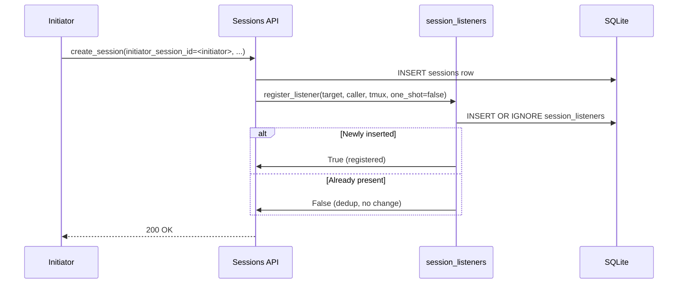
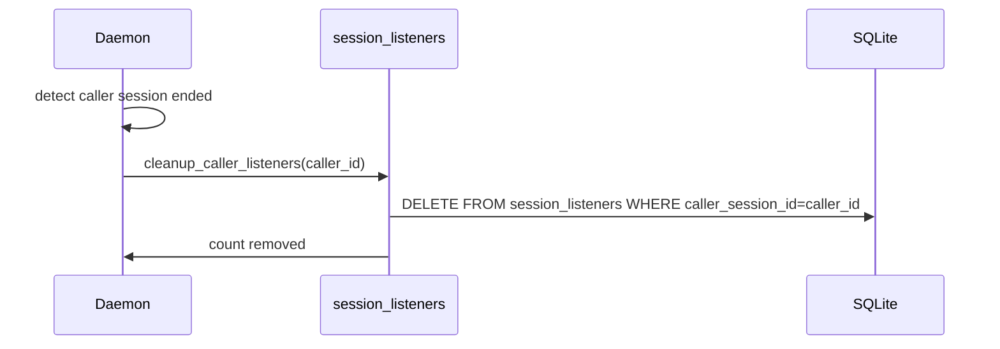

# Session Listeners — Design

## Required reads

- @docs/project/spec/session-subscriptions.md

## Purpose

Persist caller-target subscriptions for passive notification (`agent_stop`, input-request), and deliver those notifications into caller tmux sessions — subject to the link-aware suppression rule defined in `session-subscriptions`.

This design owns the listener axis. It does not own the direct-link axis (see `conversation-delivery`) and is not the place to learn the cross-axis contract — see `session-subscriptions` for that.

## Inputs/Outputs

**Inputs:**

- Listener registration requests from session command handlers:
  - persistent (`one_shot=false`) at orchestrator dispatch time (`create_session` with `initiator_session_id`)
  - one-shot (`one_shot=true`) at non-direct `send_message` time, so the sender hears back when the target's turn completes
- Session stop events from `AgentCoordinator`
- Session input-request events from agent parsers
- Unsubscribe requests via `POST /sessions/{id}/unsubscribe`
- Cleanup triggers when caller sessions end

**Outputs:**

- Rows in `session_listeners` (SQLite table)
- Injected notification messages to caller tmux sessions via `deliver_listener_message`
- Boolean confirmations on register / unregister

## Invariants

- **Durable storage.** Listeners are persisted in SQLite (`session_listeners` table). They survive daemon restart; callers do not need to re-register after a restart.
- **One-shot delivery for `one_shot=true` rows.** These fire once on stop event and are auto-removed.
- **Persistent rows for `one_shot=false`.** Registered at dispatch time. Survive across many turn boundaries. Removed only by explicit unsubscribe or by caller-session cleanup.
- **Deduplication by `(caller, target)`.** At most one row per pair. Repeat registrations are no-ops; the existing `one_shot` value is preserved.
- **Multiple callers allowed per target.** Many callers can listen to the same target.
- **Caller cleanup cascades.** All listeners registered by a caller are removed when the caller session ends.
- **Link-aware suppression.** Notification delivery to a caller is skipped while an active direct link exists between that caller and the target. The listener row is never mutated by link create / close — only delivery is gated. Canonical rule lives in `session-subscriptions`.
- **No destructive coupling.** Creating, reusing, or closing a direct link must not call `register_listener` / `unregister_listener`. Earlier code paths that did so are bugs; the contract forbids them.
- **Cross-restart correctness.** Because rows are durable, restart preserves both persistent and one-shot listeners. A one-shot listener registered before restart will still fire on the next event after restart.

## Primary flows

### 1. Listener Registration



### 2. Stop Event Notification with Suppression Check

```mermaid
sequenceDiagram
    participant Worker
    participant Coord as AgentCoordinator
    participant Registry as session_listeners
    participant Links as conversation_links
    participant Tmux as deliver_listener_message
    participant Caller

    Worker->>Coord: agent_stop
    Coord->>Registry: notify_stop(target=worker_id)
    Registry->>DB: SELECT listeners WHERE target=worker_id
    loop For each listener
        Registry->>Links: active direct link (listener.caller, worker_id)?
        alt Link present
            Note over Registry: suppress — skip delivery for this caller
        else No link
            Registry->>Tmux: deliver to (caller, caller_tmux_session)
            Tmux->>Caller: inject notification
            opt one_shot row
                Registry->>DB: DELETE session_listeners row
            end
        end
    end
```

### 3. Caller Session Cleanup



### 4. Unsubscribe (umbrella verb)

```mermaid
sequenceDiagram
    participant Caller
    participant API as POST /sessions/{id}/unsubscribe
    participant Registry as session_listeners
    participant Links as conversation_links

    Caller->>API: unsubscribe(target_id)
    API->>Registry: unregister_listener(target_id, caller_id)
    Registry-->>API: listener_removed: bool
    API->>Links: close_link_for_member(caller_id, target_id)
    Links-->>API: link_id | null
    API-->>Caller: { status: success, listener_removed, link_closed, link_id }
```

`unsubscribe` is idempotent — empty state returns success.

### 5. Notification Message Templates

| Event Type    | Message Format                                                                                             |
| ------------- | ---------------------------------------------------------------------------------------------------------- |
| Stop          | `Session {id} [on {computer}] "{title}" finished its turn. Use: telec sessions tail {id}`                  |
| Input Request | `Session {id} on {computer} needs input: {message}. Reply with: telec sessions send {id} "<your message>"` |

### 6. Stale Listener Inspection

The listener module exposes `get_stale_targets(max_age_minutes=10)` as a helper for inspection and diagnostics. No daemon-side automatic stale-listener cleanup loop is wired to it today.

## Failure modes

- **Caller session crash with no clean shutdown.** Cleanup hook may not fire. Listener rows remain until a later caller cleanup pass or until the operator manually unsubscribes. Rows are inert — at worst they suppress on a target that no one is reading.
- **Target session never stops.** Listener row remains until caller cleanup, unsubscribe, or target end.
- **Notification injection fails (tmux gone).** Logged. A `one_shot=true` row is still removed (one-shot semantics preserved). A persistent row is retained; it becomes silent until tmux is restored or the caller is cleaned up.
- **Duplicate registration.** No-op. Returns False to caller; no error.
- **Concurrent stop events for same target.** Listeners load + deliver under per-row locking; double-fire is prevented by the one-shot DELETE being atomic with the SELECT.
- **Suppression check race.** A link severed mid-notify still suppresses for the current event (suppression evaluated at notify time); the next event delivers normally. Cost is at most one missed notification at the exact moment of sever, acceptable because the caller was actively conversing through the link until that moment.
- **Daemon restart with pending one-shot rows.** Rows are durable; the next event after restart fires them.

Direct conversation recovery is owned elsewhere. Restart-safe peer replay is handled by the conversation delivery system, not by this registry.
