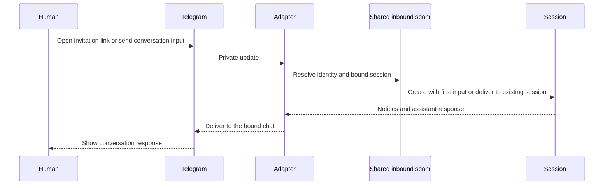

# Telegram Adapter — Design

## Required reads

@docs/project/policy/ux-message-cleanup.md

## Purpose

Telegram is a personal-assistant conversation adapter. It binds a person to a
session through the invitation flow, accepts conversational input, and returns
that session's response to the bound chat.

Telegram exposes no operator console. It registers no command menu and offers
no session creation, agent selection, restart, resume, cancellation, raw-key,
topic-management, peer-discovery, or admin-reflection controls. Discord owns
the platform's admin surface.

## Inputs/Outputs

**Inputs:**

- Invitation-token binding through the established start-link flow.
- Private text messages.
- Voice messages handled through the shared durable transcription path.
- File and media attachments handled through the shared inbound seam.

**Outputs:**

- Origin-scoped notices and transcription feedback.
- Streaming and final session responses delivered to the bound chat.
- Files and artifacts produced for the bound conversation.

Person-addressed Telegram delivery outside the conversation adapter is owned by
the outbound messaging provider and is not part of this design.

## Invariants

- **Conversation Only**: Telegram accepts input for a bound personal-assistant
  session and returns that session's response; it exposes no administrative or
  session-control surface.
- **Shared Inbound Seam**: Text, voice, and attachments enter through the shared
  inbound contract. A newly created session receives its first message in its
  launch intent; an existing session receives the message through normal input
  delivery.
- **Origin Continuity**: Direct notices and assistant output return to the
  Telegram chat that supplied the accepted input.
- **No Admin Reflection**: Telegram never renders the additional admin copy of
  input or output. Discord is the sole admin adapter.
- **Delivery Receipts Only**: Telegram message identifiers and edit anchors are
  delivery receipts, never session or projection truth.
- **Core-Owned State**: Identity, session, transcription, projection, and
  routing state remain owned by their core contexts; Telegram translates and
  delivers at the provider boundary.

## Primary flows

### 1. Conversation binding and input

### 2. Voice and attachment input

Telegram performs provider-specific download and message operations, then
hands voice and attachment input to the shared durable processing paths. Core
owns transcription state, retries, session acceptance, and cleanup decisions;
the adapter updates the origin-scoped notice and delivers the resulting input
or failure.

### 3. Streaming response delivery

The projection and routing layers select the Telegram origin lane and provide a
generation-qualified output snapshot. Telegram creates or edits only the
delivery receipt belonging to that generation. A missing or deleted platform
message causes receipt recovery without changing source ordering.

## Failure modes

- **Unbound Person**: Identity or invitation binding cannot resolve a person;
  the input is rejected through the established onboarding response and no
  session-control fallback is exposed.
- **Provider Failure**: Telegram rejects or times out a send or edit; the
  failure is logged and the delivery owner applies its normal retry posture.
- **Stale Delivery Receipt**: The recorded platform message no longer exists;
  Telegram replaces the receipt without moving projection truth.
- **Voice or Attachment Failure**: Download or shared processing fails; the
  origin notice resolves to an explicit failure and no duplicate input is sent.
- **Operator Command Input**: Telegram has no registered operator commands and
  does not execute session-control actions.

## See Also

- docs/project/design/architecture/ui-adapter.md
- docs/project/spec/session-output-routing.md
- docs/project/spec/feature/integration/conversation-only-adapters.md
