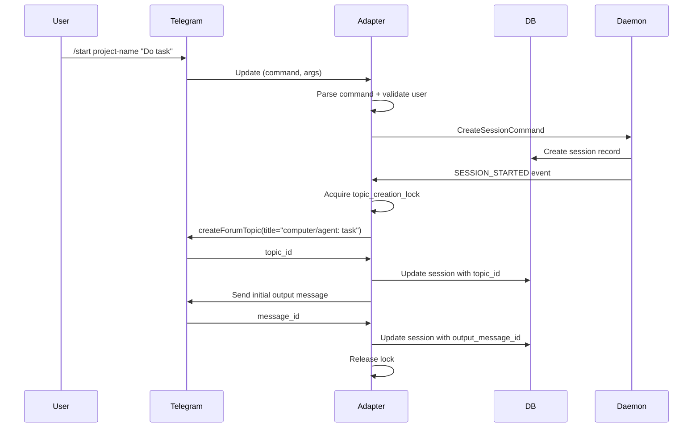
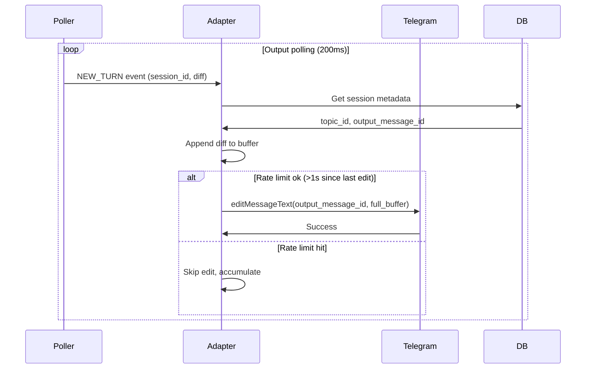
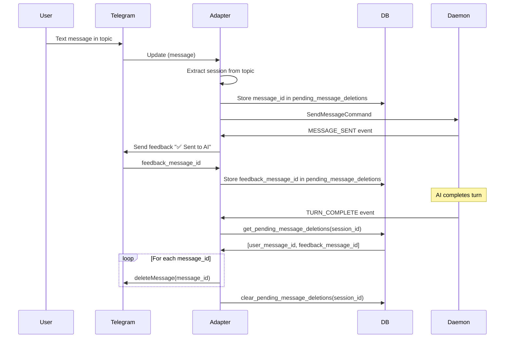
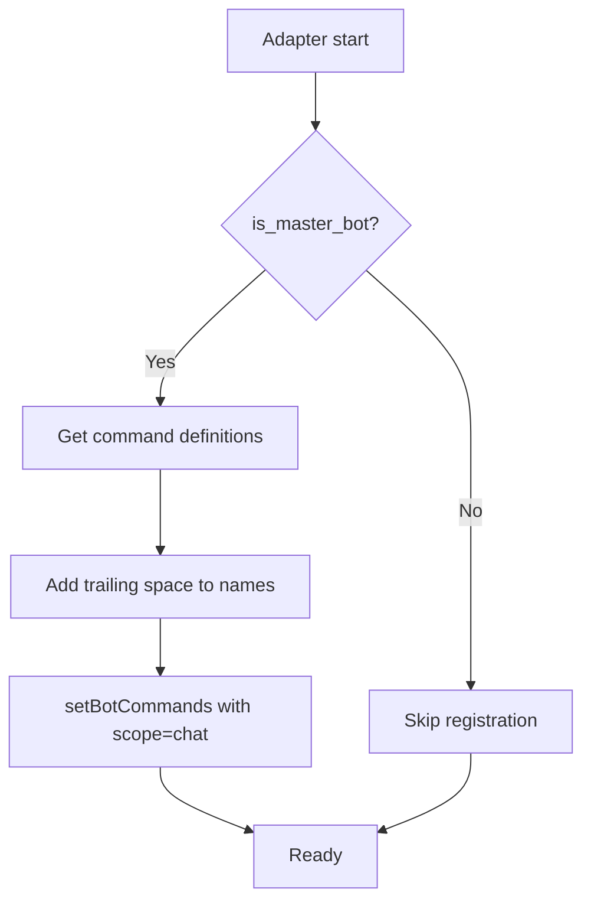
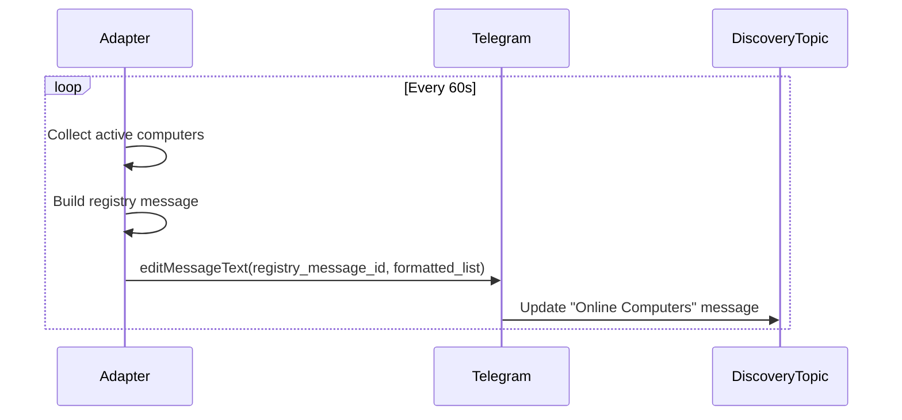

# Telegram Adapter — Design

## Required reads

- @docs/project/policy/ux-message-cleanup.md

## Purpose

- Provide the human-facing Telegram interface for sessions, commands, and streaming output.

- Commands, voice inputs, and file uploads map to explicit command objects and dispatch via CommandService.
- Session topics are created per session and named with the computer prefix.
- Output is streamed by editing a single persistent message per session.
- Heartbeats update a shared registry topic for peer discovery.

- Command registration is performed only by the master bot.
- BotCommand names include trailing spaces when published.
- Feedback and user input messages are deleted via pending_message_deletions rules.
- Unauthorized users are ignored based on whitelist.

- Missing topic threads trigger recovery and metadata repair before retry.
- Telegram API errors are logged and surfaced as adapter failures.
- Outbound methods gracefully skip if channel not ready; polling retries ensure eventual delivery.

## Inputs/Outputs

**Inputs:**

- Telegram bot commands from users (/start, /cancel, /kill, /clear, etc.)
- Text messages in session topics (user input to AI)
- Voice messages (transcribed via the existing speech-to-text backend chain)
- File uploads (documents, images, audio)
- Callback queries (inline button clicks)
- Telegram API webhooks (updates)

**Outputs:**

- Forum topics created per session (one topic = one session)
- Output messages edited in-place with streaming AI responses
- Temporary feedback messages (auto-deleted per UX cleanup rules)
- Topic title updates with session status emoji
- Registry heartbeats published to discovery topic
- Command registrations to Telegram bot scope

## Invariants

- **One Topic Per Session**: Each AI session maps to exactly one Telegram forum topic; topic_id stored in session metadata.
- **Master Bot Registration**: Only master bot publishes BotCommand list; slave bots skip registration.
- **Trailing Space in Commands**: Published BotCommand names include trailing space for Telegram client formatting.
- **Single Output Message**: One persistent output message per session, edited repeatedly; message_id stored in session metadata.
- **UX Cleanup Rules**: User input and feedback messages deleted per pending_message_deletions policy; output messages persist until session closes.
- **Unauthorized User Blocking**: Messages from users not in whitelist ignored silently; no error response sent.

## Primary flows

### 1. Session Topic Creation



### 2. Streaming Output Render



### 3. UX Message Cleanup



### 4. Command Registration (Master Bot Only)



### 5. Voice Message Handling

The Telegram adapter owns only Telegram-specific message operations (extract
session from topic, download the audio, send/edit/delete platform messages).
Transcription durability — the `voice_transcriptions` row lifecycle, the tracked
transcription task, the wall-clock timeout, bounded restart recovery, and
edit-in-place notice semantics — is owned by Core/Daemon and is authoritative in
`database#voice-transcription-durability-and-recovery` and
`daemon-lifecycle#post-adapter-completion-tasks`. The adapter does not transcribe
inline and does not own the row.

```mermaid
sequenceDiagram
    participant User
    participant TG as Telegram
    participant Adapter
    participant Daemon
    participant Core
    participant STT as Voice Service

    User->>TG: Send voice message
    TG->>Adapter: Update (voice)
    Adapter->>Adapter: Extract session from topic
    Adapter->>TG: getFile(file_id)
    TG->>Adapter: file_path
    Adapter->>TG: Download voice file
    Adapter->>Daemon: Spawn HandleVoiceCommand via task_registry and return
    Daemon->>Core: Create/reuse durable voice_transcriptions row
    Core->>Adapter: Send or edit "🎤 Transcribing..." notice
    Adapter->>TG: Send/edit notice; return platform message id
    Core->>Core: Persist notice id and drive row state
    Core->>STT: Transcribe audio with timeout
    STT->>Core: Transcribed text or failure
    Core->>Adapter: Edit original notice to result/failure
    Adapter->>TG: Edit message
    Core->>Daemon: ProcessMessageCommand(transcribed_text)
```

Telegram owns Telegram-specific extraction, authorization, download, and message
operations. It does not transcribe inline and does not own recovery state. Voice
work runs as a daemon-tracked task so shutdown can mark an in-progress row
interrupted while Telegram is still available for an in-place notice edit.
Startup recovery later resubmits surviving audio or edits the original notice to
an explicit audio-lost/retry-cap failure.

### 6. Topic Title Status Updates

| Status  | Emoji | Trigger                              |
| ------- | ----- | ------------------------------------ |
| active  | 🟢    | AI responding, output streaming      |
| waiting | 🟡    | Waiting for user input               |
| slow    | 🟠    | Turn exceeds 30s                     |
| stalled | 🔴    | Turn exceeds 120s                    |
| idle    | ⏸️    | Session paused or no recent activity |
| dead    | ❌    | Session ended or crashed             |

### 7. Registry Heartbeat Publishing



### 8. File Upload Flow

| File Type | Processing                                     | Output                               |
| --------- | ---------------------------------------------- | ------------------------------------ |
| Document  | Download → save to /tmp → send file_path to AI | AI receives file path for processing |
| Image     | Download → send to AI with caption             | AI analyzes image content            |
| Audio     | Download → transcribe → send text to AI        | AI receives transcribed text         |

## Failure modes

- **Topic Creation Race**: Two events try to create topic simultaneously. Lock prevents duplicate creation; second attempt skips.
- **Missing Topic Metadata**: Session has no topic_id. Recovery flow creates new topic and updates metadata.
- **Telegram API Timeout**: Edit or send fails due to network. Logged; next polling cycle retries. Message may be stale.
- **Rate Limit Exceeded**: Too many edits in 1s window. Adapter skips edit, accumulates diff, retries next cycle.
- **Unauthorized User**: Message from non-whitelisted user. Silently ignored; no response or error sent.
- **Voice Transcription Failure**: The speech-to-text backend chain is unavailable or returns an error, the audio format is unsupported, recovery cannot find the audio, or the retry cap is exceeded. User sees the original notice resolve to an explicit failure; voice message cleanup follows the normal cleanup rules.
- **Master Bot Conflict**: Multiple bots claim master role. Last one wins; command list overwritten. Coordinated config required.
- **Output Message Deleted**: User manually deletes output message. Next edit fails; adapter creates new output message.
- **Cleanup Failure**: pending_message_deletions row exists but message already deleted. Logged; row cleared on next cleanup.
- **Topic Thread Closed**: User closes topic. Bot can still post but user doesn't see. Status tracking unaffected.
