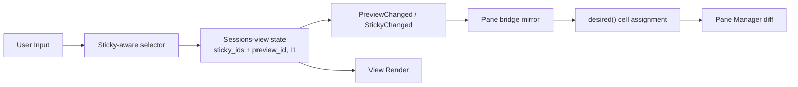
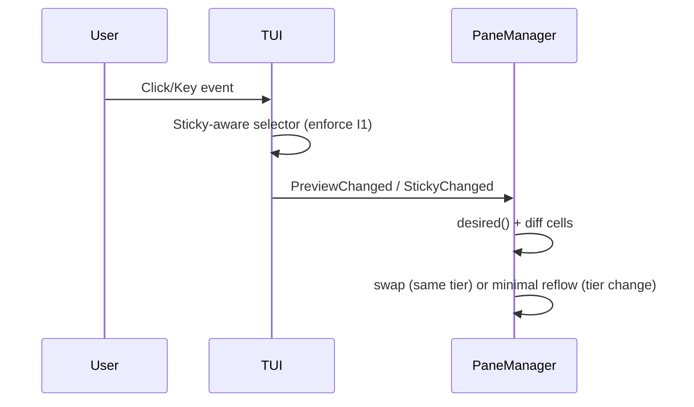
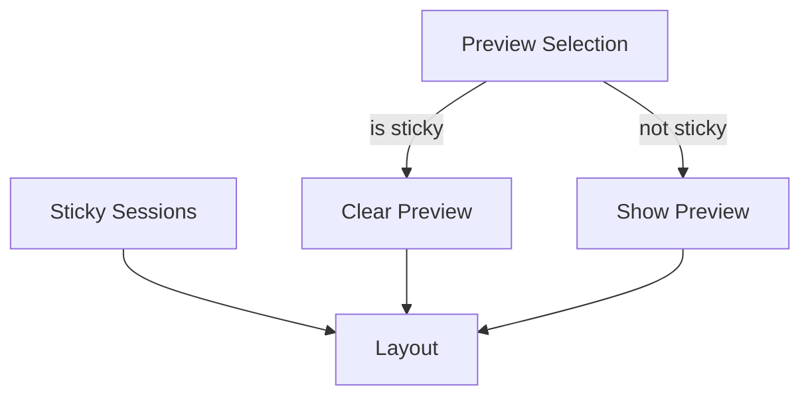

# Tui State Layout — Design

## Purpose

Define the single source of truth for TUI state and deterministic pane layout derived from it, so session panes remain stable across tabs and all view interactions share one state model. The TUI is a local UI client of the API server; it owns its view state and must not mutate core daemon state directly. Applies to all TUI views in `teleclaude/cli/tui/views/` (Sessions, Preparation) and shared UI components (tab bar, modals, widgets) which emit messages but do not own state.



## Inputs/Outputs

**Inputs:**

- Mouse/keyboard events from the TUI runtime
- Session list updates from the API cache
- Focus changes (computer/project)
- Persisted local TUI state from `$TELECLAUDE_HOME/state/tui_state.json`

**Outputs:**

- Deterministic pane layout (active preview + sticky panes)
- View render data (selection, collapse state, badges)

## Invariants

- **Single State Owner**: The Sessions view owns the layout state — an ordered `sticky_ids` list (max `MAX_STICKY = 5`) and a single `preview_id`. The pane bridge holds a mirror that is re-synced from this owner on every data refresh; no second source of truth exists.
- **I1 — No Dual Reference**: `preview_id` is never also in `sticky_ids`. Enforced at every mutation boundary (all preview gestures route through one sticky-aware selector) and on persisted-state load (a corrupt `preview in sticky` snapshot self-heals by dropping the preview). This makes "a duplicate pane in place of the preview window" structurally impossible.
- **Derived Layout**: The non-TUI cell assignment is the pure function `desired(sticky_ids, preview_id)` (see Layout derivation). No hidden child or active-pane fields participate.
- **Minimal Reflow Only On Tier Change**: Tier changes apply the smallest tmux delta that preserves surviving session pane ids: split added cells, kill removed cells, and move existing panes only where geometry requires it. Same-tier transitions swap only the cells whose assigned session changed (`respawn-pane -k` on that single pane); stable panes are never destroyed.
- **Orphans Reaped, Stable Panes Preserved**: At render entry, live non-TUI panes that no tracked session maps to are reaped (a crashed process or a stale reflow can leak one). Tracked panes backing a desired session are never killed as part of this sweep. Column widths are set with explicit split percentages, never `select-layout even-horizontal`, so a stray pane can no longer leak an extra column.
- **Clockwise, Index-Preserving Grids**: `LAYOUT_SPECS` numbers session cells clockwise from the cell nearest the TUI, so growing or shrinking the grid by one keeps every surviving session in its cell (see the pane-count table).
- **Stable Panes Across Tabs**: Switching tabs must not hide or reflow panes.
- **No View-Local Pane Calls**: Views post `PreviewChanged` / `StickyChanged` messages only; layout is applied centrally by the pane bridge.
- **Sticky Is Authoritative**: Sticky panes persist until explicitly removed.
- **Pane Lifecycle Is Tmux-Anchored**: Preview and sticky panes live and die by tmux liveness plus explicit `SessionClosed` events. Snapshot diffs from the daemon (bootstrap refresh, per-computer initial events on WS reconnect) never destroy pane state — a daemon restart must not kill the user's preview/sticky panes while their underlying agent tmux sessions are alive.
- **Un-Sticky Transitions to Preview**: When a sticky session is removed (double-press), that session becomes the active preview. Any previously active preview is dismissed. This preserves the user's focus on the session they just interacted with and minimizes layout disruption.
- **Local-Only State**: TUI state is local UI state; core session state remains owned by the daemon.
- **Pane Style Transition Contract**: Session pane foreground remains constant across focus changes; focus/inactive transitions are represented by background only (terminal default for active, computed haze for inactive).
- **Input Safety**: Bindings fire only on the bare control surface — when no popup is open and no text field is active. Pastes and injected key bursts that reach that bare surface are rejected before they can fire bindings.

### Input Safety

The guard's intent is narrow: a key binding must only fire when there is **no popup open and no text field active**. Otherwise paste and key bursts pass through untouched. `_input_surface_active()` (in `teleclaude/cli/tui/app.py`) encodes this — it is true when a `ModalScreen` is pushed (any popup) or the focused-widget walk finds a text field. Only when it is false does the App discard bracketed-paste events with a one-line `self.notify(...)` warning: "paste ignored on TUI controls — focus an agent pane to paste". So pasted clipboard contents never execute operational-control bindings such as remove, freeze, close, or restart on views like Sessions, Preparation, and Jobs.

Text-entry surfaces are recognized automatically or opt in. Every Textual `Input` is paste-safe by default; any popup is paste-safe by virtue of being a `ModalScreen`; non-`Input` widgets that legitimately accept pasted text or fast generated input opt in with a `paste_safe` class attribute (which may be a property — the Config inline editor returns `True` only while `is_editing`). The Config editor owns a custom edit buffer rather than a Textual `Input`, so it also handles `on_paste` to insert the pasted text into that buffer. There is no external paste-safe registry.

The same operational-control surfaces use a keystroke-burst safety net for input tools that emit raw key events without a preceding `Paste` event. Raw keys are held for the short `RAW_KEY_BURST_WINDOW_MS` window defined in `teleclaude/cli/tui/paste_guard.py`. One or two quiet command keys are released through Textual's normal key-dispatch path after that window. A group larger than `RAW_KEY_BURST_THRESHOLD` is discarded as paste-like input with the same notification, followed by the short `RAW_KEY_BURST_QUIET_MS` suppression window. `_POST_PASTE_KEY_SUPPRESSION_MS` suppresses duplicate raw-key fallout briefly after a handled bracketed paste.

Guarded release never invokes `screen.active_bindings`, never calls `action_*` methods directly, and never replays a buffered burst into bindings. Textual remains the only owner of binding resolution for manual keys that survive the guard.

Bracketed-paste forwarding from tmux into the TUI pane is a documented runtime requirement; the burst net is the backstop if forwarding ever degrades. This invariant carries into `v2-tui-rewrite` as a required contract rather than a behavior to rediscover during the rewrite.

### State model

The Sessions view is the single owner of layout state:

- `sticky_ids`: ordered list of sticky session ids, capped at `MAX_STICKY = 5`.
- `preview_id`: the single previewed session (or doc), or `null`. Held by the
  reactive `preview_session_id`; never equal to a member of `sticky_ids` (I1).
- `collapsed`: set of collapsed session ids (session-level row fold)
- Default fold for new rows: a session row that appears in the tree renders **collapsed by default**. Expanding a row persists that choice in the session fold state, so user-expanded rows stay expanded across tree rebuilds and process restarts; a row the user never expanded stays collapsed when it reappears.
- `collapsed_computers` / `collapsed_projects`: structural fold of whole computers (keyed by computer name) and projects (keyed by computer + path, since the same path can exist on multiple computers). Persisted per view via `get_persisted_state` / `load_persisted_state`, in both the Sessions and Preparation trees. A collapsed computer hides its project headers and all their descendants; a collapsed project hides its sessions/todos while keeping its own header.
- `selection`: currently selected tree item
- `focus`: computer/project focus stack
- `scroll`: scroll offset and window bounds
- `output_working`: set of session ids that must render `out: Working...` until authoritative turn completion (`agent_stop`)

The canonical derivation and invariant live in `teleclaude/cli/tui/layout_model.py` (`desired()`, `enforce_i1()`, `diff_cells()`, `orphan_panes()`); the pane bridge keeps a mirror that is re-synced from this owner on every data refresh.

### Signal-driven reload and external instrumentation

The TUI persists its state and restarts on two signals, both routing through the same save-then-restart path:

- **SIGUSR2** — reload. After changing TUI code, send SIGUSR2 to the first pane of the `tc_tui` tmux session to apply and verify the change in the TUI: `kill -USR2 "$(tmux list-panes -t tc_tui -F '#{pane_pid}' | head -1)"`. The `tc_tui` pane PID is reliable regardless of how the process was launched. Do not restart the daemon and do not instruct the user to restart telec — the SIGUSR2 reload is sufficient.
- **SIGUSR1** — appearance/theme refresh on OS dark/light change, sent by external appearance tooling; it follows the same save-and-restart path, so it is reserved for appearance and never used for code reloads.

The tmux `bind R` key triggers agent restart via the daemon API. The appearance sync that emits SIGUSR1, the agent-CLI theme syncing, and the restart binding are owned by the dotfiles repository at `~/Sync/dotfiles/terminal/`.

## Primary flows

### 1. Input to Layout



### 2. Preview vs Sticky Resolution



### State and layout architecture

Production TUI views own their state as Textual reactive attributes and emit
Textual `Message`s for cross-widget effects; there is no central reducer object.
The Sessions view owns `sticky_ids` + `preview_id` and posts `PreviewChanged` /
`StickyChanged`; the pane bridge consumes those, mirrors the state, and drives
the pane manager through the canonical `layout_model`. The logical interactions
below name the user-facing operations (not reducer intents).

#### Logical interactions

- `SelectItem(session_id, source)`
- `SetPreview(session_id)`
- `ClearPreview()`
- `ToggleSticky(session_id)`
- `Collapse(session_id)` / `Expand(session_id)`
- `ExpandAll()` / `CollapseAll()`
- `FocusComputer(name)` / `FocusProject(path)` / `FocusBack()`
- `SyncSessions(sessions)` (refresh session list + prune state)
- `SyncProjects(projects)` (refresh projects list)
- `SelectTodo(todo_id)` / `SelectTodoGroup(group_id)`
- `ToggleTodo(todo_id)` / `SetTodoStatus(todo_id, status)`
- `FilterTodos(filter_state)` (status, owner, scope, search)
- `SyncTodos(todos)` (refresh todos list + prune state)
- `ExpandTodo(todo_id)` / `CollapseTodo(todo_id)`
- `ToggleProjectDelivered(project_path)` / `ToggleProjectIcebox(project_path)` / `ToggleProjectTrashed(project_path)` — per-project, persisted reveal toggles for the Delivered, Icebox, and Trashed todo-list sections (the Trashed toggle has delivered_by roadmap-trash-reveal-ui).
- `UnfreezeTodo(todo_id)` (existing actual) and `ReactivateTodo(todo_id)` (new, delivered_by roadmap-trash-reveal-ui) — both intents are dispatched through the same `u` keybinding under the context-sensitive restore mapping defined in the Interaction mapping section. `ReactivateTodo` dispatches the soft-delete reactivation primitive against the selected trashed row; fail-closed diagnostics surface via notifications, never via state mutation.
- `StartSession(project_path)` (sessions view: new session on project)
- `ToggleProjectStickySessions(project_path)` (sessions view: open/close previews)
- `RestartSession(session_id)` / `KillSession(session_id)`
- `PrepareProject(project_path)` (prep view: start session modal)
- `PrepareTodo(todo_id)` / `StartWork(todo_id)`
- `ViewFile(file_id)` / `EditFile(file_id)`
- `OpenFilePane(cmd)` / `CloseFilePane()`
- `SelectTab(view_id)`

#### State contract

- The Sessions view is the only owner of `sticky_ids` + `preview_id`; the pane bridge mirror is re-synced from it on every data refresh.
- Views post `PreviewChanged` / `StickyChanged`; they do not call the pane manager directly.
- Every preview gesture routes through one sticky-aware selector that enforces I1.
- Exception handling (confirmation modals, missing tmux sessions, missing files) happens before posting messages.

#### Layout derivation — `desired(sticky_ids, preview_id)`

`desired()` returns the ordered list of sessions occupying the non-TUI cells:

- `preview_id is None` **or** `preview_id in sticky_ids` → `sticky_ids`.
- `len(sticky_ids) < MAX_STICKY` → `sticky_ids + [preview_id]` (preview is an added pane).
- `len(sticky_ids) == MAX_STICKY` and preview not sticky → `sticky_ids[:MAX_STICKY-1] + [preview_id]`; the **last sticky pane is borrowed** to show the preview and reverts to that sticky when the preview clears (same tier → in-place swap).

`tier = 1 + len(desired)` indexes `LAYOUT_SPECS`. The renderer diffs the new
cell assignment against the previous: same tier → `respawn-pane -k` only on the
cells whose session changed; tier change → a minimal reflow that preserves
surviving pane ids, splits added cells, and kills removed cells. The 4↔5 boundary
uses explicit pane moves because the TUI pane changes between top-left and
full-left shapes. Removing a sticky (`un-sticky → preview`) promotes that session
to `preview_id`, dismissing any prior preview.

#### Pane-count matrix

TUI spans the left; session cells run clockwise from the cell nearest the TUI
(`T` = TUI pane, digits = session cell index):

```
tui+1 (tier 2)   tui+2 (tier 3)   tui+3 (tier 4)   tui+4 (tier 5)   tui+5 (tier 6)
┌────┬────┐      ┌────┬────┐      ┌────┬────┐      ┌───┬───┬───┐    ┌───┬───┬───┐
│    │    │      │    │ 1  │      │ T  │ 1  │      │ T │ 1 │ 2 │    │ T │ 1 │ 2 │
│ T  │ 1  │      │ T  ├────┤      ├────┼────┤      │ T ├───┼───┤    ├───┼───┼───┤
│    │    │      │    │ 2  │      │ 3  │ 2  │      │ T │ 4 │ 3 │    │ 5 │ 4 │ 3 │
└────┴────┘      └────┴────┘      └────┴────┘      └───┴───┴───┘    └───┴───┴───┘
```

Adjacent tiers are index-preserving: growing tui+4 → tui+5 only adds session 5
at the bottom-left; sessions 1–4 keep their cells.

### Interaction mapping (Sessions)

All preview gestures funnel through one sticky-aware selector that enforces I1:
selecting a **sticky** session clears the preview (and focuses the existing
sticky pane on focus intent) rather than duplicating it as a preview; selecting
a **non-sticky** session sets/swaps the preview.

- Single click on a session: set/swap preview (with focus), sticky-aware.
- Enter on a session: set/swap preview **and** focus the pane, sticky-aware.
- Space on a session: preview toggle (no focus); pressing the active preview again clears it.
- Double click / double Space on a session: toggle sticky (un-sticky promotes the session to preview).
- Enter on project: open new-session modal.
- `a` on project/computer: batch toggle sticky for that scope.
- `R` on session: restart session.
- `k` on session (after confirm): kill session.
- `←`/`→` on a session: collapse/expand that row; on a project or computer header: collapse/expand that node's whole subtree.
- `=`/`-`: expand/collapse every session row (leaf fold).
- `+`/`_` (shift): expand/collapse every computer and project (structural fold); session rows are untouched.

### Interaction mapping (Preparation)

- Enter on computer: `FocusComputer(name)`
- Enter on project: `PrepareProject(project_path)`
- Enter on todo READY: `StartWork(todo_id)`
- Enter on todo not READY: `ExpandTodo(todo_id)`
- Enter on file: `ViewFile(file_id)`
- `p` on todo: `PrepareTodo(todo_id)`
- `s` on todo READY: `StartWork(todo_id)`
- `v` on file: `ViewFile(file_id)`
- `e` on file: `EditFile(file_id)`
- `←`/`→` on a todo: collapse/expand its file list; on a project or computer header: collapse/expand that node's whole subtree.
- `=`/`-`: `ExpandAll()` / `CollapseAll()` — leaf fold of every todo's file list.
- `+`/`_` (shift): collapse/expand every computer and project (structural fold); todo file lists are untouched.
- `d` on project: `ToggleProjectDelivered(project_path)` — reveals/hides the project's recent delivery history.
- `i` on project: `ToggleProjectIcebox(project_path)` — reveals/hides the project's iceboxed entries.
- `x` on project: `ToggleProjectTrashed(project_path)` — reveals/hides the project's soft-removed entries (Trashed section). Per-project toggle; persisted across TUI sessions. Binding chosen over `t` (the global Cycle-Theme binding at `teleclaude/cli/tui/app.py:233`) and `T` (kept free for future use); `x` matches the "trash" mental model and the input proposal.
- `u` on selected todo row — **context-sensitive restore**, extending the existing `unfreeze` binding into one mental model: "u = restore from a non-active holding state, dispatched against the selected row's status".
  - On an iceboxed row (existing actual behavior): `UnfreezeTodo(todo_id)` — calls `telec todo unfreeze <slug>`.
  - On a trashed row: `ReactivateTodo(todo_id)` dispatches the row-id-addressed reactivation primitive (UC-WFL-12) against the selected soft-removed row's **durable `todo.id`**. The cached `TodoDTO`/`TodoItem` carry the row's `todo_id`, so selection identifies the row unambiguously and the TUI never resolves slug→row-id for the restore path; the slug-ambiguity diagnostic the CLI verb produces cannot arise here. The dispatch boundary checks `todo_id is not None` (fail-fast guard against a stale snapshot), then routes through the row-id API route (`POST /todos/by-id/{todo_id}/reactivate`, paralleling the slug-addressed `POST /todos/{slug}/reactivate` that backs the CLI verb); both routes call `reactivate_removed(todo_id)` and enforce the server-side `clearance_todos_reactivate` boundary. The daemon's `todo_updated` mutation hook refreshes the view and the entry reappears in its restored section. Fail-closed diagnostics from the primitive (`live_twin_exists`, `not_removed`, `invalid_removed_deps`) surface through the existing TUI notification surface; no destructive side effects on refusal.
  - On any other row (active / delivered / pending / ready / in_progress): the binding is a no-op with a one-line notification explaining the action does not apply to that status, so the operator does not get a silent dispatch.
- Expanded todo file list is derived from DB-sourced artifacts for the todo (via `telec todo artifacts list {slug}`), sorted alphabetically.
- Todo rows render roadmap status plus compact phase tags (`B`, `R`, `DOR`, `DEF`, `F`) from todo metadata.

### Section model — Todo list (Preparation view)

The todo-list pane assembles entries into per-project sections that mirror the persisted roadmap `status` enum (workflow domain spec, Roadmap entry term). Each non-active section is opt-in via a per-project toggle persisted alongside `expanded_todos`. The four sections, in display order:

- **Active** (always rendered) — `status=active` entries plus their derived display states (`pending`/`ready`/`in_progress`).
- **Delivered** (toggle `d`) — `status=delivered` entries (recent window); shown under `DeliveredSeparator`.
- **Icebox** (toggle `i`) — `status=icebox` entries; shown under `IceboxSeparator`.
- **Trashed** (toggle `x`) — `status=removed` entries within the retention window; shown under `TrashedSeparator`. Renders each row with its `removed_at` age. Visually distinct from delivered/icebox so the operator never confuses recoverable-but-removed with archived.

The persisted toggle-state sets are: `_delivered_projects`, `_icebox_projects`, `_trashed_projects` (one entry per project path; serialized via `get_persisted_state` / `load_persisted_state`). Section rebuilds are gated by the corresponding toggle: if the toggle is off for a project, the section's rows are not flattened into the rendered row list.

The Trashed section depends on the daemon's todo cache surfacing `status=removed` rows when the TUI requests them. The daemon cache is scoped to high-frequency TUI todo-pane reads (per the cache-system design); the CLI reveal paths bypass it — `telec todo list --include-removed` / `--removed-only` invokes the local DB resolver `assemble_todo_from_db`, and `telec todo show --include-removed` calls the existing daemon REST API route (`GET /todos/{slug}/show?include_removed=true`) whose handler invokes the include-removed-aware show resolver server-side. Neither command consults this cache snapshot. Per the cache-system "Single Snapshot Per Scope" invariant, the cache holds **one** todo snapshot per project that contains the full persisted todo list (including `removed` rows). Default cache accessors apply a filter at read time that excludes `removed`, so every default TUI consumer behaves exactly as before. The Trashed section is the only cache reveal consumer: it reads the same snapshot with the filter relaxed via a per-call opt-in flag (`include_removed=true`). The filter — never the snapshot — changes between default and reveal paths on the TUI side, and the workflow domain spec's default-hide invariant for every non-Trashed consumer is preserved.

A new `TodoStatus.REMOVED` value extends the TUI status enum, with its own glyph and color in the row renderer's status-to-glyph/colour map. The color is chosen to be distinct from active/delivered/icebox/pending/ready/in_progress; the exact palette entry is the row renderer's choice and is asserted via the existing snapshot tests for `todo_row.py`.

### Navigation, modals, and edge cases

#### Navigation intents

- `MoveUp()` / `MoveDown()` (arrow keys)
- `PageUp()` / `PageDown()` (if supported by runtime)
- `ScrollTo(index)` (mouse wheel or programmatic selection)
- `SelectIndex(index, source)` where `source = click | arrow`
- `FocusBack()` on Escape/Left when no collapse action applies

#### Modal intents

- `ConfirmKill(session_id)` → `KillSession(session_id)` on accept
- `StartSessionModal(project_path)` → `StartSession(project_path)` on accept
- `StartPrepareModal(project_path)` → `PrepareProject(project_path)` on accept
- `ModalCancelled()` (no state change)

#### Edge cases and exceptions

- **Selection effects**: selection by click may trigger preview; selection by arrow requires Enter.
- **Missing tmux session**: message still posted; side-effect handler reports error and leaves state unchanged.
- **Missing file**: `ViewFile/EditFile` ignored with user notice; state unchanged.
- **Sticky + Preview conflict**: the sticky-aware selector enforces I1 — a selection that would set the preview to a sticky clears the preview instead.
- **Un-sticky transition**: removing a sticky sets that session as the active preview, dismissing any previous preview. See `@docs/project/design/ux/session-preview-sticky.md`.
- **Tab switching**: `SelectTab(view_id)` must not alter preview or sticky.

## Failure modes

- **Hidden Panes on Tab Switch**: Indicates layout is still tied to view switching, not state.
- **Duplicate Pane Where the Preview Should Be**: Indicates a preview gesture bypassed the sticky-aware selector and set `preview_id` to a sticky (I1 violated).
- **Orphan Columns / Dead-Dot Half-Panes**: Indicates a relayout ran `select-layout even-horizontal` or skipped orphan reaping, so a stray live pane became an extra column. Column widths must come from explicit split percentages and orphans must be reaped at render entry.
- **Pane Churn on Same-Tier Change**: Indicates the renderer rebuilt the grid instead of swapping only the changed cells — relayout must happen only on tier change.
- **Sticky Drift**: Indicates the bridge mirror was not re-synced from the Sessions-view owner, or state is split across views.
