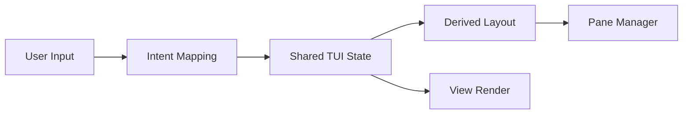
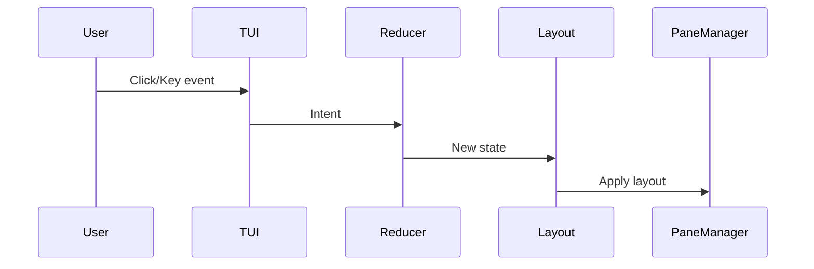
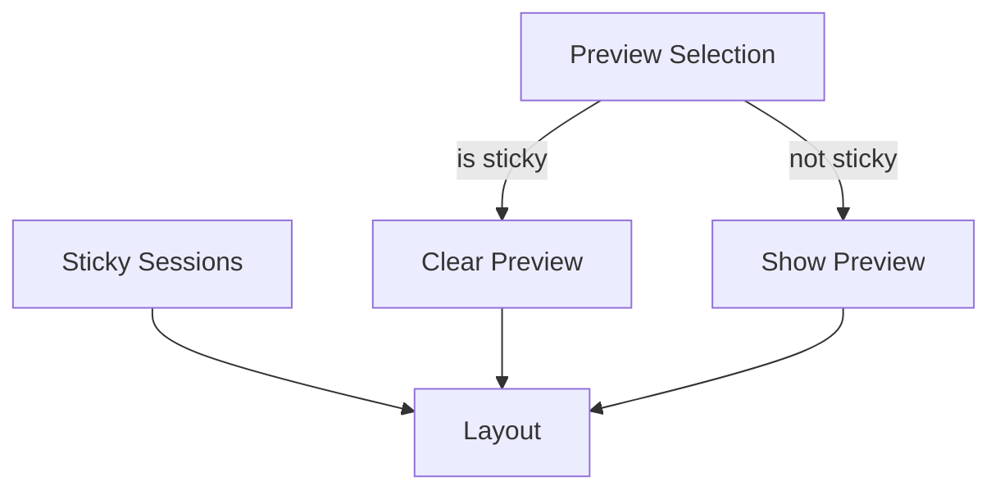

# Tui State Layout — Design

## Purpose

Define the single source of truth for TUI state and deterministic pane layout derived from it, so session panes remain stable across tabs and all view interactions share one state model. The TUI is a local UI client of the API server; it owns its view state and must not mutate core daemon state directly. Applies to all TUI views in `teleclaude/cli/tui/views/` (Sessions, Preparation) and shared UI components (tab bar, modals, widgets) which emit intents but do not own state.

## Inputs/Outputs

**Inputs:**

- Mouse/keyboard events from the TUI runtime
- Session list updates from the API cache
- Focus changes (computer/project)
- Persisted sticky state from `~/.teleclaude/tui_todo state (todos.db)`

**Outputs:**

- Deterministic pane layout (active preview + sticky panes)
- View render data (selection, collapse state, badges)

## Invariants

- **Single State Object**: All TUI interactions mutate a single shared state object.
- **Derived Layout**: Pane layout is computed from state only; no hidden child or active pane fields.
- **Stable Panes Across Tabs**: Switching tabs must not hide or reflow panes.
- **No View-Local Pane Calls**: Views emit intents only; layout is applied centrally.
- **Sticky Is Authoritative**: Sticky panes persist until explicitly removed.
- **Pane Lifecycle Is Tmux-Anchored**: Preview and sticky panes live and die by tmux liveness plus explicit `SessionClosed` events. Snapshot diffs from the daemon (bootstrap refresh, per-computer initial events on WS reconnect) never destroy pane state — a daemon restart must not kill the user's preview/sticky panes while their underlying agent tmux sessions are alive.
- **Un-Sticky Transitions to Preview**: When a sticky session is removed (double-press), that session becomes the active preview. Any previously active preview is dismissed. This preserves the user's focus on the session they just interacted with and minimizes layout disruption.
- **Local-Only State**: TUI state is local UI state; core session state remains owned by the daemon.
- **Pane Style Transition Contract**: Session pane foreground remains constant across focus changes; focus/inactive transitions are represented by background only (terminal default for active, computed haze for inactive).
- **Input Safety**: Bindings fire only on the bare control surface — when no popup is open and no text field is active. Pastes and injected key bursts that reach that bare surface are rejected before they can fire bindings.

### Input Safety

The guard's intent is narrow: a key binding must only fire when there is **no popup open and no text field active**. Otherwise paste and key bursts pass through untouched. `_input_surface_active()` (in `teleclaude/cli/tui/app.py`) encodes this — it is true when a `ModalScreen` is pushed (any popup) or the focused-widget walk finds a text field. Only when it is false does the App discard bracketed-paste events with a one-line `self.notify(...)` warning: "paste ignored on TUI controls — focus an agent pane to paste". So pasted clipboard contents never execute operational-control bindings such as remove, freeze, close, or restart on views like Sessions, Preparation, and Jobs.

Text-entry surfaces are recognized automatically or opt in. Every Textual `Input` is paste-safe by default; any popup is paste-safe by virtue of being a `ModalScreen`; non-`Input` widgets that legitimately accept pasted text or fast generated input opt in with a `paste_safe` class attribute (which may be a property — the Config inline editor returns `True` only while `is_editing`). The Config editor owns a custom edit buffer rather than a Textual `Input`, so it also handles `on_paste` to insert the pasted text into that buffer. There is no external paste-safe registry.

The same operational-control surfaces use a keystroke-burst safety net for input tools that emit raw key events without a preceding `Paste` event. Same-turn key groups above `_BURST_THRESHOLD` (`30` keys in `teleclaude/cli/tui/app.py`) are discarded as a group with the same notification before bindings fire; smaller groups replay on the next event-loop turn so manual typing remains responsive. `_POST_PASTE_KEY_SUPPRESSION_MS` suppresses duplicate raw-key fallout briefly after a handled bracketed paste.

Bracketed-paste forwarding from tmux into the TUI pane is a documented runtime requirement; the burst net is the backstop if forwarding ever degrades. This invariant carries into `v2-tui-rewrite` as a required contract rather than a behavior to rediscover during the rewrite.

### State model

- `selection`: currently selected item
- `preview`: `{ session_id, show_child } | null`
- `sticky`: list of `{ session_id, show_child }`
- `collapsed`: set of collapsed session ids
- `focus`: computer/project focus stack
- `scroll`: scroll offset and window bounds
- `output_working`: set of session ids that must render `out: Working...` until authoritative turn completion (`agent_stop`)

## Primary flows

### 1. Input to Layout

### 2. Preview vs Sticky Resolution

### Reducer architecture

#### Intent set

- `SelectItem(session_id, source)`
- `SetPreview(session_id, show_child)`
- `ClearPreview()`
- `ToggleSticky(session_id, show_child)`
- `Collapse(session_id)` / `Expand(session_id)`
- `ExpandAll()` / `CollapseAll()`
- `FocusComputer(name)` / `FocusProject(path)` / `FocusBack()`
- `SyncSessions(sessions)` (refresh session list + prune state)
- `SyncProjects(projects)` (refresh projects list)
- `SelectTodo(todo_id)` / `SelectTodoGroup(group_id)`
- `ToggleTodo(todo_id)` / `SetTodoStatus(todo_id, status)`
- `FilterTodos(filter_state)` (status, owner, scope, search)
- `SyncTodos(todos)` (refresh todos list + prune state)
- `ExpandTodo(todo_id)` / `CollapseTodo(todo_id)`
- `ToggleProjectDelivered(project_path)` / `ToggleProjectIcebox(project_path)` / `ToggleProjectTrashed(project_path)` — per-project, persisted reveal toggles for the Delivered, Icebox, and Trashed todo-list sections (the Trashed toggle is `target — delivered_by roadmap-trash-reveal-ui`).
- `UnfreezeTodo(todo_id)` (existing actual) and `ReactivateTodo(todo_id)` (new, target — delivered_by roadmap-trash-reveal-ui) — both intents are dispatched through the same `u` keybinding under the context-sensitive restore mapping defined in the Interaction mapping section. `ReactivateTodo` dispatches the soft-delete reactivation primitive against the selected trashed row; fail-closed diagnostics surface via notifications, never via state mutation.
- `StartSession(project_path)` (sessions view: new session on project)
- `ToggleProjectStickySessions(project_path)` (sessions view: open/close previews)
- `RestartSession(session_id)` / `KillSession(session_id)`
- `PrepareProject(project_path)` (prep view: start session modal)
- `PrepareTodo(todo_id)` / `StartWork(todo_id)`
- `ViewFile(file_id)` / `EditFile(file_id)`
- `OpenFilePane(cmd)` / `CloseFilePane()`
- `SelectTab(view_id)`

#### Reducer contract

- The reducer is the only place that mutates `TuiState`.
- Views emit intents; they do not mutate state or call pane layout directly.
- Every reducer update is followed by layout derivation + apply.
- Exception handling (confirmation modals, missing tmux sessions, or missing files) is handled before emitting intents; reducer remains pure.

#### Layout derivation

- `active_session_id = preview.session_id` if preview set, else `null`
- `child_session_id = child_of(preview.session_id)` **only if** `preview.show_child`
- `sticky_session_ids = [s.session_id for s in sticky]`
- If `preview.session_id` is sticky, reducer clears preview (no duplication)
- If a sticky is removed, the removed session becomes the active preview (un-sticky → preview transition)

### Interaction mapping (Sessions)

- Single click on session line: `SetPreview(session_id, show_child=True)`
- Double click on session title line: `ToggleSticky(session_id, show_child=True)`
- Double click on session ID line: `ToggleSticky(session_id, show_child=False)`
- Enter on session: `SetPreview(session_id, show_child=True)`
- Enter on project: `StartSession(project_path)`
- `a` on project: `ToggleProjectStickySessions(project_path)`
- `R` on session: `RestartSession(session_id)`
- `k` on session (after confirm): `KillSession(session_id)`

### Interaction mapping (Preparation)

- Enter on computer: `FocusComputer(name)`
- Enter on project: `PrepareProject(project_path)`
- Enter on todo READY: `StartWork(todo_id)`
- Enter on todo not READY: `ExpandTodo(todo_id)`
- Enter on file: `ViewFile(file_id)`
- `p` on todo: `PrepareTodo(todo_id)`
- `s` on todo READY: `StartWork(todo_id)`
- `v` on file: `ViewFile(file_id)`
- `e` on file: `EditFile(file_id)`
- `+`/`-`: `ExpandAll()` / `CollapseAll()`
- `d` on project: `ToggleProjectDelivered(project_path)` — reveals/hides the project's recent delivery history.
- `i` on project: `ToggleProjectIcebox(project_path)` — reveals/hides the project's iceboxed entries.
- `x` on project: `ToggleProjectTrashed(project_path)` — reveals/hides the project's soft-removed entries (Trashed section). Per-project toggle; persisted across TUI sessions. Binding chosen over `t` (the global Cycle-Theme binding at `teleclaude/cli/tui/app.py:233`) and `T` (kept free for future use); `x` matches the "trash" mental model and the input proposal (status: target — delivered_by roadmap-trash-reveal-ui).
- `u` on selected todo row — **context-sensitive restore**, extending the existing `unfreeze` binding into one mental model: "u = restore from a non-active holding state, dispatched against the selected row's status".
  - On an iceboxed row (existing actual behavior): `UnfreezeTodo(todo_id)` — calls `telec todo unfreeze <slug>`.
  - On a trashed row (new target behavior — depends on the `TodoDTO`/`TodoItem` row-id extension): `ReactivateTodo(todo_id)` — dispatches the row-id-addressed reactivation primitive (UC-WFL-12) against the selected soft-removed row's **durable `roadmap.id`**. Today's `TodoDTO`/`TodoItem` carry no roadmap row id; this restore path is enabled by the prerequisite DTO extension that populates an optional `roadmap_id` field on every cached row. With that extension landed, the TUI never resolves slug→row-id for the restore path: selection identifies the row unambiguously, so the slug-ambiguity diagnostic that the CLI verb must produce simply cannot arise here. The dispatch boundary defensively checks `roadmap_id is not None` (fail-fast guard against a stale snapshot from a pre-extension daemon), then routes through a dedicated row-id API route (`POST /todos/by-id/{roadmap_id}/reactivate`, paralleling the slug-addressed `POST /todos/{slug}/reactivate` that backs the CLI verb); both routes call the same `reactivate_removed(roadmap_id)` primitive and both enforce the server-side `clearance_todos_reactivate` boundary. The daemon's `todo_updated` mutation hook refreshes the view and the entry reappears in its restored section. Fail-closed diagnostics from the primitive (`live_twin_exists`, `not_removed`, `invalid_removed_deps`) surface through the existing TUI notification surface; no destructive side effects on refusal.
  - On any other row (active / delivered / pending / ready / in_progress): the binding is a no-op with a one-line notification explaining the action does not apply to that status, so the operator does not get a silent dispatch.
  - (Trashed-row reactivate path: status: target — delivered_by roadmap-trash-reveal-ui. Iceboxed-row unfreeze path: status: actual.)
- Expanded todo file list is derived from DB-sourced artifacts for the todo (via `telec todo artifacts list {slug}`), sorted alphabetically.
- Todo rows render roadmap status plus compact phase tags (`B`, `R`, `DOR`, `DEF`, `F`) from todo metadata.

### Section model — Todo list (Preparation view)

The todo-list pane assembles entries into per-project sections that mirror the persisted roadmap `status` enum (workflow domain spec, Roadmap entry term). Each non-active section is opt-in via a per-project toggle persisted alongside `expanded_todos`. The four sections, in display order:

- **Active** (always rendered) — `status=active` entries plus their derived display states (`pending`/`ready`/`in_progress`).
- **Delivered** (toggle `d`) — `status=delivered` entries (recent window); shown under `DeliveredSeparator`.
- **Icebox** (toggle `i`) — `status=icebox` entries; shown under `IceboxSeparator`.
- **Trashed** (toggle `x`) — `status=removed` entries within the retention window; shown under `TrashedSeparator`. Renders each row with its `removed_at` age. Visually distinct from delivered/icebox so the operator never confuses recoverable-but-removed with archived (status: target — delivered_by roadmap-trash-reveal-ui).

The persisted toggle-state sets are: `_delivered_projects`, `_icebox_projects`, `_trashed_projects` (one entry per project path; serialized via `get_persisted_state` / `load_persisted_state`). Section rebuilds are gated by the corresponding toggle: if the toggle is off for a project, the section's rows are not flattened into the rendered row list.

The Trashed section depends on the daemon's roadmap cache surfacing `status=removed` rows when the TUI requests them. The daemon cache is scoped to high-frequency TUI roadmap-pane reads (per the cache-system design); the CLI reveal paths bypass it — `telec todo list --include-removed` / `--removed-only` invokes the local DB resolver `assemble_roadmap_from_db`, and `telec todo show --include-removed` calls the existing daemon REST API route (`GET /todos/{slug}/show?include_removed=true`) whose handler invokes the include-removed-aware show resolver server-side. Neither command consults this cache snapshot. Per the cache-system "Single Snapshot Per Scope" invariant, the cache holds **one** roadmap snapshot per project that contains the full persisted roadmap (including `removed` rows). Default cache accessors apply a filter at read time that excludes `removed`, so every default TUI consumer behaves exactly as before. The Trashed section is the only cache reveal consumer: it reads the same snapshot with the filter relaxed via a per-call opt-in flag (`include_removed=true`). The filter — never the snapshot — changes between default and reveal paths on the TUI side, and the workflow domain spec's default-hide invariant for every non-Trashed consumer is preserved.

A new `TodoStatus.REMOVED` value extends the TUI status enum, with its own glyph and color in the row renderer's status-to-glyph/colour map. The color is chosen to be distinct from active/delivered/icebox/pending/ready/in_progress; the exact palette entry is the row renderer's choice and is asserted via the existing snapshot tests for `todo_row.py` (status: target — delivered_by roadmap-trash-reveal-ui).

### Navigation, modals, and edge cases

#### Navigation intents

- `MoveUp()` / `MoveDown()` (arrow keys)
- `PageUp()` / `PageDown()` (if supported by runtime)
- `ScrollTo(index)` (mouse wheel or programmatic selection)
- `SelectIndex(index, source)` where `source = click | arrow`
- `FocusBack()` on Escape/Left when no collapse action applies

#### Modal intents

- `ConfirmKill(session_id)` → `KillSession(session_id)` on accept
- `StartSessionModal(project_path)` → `StartSession(project_path)` on accept
- `StartPrepareModal(project_path)` → `PrepareProject(project_path)` on accept
- `ModalCancelled()` (no state change)

#### Edge cases and exceptions

- **Selection effects**: selection by click may trigger preview; selection by arrow requires Enter.
- **Missing tmux session**: intent still emitted; side-effect handler reports error and leaves state unchanged.
- **Missing file**: `ViewFile/EditFile` ignored with user notice; state unchanged.
- **Sticky + Preview conflict**: reducer clears preview when sticky is set for same session.
- **Un-sticky transition**: removing a sticky sets that session as the active preview, dismissing any previous preview. See `@docs/project/design/ux/session-preview-sticky.md`.
- **Tab switching**: `SelectTab(view_id)` must not alter preview or sticky.

## Failure modes

- **Hidden Panes on Tab Switch**: Indicates layout is still tied to view switching, not state.
- **Child Pane Persists**: Indicates derived layout is bypassed by stale child fields.
- **Sticky Drift**: Indicates state is split across views or layout is not centrally applied.
