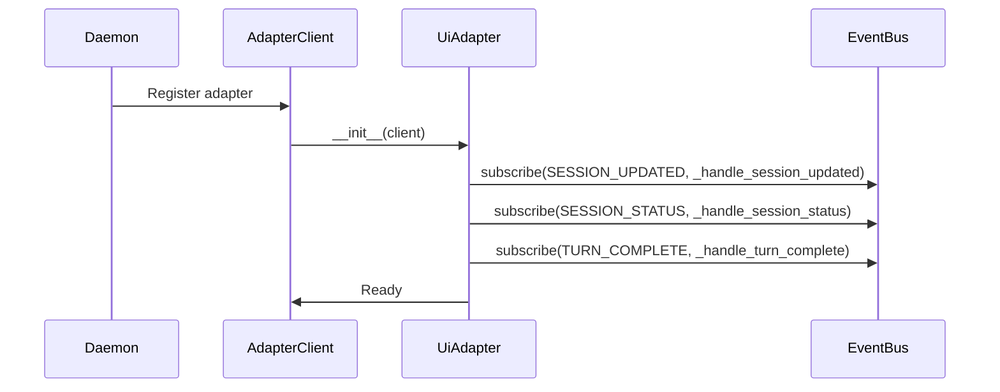
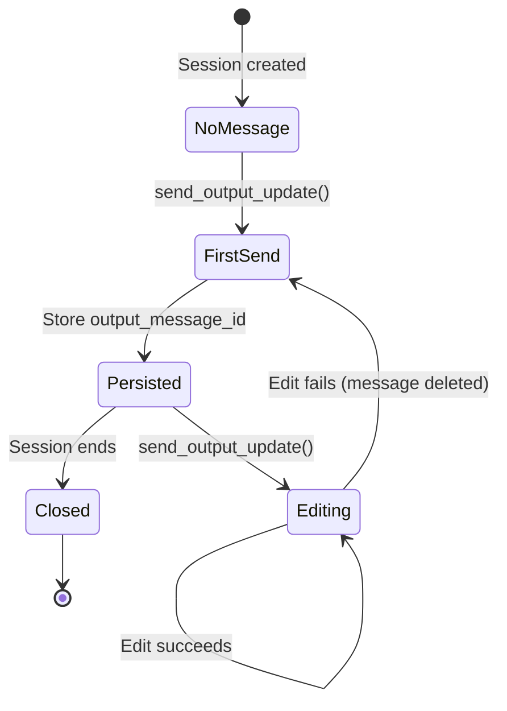
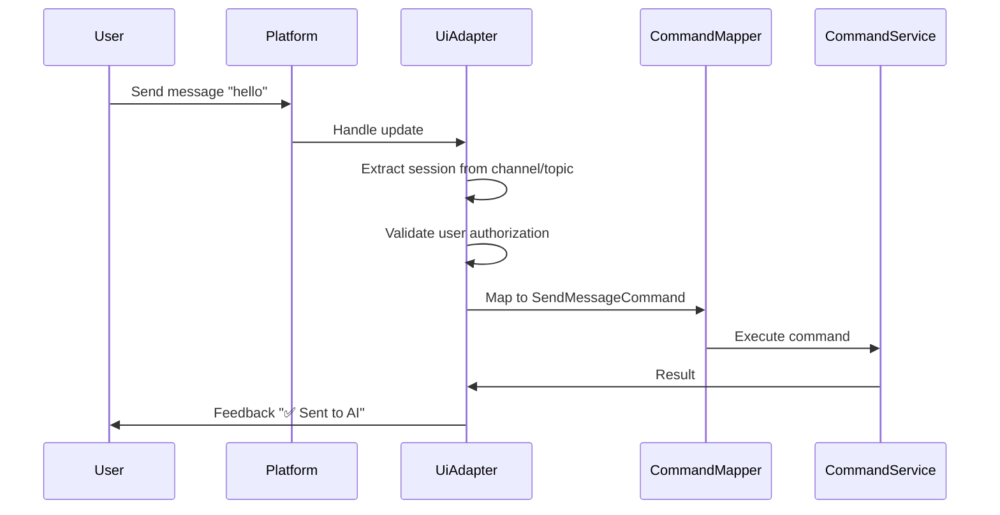
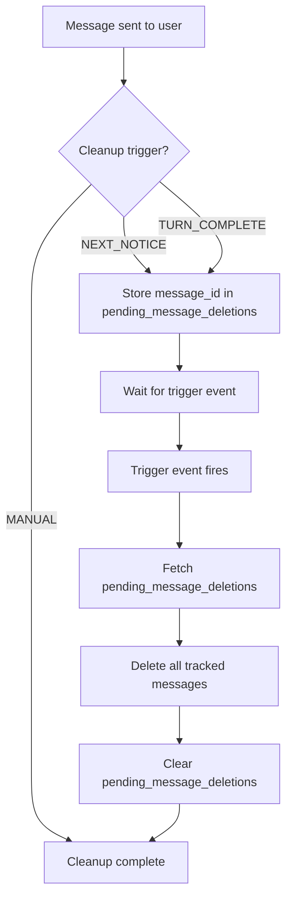
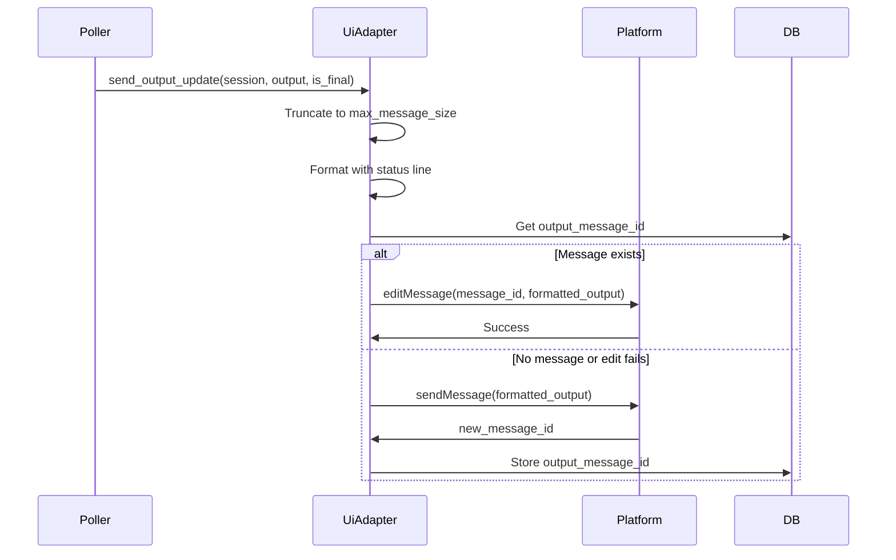
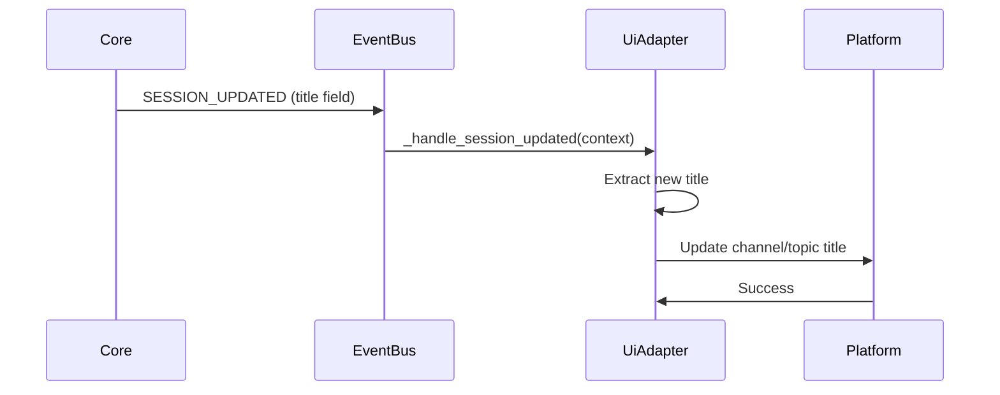
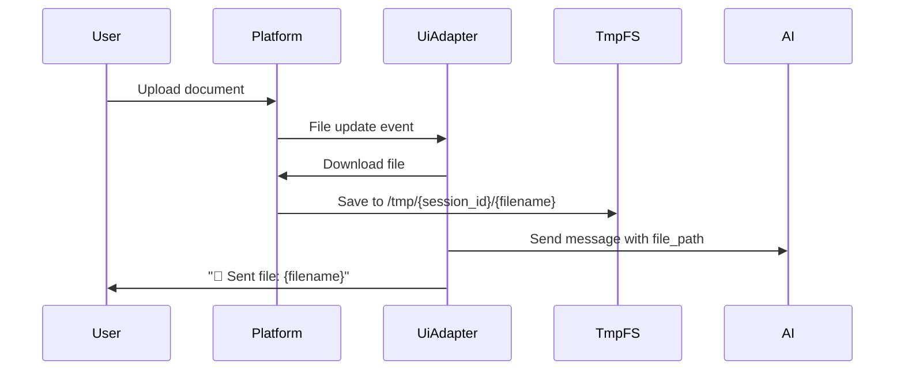
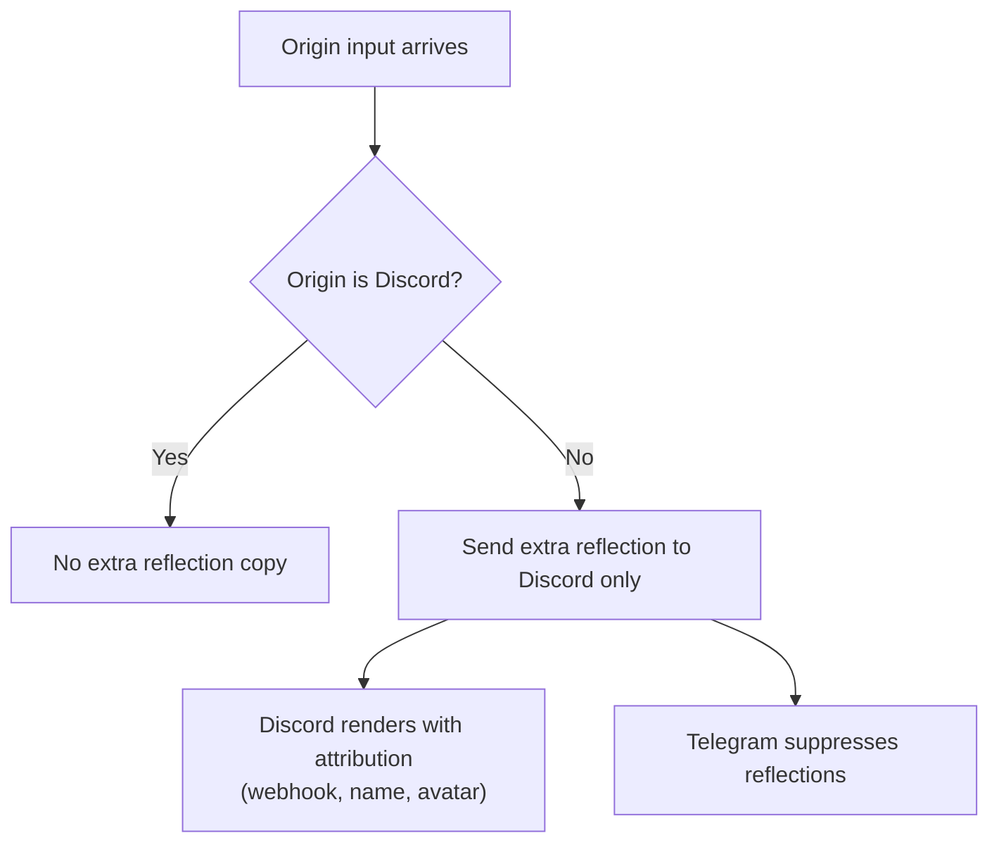

# Ui Adapter — Design

## Required reads

- @docs/project/policy/ux-message-cleanup.md
- @docs/project/spec/session-output-routing.md
- @docs/project/spec/session-projection.md

## Purpose

Responsibilities

- Normalize user commands and messages into daemon events.
- Render session output and feedback according to UX cleanup rules.
- Manage topics or channels for per-session organization.
- Preserve origin-endpoint continuity for direct user replies.
- Decide local presentation strategy (edit-in-place, threaded, or multi-placement) for delivered messages.
- Store adapter-local delivery receipts for platform messages.

Boundaries

- No cross-computer orchestration responsibilities.
- No domain policy decisions; UI is translation and presentation only.
- No core-level routing assumptions for origin continuity; the extra admin reflection is routed upstream and only Discord renders it.
- No projection truth ownership. Adapter metadata is delivery receipt state only.

Invariants

- UI adapters do not mutate core state directly.
- Cleanup rules are enforced consistently for each session.

## Inputs/Outputs

**Inputs:**

- User commands (text, slash commands, button clicks)
- Voice messages (audio files requiring transcription)
- File uploads (documents, images, media)
- Domain events from EventBus (SESSION_UPDATED, SESSION_STATUS, TURN_COMPLETE, MESSAGE_SENT)
- Command results from CommandService

**Outputs:**

- Formatted UI messages (output, feedback, notices)
- Output message edits (in-place updates for streaming content)
- Channel/topic title updates with status emoji
- Message deletions per UX cleanup rules
- Platform-specific UI elements (buttons, inline keyboards, formatted text)

## Invariants

- **Read-Only Core State**: UI adapters never mutate session, database, or domain state directly; all writes via commands.
- **Platform-Agnostic Commands**: User actions normalized to command objects (CreateSessionCommand, SendMessageCommand); platform details in metadata only.
- **Consistent Cleanup Rules**: pending_message_deletions enforced uniformly across all UI adapters; trigger conditions identical.
- **Delivery Receipts Only**: Output message ids, char offsets, overflow state, and edit anchors are adapter-local receipts. They are not source truth and must not determine projection ordering.
- **Scope Contract**: Core defines recipients via delivery scope. Adapters must not broaden `ORIGIN_ONLY` recipient sets.
- **Reflection Contract**: Discord is the single admin adapter. Core sends the extra admin reflection only to Discord when the origin is not Discord. Telegram suppresses reflections entirely.
- **Origin Endpoint UX**: `ORIGIN_ONLY` messages appear only at the origin endpoint.
- **Summary Rule**: `last_output_summary` is origin-only and non-threaded only (in-edit UX path).
- **No Command Rebroadcast**: UI adapters do not rebroadcast command acknowledgements or lifecycle chatter to peer adapters.
- **No Turn Truth in Adapters**: UI adapters may clear or replace delivery receipts when rendering requires it, but source turn boundaries and projection cursors are owned upstream.

## Primary flows

### 1. Adapter Registration & Event Subscription

### 2. Output Message Lifecycle

### 3. User Input Normalization

### 4. UX Cleanup Rule Enforcement

### 5. Output Rendering Flow

### 6. Session Title Synchronization

### 7. Typing Indicator Flow

UI adapters fire platform typing indicators in response to lifecycle status events. This provides immediate user feedback that the agent is working.

| Status          | Trigger                   | Adapter Action                   |
| --------------- | ------------------------- | -------------------------------- |
| `accepted`      | `user_prompt_submit` hook | Request a throttled typing pulse |
| `active`        | `session_start` hook      | Request a throttled typing pulse |
| `active_output` | `tool_use` hook           | No direct adapter API call       |
| `completed`     | `agent_stop` hook         | Footer/badge decoration only     |

Typing is naturally replaced by output from the polling cadence (`send_output_update` at ~1s). UI adapters may only issue throttled typing pulses from lifecycle status transitions; tool-use churn must never call platform typing APIs directly. `active_output` remains an observer status for internal and websocket consumers, not a direct UI side-effect trigger.

### 8. Voice Message Processing

Voice transcription is durable across daemon restart and bounded against a hung
backend. The transcription runs as a tracked task (not awaited inline on the
adapter event loop) and its lifecycle is persisted in the daemon-owned
`voice_transcriptions` table. The durability and recovery contract is
authoritative in `database#voice-transcription-durability-and-recovery` and
`daemon-lifecycle#post-adapter-completion-tasks`; this table is the happy-path
view.

UI adapters only download, send, edit, and delete platform messages; Core/Daemon
owns every `voice_transcriptions` row write and state transition (UI adapters
never mutate core state directly — see `#invariants` and
`layer-ownership#layer-boundaries`).

| Step | Actor     | Action                                                                       |
| ---- | --------- | ---------------------------------------------------------------------------- |
| 1    | User      | Sends voice message                                                          |
| 2    | UiAdapter | Downloads audio file to /tmp                                                 |
| 3    | Core      | Writes `voice_transcriptions` row `state=pending` (notice id NULL)           |
| 4    | UiAdapter | Sends "🎤 Transcribing..." notice (origin-only); returns its platform msg id |
| 5    | Core      | Persists the returned id as `notice_message_id`; runs transcription as a tracked task |
| 6    | STT       | Transcribes audio via the existing speech-to-text backend chain, bounded by a wall-clock timeout |
| 7    | UiAdapter | Edits the notice in place with the transcribed text                          |
| 8    | Core      | Transitions row to `succeeded`                                               |
| 9    | UiAdapter | Deletes voice message per cleanup rules (temp audio is swept by maintenance) |

Non-happy paths edit the **same** notice in place rather than emitting a
duplicate. Core drives the row's state and asks the adapter to edit: a
wall-clock timeout or terminal STT failure resolves the notice to an explicit
failure; on a daemon restart Core marks the row `interrupted` and the adapter
edits the notice in place (when a notice id was persisted), and the next boot's
recovery pass either completes the transcription or reports an audio-lost
failure. See the authoritative snippets above for the bounded-retry and
notice-ordering contract.

### 9. File Upload Flow

### 10. Reflection Routing

Core creates only the extra admin reflection, and only for Discord. The normal origin-path delivery is separate.

- Discord remains the only admin adapter.
- Telegram is an origin/input adapter only.
- Reflection suppression now happens before broad UI fanout, which avoids unnecessary lane work.
- Live output is now targeted at the origin UI adapter only. UI adapters never broaden that routing decision.
- Whether a user source entry is echoed, skipped, or reflected is decided by session projection before adapter rendering.

## Failure modes

- **Output Message Deleted by User**: Next edit fails. Adapter logs error, clears stale message_id, sends new message on next update.
- **Platform API Timeout**: Edit or send times out. Logged; polling retries next cycle. Output may be stale for 200ms.
- **Rate Limit Exceeded**: Platform rejects edit due to frequency. Adapter skips edit, accumulates diff, retries next cycle.
- **Session Channel Not Found**: Platform returns 404 on edit. Adapter clears metadata, recreates channel on next event.
- **Unauthorized User**: Message from non-whitelisted user. Silently ignored; no command execution or feedback.
- **Cleanup Message Already Deleted**: pending_message_deletions references deleted message. Delete fails gracefully; row cleared.
- **Feedback Routing Failure**: last_input_origin adapter offline. Feedback not delivered; logged. User sees nothing.
- **Adapter State Treated as Truth**: Invalid. A stale message id, char offset, or turn anchor may cause bad rendering, but it must not move the projection cursor or reorder source content.
- **Voice Transcription Failure**: the speech-to-text backend chain is unavailable or the audio format is unsupported. User sees error notice; voice message not deleted.
- **File Download Failure**: Platform API error during download. User sees error feedback; no file sent to AI.
- **Multiple Adapters Active**: Origin-only feedback appears only on the origin endpoint. Non-origin endpoints rely on dual-lane stream traffic.
