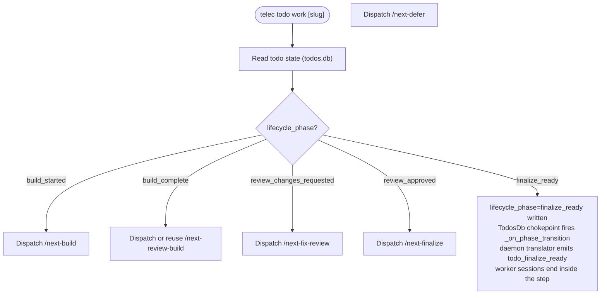
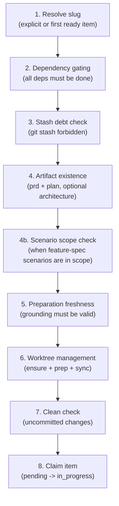
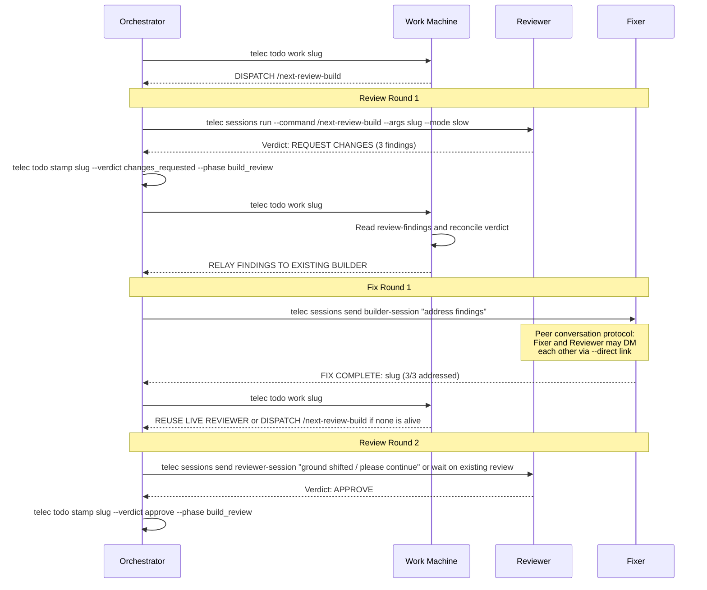

# Work State Machine — Design

## Purpose

The Work state machine routes implementation through four sub-phases: **Build → Review → Fix → Finalize**. It shares the same canonical `lifecycle_phase` field as Prepare, but it does not advance that pointer on its own. Natural progression happens only when the current phase receives an authoritative stamp.

**Entry point:** `telec todo work {slug}` for orchestrator-driven work
**Implementation:** [`next_work()`](../../../../teleclaude/core/next_machine/core.py)
**Terminal outputs:** `COMPLETE`, `NO_CURRENT_WORK_SLUG`, `FINALIZE_READY` (terminal Phase-B lifecycle phase; integration is triggered by the `TodosDb` write-state chokepoint when the phase is written, not by an in-machine handoff step)

### Referenced files

| File                                                                                                                                       | Purpose                                      |
| ------------------------------------------------------------------------------------------------------------------------------------------ | -------------------------------------------- |
| [`teleclaude/core/next_machine/core.py`](../../../../teleclaude/core/next_machine/core.py)                                                 | State machine implementation (`next_work()`) |
| [`docs/software-development/procedure/lifecycle/work/build.md`](../../../software-development/procedure/lifecycle/work/build.md)           | Build procedure                              |
| [`docs/software-development/procedure/lifecycle/work/review.md`](../../../software-development/procedure/lifecycle/work/review.md)         | Review procedure                             |
| [`docs/software-development/procedure/lifecycle/work/fix-review.md`](../../../software-development/procedure/lifecycle/work/fix-review.md) | Fix review procedure                         |
| [`docs/software-development/procedure/lifecycle/work/finalize.md`](../../../software-development/procedure/lifecycle/work/finalize.md)     | Finalize procedure                           |
| [`docs/general/procedure/orchestration.md`](../../../general/procedure/orchestration.md)                                                   | Orchestration loop procedure                 |

### Referenced doc snippets

| Snippet ID                                                 | Content                                                  |
| ---------------------------------------------------------- | -------------------------------------------------------- |
| `software-development/procedure/lifecycle/work/build`      | Build phase — implement plan, commit per task            |
| `software-development/procedure/lifecycle/work/review`     | Review phase — parallel lanes, structured findings       |
| `software-development/procedure/lifecycle/work/fix-review` | Fix phase — address findings, peer conversation          |
| `software-development/procedure/lifecycle/work/finalize`   | Finalize — two-stage: worker prepare, orchestrator apply |
| `general/procedure/orchestration`                          | Orchestration loop and dispatch rules                    |
| `software-development/policy/definition-of-done`           | Quality gates for completion                             |
| `software-development/policy/testing`                      | Pre-commit quality gates                                 |

## Inputs/Outputs

**Inputs:**

- `telec todo artifacts read {slug} prd` — product intent and success criteria (from Phase A)
- `telec todo artifacts read {slug} architecture` — optional technical context and constraints (from Phase A)
- `telec todo artifacts read {slug} implementation-plan` — execution plan with task checkboxes (from Phase A)
- `todos.db` state — build/review status, finalize state, review rounds
- `telec todo artifacts read {slug} quality-checklist` — build and review gate checkboxes
- `todos.db` todo list — slug resolution and dependency graph
- Worktree at `trees/{slug}/` — isolated git branch for implementation

**Outputs:**

- Code changes, tests, and commits (build)
- `telec todo artifacts read {slug} review-findings` — structured findings with severity and verdict (review)
- `telec todo artifacts read {slug} deferrals` — out-of-scope work identified during build (optional)
- Integration handoff events (`branch.pushed`, `deployment.started`)
- Updated `todo state (todos.db)` with phase progression

### State YAML structure

```yaml
phase: in_progress # pending | in_progress | done
lifecycle_phase: build_started
build_start_base_sha: abc123...
deferrals_processed: false

finalize:
  status: pending # pending | ready (terminal)
  branch: my-feature
  sha: abc123...
  ready_at: 2026-03-09T10:00:00+00:00

build_review:
  verdict: ''
  reviewed_at: ''
  round: 0
  baseline_commit: ''
  dispatch_head: ''
```

## Invariants

- **Routing from canonical phase**: all routing decisions read `lifecycle_phase` from `todo state (todos.db)`.
- **Build gates before review**: the worker- or orchestrator-owned `build_complete` stamp validates diff-scoped gates before review can be dispatched.
- **Artifact verification**: mechanical checks at phase boundaries (tasks checked, commits exist, findings substantive).
- **Reviewer reuse**: when review is already in flight for a slug, the state machine reuses the live reviewer session instead of dispatching a second reviewer.
- **Verdict reconciliation**: `review-findings` is authoritative only for the currently dispatched review head (`review_dispatch_head`). Stale findings from an older round must not short-circuit a fresh re-review.
- **Ground-shift follow-up**: if `origin/main` is merged while review is in flight and the newly landed files overlap the current review surface, the state machine sends a targeted follow-up to the same reviewer instead of widening scope or spawning a new reviewer.
- **Explicit build completion**: commits and passing gates are evidence only. Review does not reopen until the builder stamps `build_complete`.
- **Review round limit**: after `max_review_rounds` (default 3) iterations, the machine returns `REVIEW_ROUND_LIMIT` for orchestrator decision instead of looping.
- **Finalize ownership**: `telec todo stamp --finalize-ready` records `finalize.status=ready` on the finalize sub-state; the Work machine performs the triple-ref-gated advance from `review_approved` to terminal `lifecycle_phase=finalize_ready` and ends the worker's child sessions and own session inside the same step. There is no separate `handed_off` follow-up phase.
- **Integration emission is state-bound, not path-bound**: the `TodosDb.write_state` chokepoint fires a `_on_phase_transition` hook on every owned-commit lifecycle-phase change; the daemon-registered translator emits the `domain.software-development.planning.todo_finalize_ready` event on every `* → finalize_ready` transition the chokepoint observes, regardless of which writer (the work-machine claim, or any future writer landing the transition through the same chokepoint) produced it. v1 `TodosDb` does NOT serialize writers per project, so concurrent writers landing the same transition can each fire the hook — the chokepoint provides **at-least-once** emission at the bus layer. The `IntegrationTriggerCartridge`'s `_spawned_event_keys` dedup keyed on `(slug, sha, worker_session_id)` collapses duplicates to **exactly one** integrator spawn per logical event, and the integrator's `integration/main` singleton lease serializes spawns into a single integration run per slug. The work-step no longer emits the event directly. The integrator's periodic candidate scanner remains the in-band safety net for cases where the chokepoint emission was not delivered (e.g., daemon down).
- **Stash prohibition**: git stash is forbidden in all agent workflows. The machine checks for stash debt.

## Primary flows

### State diagram

```mermaid
stateDiagram-v2
    [*] --> Preconditions

    state Preconditions {
        [*] --> SlugResolution
        SlugResolution --> DependencyCheck
        DependencyCheck --> WorktreeSetup
        WorktreeSetup --> CleanCheck
    }

    Preconditions --> Build: build = pending/started
    Preconditions --> Review: build = complete, review = pending
    Preconditions --> Fix: review = changes_requested
    Preconditions --> Finalize: review = approved

    Build --> Review: `build_complete`
    Review --> Fix: verdict = REQUEST CHANGES
    Review --> Finalize: verdict = APPROVE
    Fix --> Review: `build_complete`

    state Finalize {
        [*] --> CheckDeferrals
        CheckDeferrals --> FinalizeWorker: deferrals processed
        FinalizeWorker --> MarkReady: FINALIZE_READY (triple-ref gated)
        MarkReady --> EndWorkerSessions: end child + own sessions
    }

    Finalize --> [*]: lifecycle_phase=finalize_ready written via TodosDb chokepoint; integration emission and Phase C handoff happen outside the work machine
```



### Routing logic

The machine reads `todo state (todos.db)` and routes from the canonical `lifecycle_phase`:



### Precondition checks

Before routing to any sub-phase, the Work machine runs these checks in order:



### Happy path (sequence diagram)

```mermaid
sequenceDiagram
    participant O as Orchestrator
    participant SM as Work Machine
    participant B as Builder Worker
    participant R as Reviewer Worker
    participant F as Finalizer Worker
    participant I as Integration Queue

    O->>SM: telec todo work slug
    SM-->>O: DISPATCH /next-build

    Note over O,B: Build Phase
    O->>B: telec sessions run --command /next-build --args slug
    B->>B: Bind feature-spec scenarios, implement tasks, commit per task
    B->>B: Check all tasks [x], run scoped build gates, repo-wide lint/test when explicitly requested
    B-->>O: BUILD COMPLETE: slug
    O->>B: wait for `telec todo stamp slug --build-complete`
    O->>O: telec sessions end builder-session

    O->>SM: telec todo work slug
    SM-->>O: DISPATCH /next-review-build

    Note over O,R: Review Phase
    O->>R: telec sessions run --command /next-review-build --args slug --mode slow
    R->>R: Run review lanes (code, tests, security, types, ...)
    R->>R: Write review-findings.md
    R-->>O: REVIEW COMPLETE: slug - Verdict: APPROVE
    O->>O: telec todo stamp slug --verdict approve --phase build_review

    O->>SM: telec todo work slug
    SM->>SM: Read review-findings and reconcile verdict
    SM-->>O: DISPATCH /next-finalize

    Note over O,F: Finalize Phase
    O->>F: telec sessions run --command /next-finalize --args slug
    F->>F: git fetch origin main, git merge origin/main
    F->>F: git push origin HEAD:slug
    F-->>O: FINALIZE_READY: slug
    O->>O: telec todo mark-finalize-ready slug
    O->>O: telec sessions end finalizer-session

    O->>SM: telec todo work slug
    SM->>SM: triple-ref validate; write lifecycle_phase=finalize_ready via TodosDb.write_state
    SM->>SM: end finalizer's child sessions + own session inside _work_step_finalize_ready
    Note over SM,I: TodosDb write-state chokepoint fires _on_phase_transition; daemon-registered translator emits domain.software-development.planning.todo_finalize_ready
    I->>I: IntegrationTriggerCartridge consumes the event and spawns the integrator (Phase C)
    Note over I: Phase C begins
```

### Review/fix loop (sequence diagram)

When the reviewer requests changes, the machine reuses the live builder and keeps the
reviewer session as the review owner for follow-up. The builder and reviewer may
communicate directly via peer conversation protocol.



### Command dispatch map

| Sub-Phase   | Command              | Worker Role  | Thinking Mode      | Output                                         |
| ----------- | -------------------- | ------------ | ------------------ | ---------------------------------------------- |
| Build       | `/next-build`        | Builder      | `med`              | Code, tests, commits                           |
| Build (bug) | `/next-build`        | Builder      | `med`              | Plan execution + reproduction test (RED→GREEN) |
| Review      | `/next-review-build` | Reviewer     | `slow` (mandatory) | `review-findings.md`, verdict                  |
| Fix         | `/next-fix-review`   | Fixer        | `med`              | Fix commits                                    |
| Deferrals   | `/next-defer`        | Orchestrator | —                  | New todos from deferrals                       |
| Finalize    | `/next-finalize`     | Finalizer    | `med`              | Branch pushed, FINALIZE_READY                  |

### Lifecycle events

| Event                      | Emitted When                     |
| -------------------------- | -------------------------------- |
| `build.started`            | Builder worker dispatched        |
| `build.complete`           | Build phase marked complete      |
| `review.started`           | Reviewer worker dispatched       |
| `review.approved`          | Review verdict = APPROVE         |
| `review.changes_requested` | Review verdict = REQUEST CHANGES |
| `branch.pushed`            | Finalize worker pushed branch    |
| `deployment.started`       | Integration handoff initiated    |

## Failure modes

- **No current work slug**: returns `NO_CURRENT_WORK_SLUG` with `telec sessions end self`; daemon-runner pickup owns selecting future work.
- **Dependency not satisfied**: returns `BLOCKED` with dependency information.
- **Stash debt detected**: hard error — git stash is forbidden in agent workflows.
- **Missing preparation artifacts**: returns a prepare-directed error for the current slug — run `telec todo prepare {slug}` first.
- **Stale preparation grounding**: returns instruction to re-run prepare before building.
- **Worker crash**: orchestrator retries once, then escalates with context.
- **Review round limit exceeded**: returns `REVIEW_ROUND_LIMIT` for orchestrator decision — approve with documented follow-up for non-critical residual items, or escalate if unresolved critical findings remain.
- **Build gates fail**: the `build_complete` stamp is rejected; the builder fixes the issue before review.
- **State repair**: reconciles from authoritative fields only; commits alone never repair to `build_complete`.
