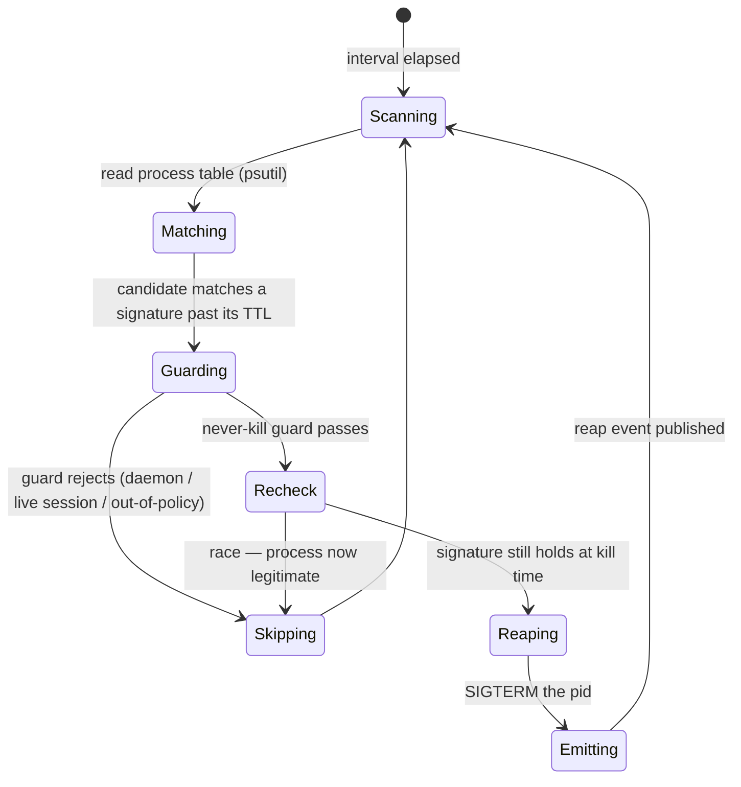
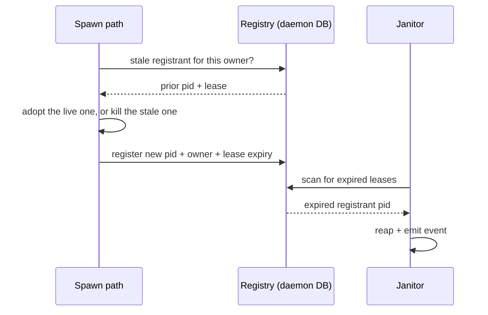

# Process Lifecycle — Design

## Required reads

- @docs/project/design/architecture-v2/daemon-runtime.md

## Purpose

The daemon owns the lifecycle of the processes it spawns or recognizes as its
own leaked dead weight, so orphaned and runaway processes are reaped
automatically and observably rather than accumulating until the host congests.

Two parts under one concept:

- **Janitor** — a periodic daemon task that scans the host process table against
  a signature + TTL policy and reaps matches, emitting one event per kill.
- **Spawn registry** — platform-spawned detached children record an identity and
  an expiring lease at spawn time; spawn paths adopt-or-kill a stale prior
  registrant before starting a replacement; the janitor reaps expired leases.

The signature policy is **data**, not branching code: a new leak class is a new
policy row, so a recurrence becomes configuration rather than a fresh incident.

## Inputs/Outputs

**Inputs:**

- The host process table (pid, ppid, start time, command), read through `psutil`
  — the dependency already used in `teleclaude/core/system_stats.py`.
- The signature + TTL policy: the set of leak-class matchers and their grace
  windows, seeded with the known classes and extensible by row.
- The spawn registry: identity (pid + owner + lease expiry) records written by
  platform spawn paths.
- Configurable scan interval and policy/lease TTLs from the typed config surface.

**Outputs:**

- Terminated leaked processes whose signature match has outlived its TTL.
- One observable reap event per killed pid, carrying the pid, the matched
  signature, and the reason — emitted through `teleclaude/events/producer.py`
  `emit_event` and registered in `teleclaude/events/catalog.py`. Reaping is never
  silent.
- Registry rows mutated as detached children are registered, adopted, or reaped.

Seed signature classes (from the Jun 2026 leak evidence):

- execnet / pytest-xdist bootstrap processes reparented to `ppid == 1`;
- shell loops invoking `telec sessions tail` older than their TTL;
- parentless `node` / `pyright` servers under the project venv past TTL;
- detached workers with no live registration.

## Invariants

- **The signature policy is the sole authority for what is reapable.** A process
  is a candidate only if it satisfies an explicit signature; nothing outside the
  policy is ever killed.
- **The matcher can never reap the daemon, a live agent session, or an
  out-of-policy process.** This never-kill guard is not optional and defaults
  toward not killing on any ambiguity. Killing is irreversible; the guard is the
  load-bearing safety contract and is verified by refutation tests. (Its exact
  formulation is fixed in the architecture phase.)
- **Every reap is observable.** One event per killed pid reaches the event
  stream; a silent kill is a defect.
- **Reaping is idempotent and re-checked at kill time.** A signature is
  re-evaluated immediately before the kill so a process that legitimately started
  or reparented inside the TTL window is not caught by a stale match.
- **Detached children are owned, not untracked.** Anything the platform spawns
  with its own session registers a lease; an expired lease is reapable, and a
  stale registrant is resolved by adopt-or-kill before a replacement starts.
- **Daemon-owned state stays daemon-owned.** The policy table and the spawn
  registry live in the daemon DB (`teleclaude/core/schema.sql`); no other service
  reads or writes them.

## Primary flows

### Janitor scan

The scan follows the existing daemon periodic-task pattern
(`teleclaude/daemon.py`: `periodic_cleanup`, `resource_monitor_loop`) honoring
`shutdown_event`; it is not a new scheduler. The point-check reaping pattern in
`jobs/temp_reaper.py` and `teleclaude/quality/subprocess_reaper.py` is the
nearest prior art for liveness probing and signature-driven kills.

### Spawn registry lease

The chiptunes worker (`teleclaude/chiptunes/manager.py`, the existing
`subprocess.Popen(start_new_session=True)` detached spawn) is the first adopter,
proving the contract end to end and retiring its duplicate-worker leak.

## Failure modes

- **Guard false positive (kills something live).** The highest-stakes failure.
  Mitigation: signature policy is the sole authority, the never-kill guard
  defaults to not-killing on ambiguity, and an optional observe-only mode emits
  "would reap" without killing so a new signature row is validated before it
  kills.
- **Signature race.** A process matches "parentless past TTL" exactly as it
  legitimately starts or reparents. Mitigation: TTL windows plus a re-check at
  kill time; reaping is idempotent.
- **adopt-or-kill race.** Two spawn paths start the same child concurrently.
  Mitigation: the lease write is the serialization point; atomicity is fixed in
  the architecture phase.
- **Scan cost on a busy host.** Reading the full process table every interval is
  not free. Mitigation: bound the scan and keep the interval sane.
- **Silent reap.** An event fails to publish, hiding a kill. Mitigation: the
  per-kill event is part of the reap contract, not a side effect; a reap without
  its event is a defect, not a tolerated degradation.
