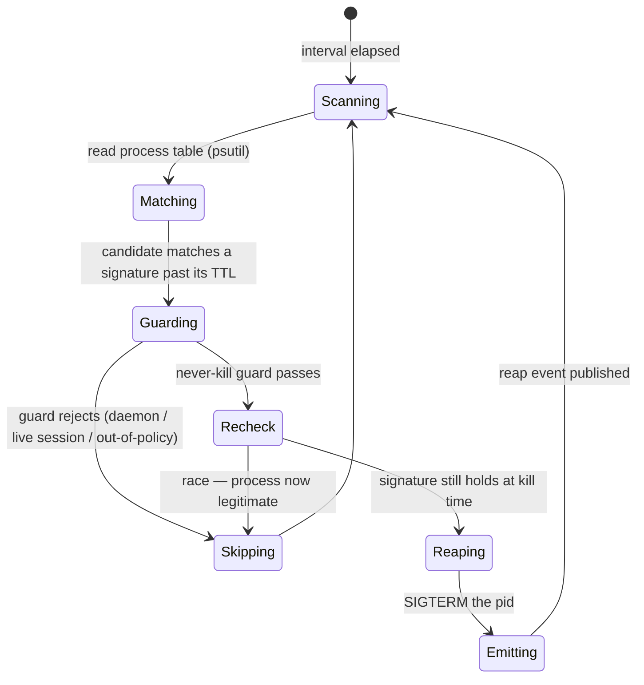
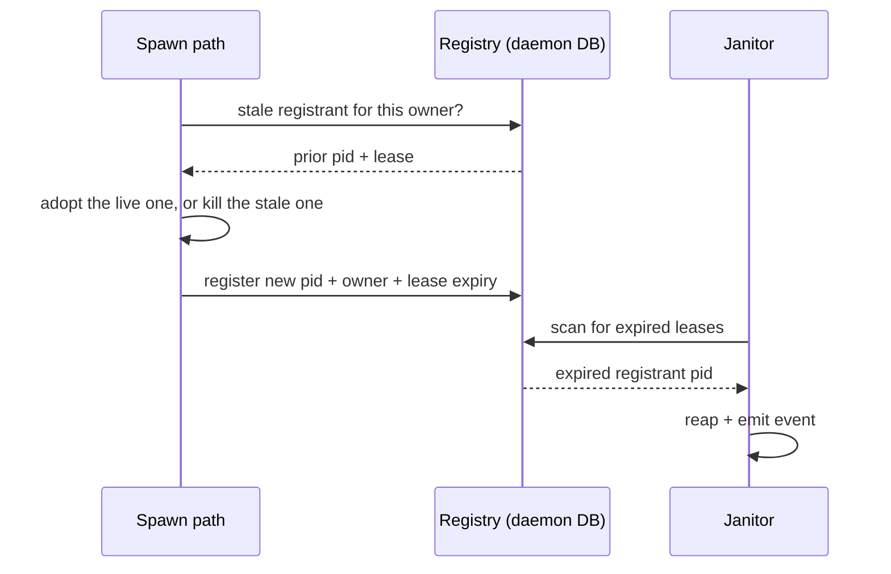

# Process Lifecycle — Design

## Required reads

- @docs/project/design/architecture-v2/daemon-runtime.md

## Purpose

The daemon owns the lifecycle of the processes it spawns or recognizes as its
own leaked dead weight, so orphaned and runaway processes are reaped
automatically and observably rather than accumulating until the host congests.

Two parts under one concept:

- **Janitor** — a periodic daemon task that scans the host process table against
  a signature + TTL policy and reaps matches, emitting one event per kill.
- **Spawn registry** — platform-spawned detached children record an identity and
  an expiring lease at spawn time; spawn paths adopt-or-kill a stale prior
  registrant before starting a replacement; the janitor reaps expired leases.

The signature policy is **data**, not branching code: a new leak class is a new
policy row, so a recurrence becomes configuration rather than a fresh incident.

## Inputs/Outputs

**Inputs:**

- The host process table (pid, ppid, start time, command), read through `psutil`
  — the dependency already used in `teleclaude/core/system_stats.py`.
- The signature + TTL policy: the set of leak-class matchers and their grace
  windows, seeded with the known classes and extensible by row.
- The spawn registry: identity (pid + owner + lease expiry) records written by
  platform spawn paths.
- Configurable scan interval and policy/lease TTLs from the typed config surface.

**Outputs:**

- Terminated leaked processes whose signature match has outlived its TTL.
- One observable reap event per killed pid — `system.process.reaped`, joining the
  existing `system.*` infrastructure-event family in
  `teleclaude/events/schemas/system.py`. Payload: the pid, the matched signature
  (id + name), the reap reason, and — when the reap is a lease expiry — the owner
  and lease. Emitted through `teleclaude/events/producer.py` `emit_event` at
  `EventLevel.OPERATIONAL` with host-local visibility, so the operator queries
  reaps through `telec events` like any other system event. Reaping is never
  silent.
- Registry rows mutated as detached children are registered, adopted, or reaped.

Seed signature classes (from the Jun 2026 leak evidence):

- execnet / pytest-xdist bootstrap processes reparented to `ppid == 1`;
- shell loops invoking `telec sessions tail` older than their TTL;
- parentless `node` / `pyright` servers under the project venv past TTL;
- detached workers with no live registration.

## Invariants

- **The signature policy is the sole authority for what is reapable.** A process
  is a candidate only if it satisfies an explicit signature; nothing outside the
  policy is ever killed.
- **The matcher can never reap the daemon, a live agent session, or an
  out-of-policy process.** This never-kill guard is not optional and defaults
  toward not killing on any ambiguity. Killing is irreversible; the guard is the
  load-bearing safety contract and is verified by refutation tests. Its exact
  formulation is the **Never-kill guard** flow below.
- **The janitor runs inside the daemon, not as an out-of-process job.** It is a
  periodic asyncio task registered in `teleclaude/daemon.py` beside
  `periodic_cleanup` and `resource_monitor_loop`, honoring `shutdown_event`. It
  shares the daemon's process and serialization domain with the spawn paths it
  coordinates with and reads live session identity directly — neither is available
  to a cron-spawned standalone job like `jobs/temp_reaper.py`.
- **Every reap is observable.** One event per killed pid reaches the event
  stream; a silent kill is a defect.
- **Reaping is idempotent and re-checked at kill time.** A signature is
  re-evaluated immediately before the kill so a process that legitimately started
  or reparented inside the TTL window is not caught by a stale match.
- **Detached children are owned, not untracked.** Anything the platform spawns
  with its own session registers a lease; an expired lease is reapable, and a
  stale registrant is resolved by adopt-or-kill before a replacement starts.
- **Daemon-owned state stays daemon-owned.** The policy table and the spawn
  registry live in the daemon DB (`teleclaude/core/schema.sql`); no other service
  reads or writes them.

## Primary flows

### Janitor scan

The scan follows the existing daemon periodic-task pattern
(`teleclaude/daemon.py`: `periodic_cleanup`, `resource_monitor_loop`) honoring
`shutdown_event`; it is not a new scheduler. The nearest prior art for the kill
mechanics: `jobs/temp_reaper.py` probes liveness with `os.kill(pid, 0)` and reaps
by a pid-embedded signature, and `teleclaude/chiptunes/manager.py` matches a
process signature over `psutil.process_iter` cmdline (the exact `-m <module>`
pair, uid-scoped via `proc.uids().real`), then SIGTERMs and polls a bounded
interval for exit. The janitor generalizes both: signature matching becomes a
data-driven policy, and the kill is guarded and observable.

### Never-kill guard

A candidate is reaped only when it **positively matches an active signature past
its TTL** AND survives the guard. The guard is a denylist of protected identities
applied after the signature allowlist, and it defaults to _not killing_ whenever
an input cannot be resolved.

Protected — never reaped regardless of signature match:

- **Not the daemon's own tree.** The daemon's own pid (`os.getpid()`) and every
  process in its process group / non-detached child tree.
- **Not a live agent session.** For every session in `db.get_active_sessions()`,
  its tmux host pid (`tmux_bridge.get_pane_pid(tmux_session_name)`) and that pid's
  descendants. A live session's hosting process is never a leak.
- **Not a leased registrant.** Any spawn-registry registrant whose lease is still
  valid — a live lease means the process is owned, not orphaned.
- **Not another user's process.** uid-scoped — only processes owned by the daemon
  user are ever candidates (mirroring `manager.py`'s `proc.uids().real` check).

Ambiguity defaults to skip: a `psutil` error, an unresolvable pid, a session whose
host pid cannot be read, or any missing identity datum removes the candidate from
the kill set rather than killing it. Signature and guard are both **re-evaluated
at kill time** (the `Recheck` state), so a process that became legitimate inside
the TTL window — started, reparented, or acquired a lease — is released before the
SIGTERM.

### Spawn registry lease

The chiptunes worker (`teleclaude/chiptunes/manager.py`, the existing
`subprocess.Popen(start_new_session=True)` detached spawn) is the first adopter,
proving the contract end to end and retiring its duplicate-worker leak.

**adopt-or-kill atomicity.** The registry lives in the daemon DB
(`teleclaude/core/db/`, schema in `teleclaude/core/schema.sql`); `owner` is unique
— at most one live registrant per owner. Registration is a single transaction that
reads the current registrant, resolves adopt-or-kill, and writes the new pid +
lease; SQLite's write serialization together with the unique-`owner` constraint is
the concurrency boundary, so two spawns of the same owner cannot both install a
registrant. Within the daemon the single asyncio event loop already serializes the
spawn paths; the transaction is the cross-process backstop. This replaces the
chiptunes manager's current file-based classify-then-spawn (pidfile + socket
probe), which is racy across processes.

A synchronous spawn path bridges the sync→async DB color boundary deliberately:
`teleclaude/chiptunes/manager.py` is a synchronous, thread-based class, while the
daemon-DB session helpers are async (`async with self._session()`). Registry reads
and writes from such a path use the synchronous SQLAlchemy/`sqlite3` session
helpers in `teleclaude/core/db/_sync.py`, or are dispatched onto a thread — never
called as if the async session were synchronous. The unique-`owner` transaction
holds identically on the sync path.

## Failure modes

- **Guard false positive (kills something live).** The highest-stakes failure.
  Mitigation: signature policy is the sole authority, the never-kill guard
  defaults to not-killing on ambiguity, and an optional observe-only mode emits
  "would reap" without killing so a new signature row is validated before it
  kills.
- **Signature race.** A process matches "parentless past TTL" exactly as it
  legitimately starts or reparents. Mitigation: TTL windows plus a re-check at
  kill time; reaping is idempotent.
- **adopt-or-kill race.** Two spawn paths start the same child concurrently.
  Mitigation: the registry write is the serialization point — a single
  transaction under a unique-`owner` constraint (see _adopt-or-kill atomicity_),
  so only one registrant survives and the loser adopts it.
- **Scan cost on a busy host.** Reading the full process table every interval is
  not free. Mitigation: bound the scan and keep the interval sane.
- **Silent reap.** An event fails to publish, hiding a kill. Mitigation: the
  per-kill event is part of the reap contract, not a side effect; a reap without
  its event is a defect, not a tolerated degradation.
