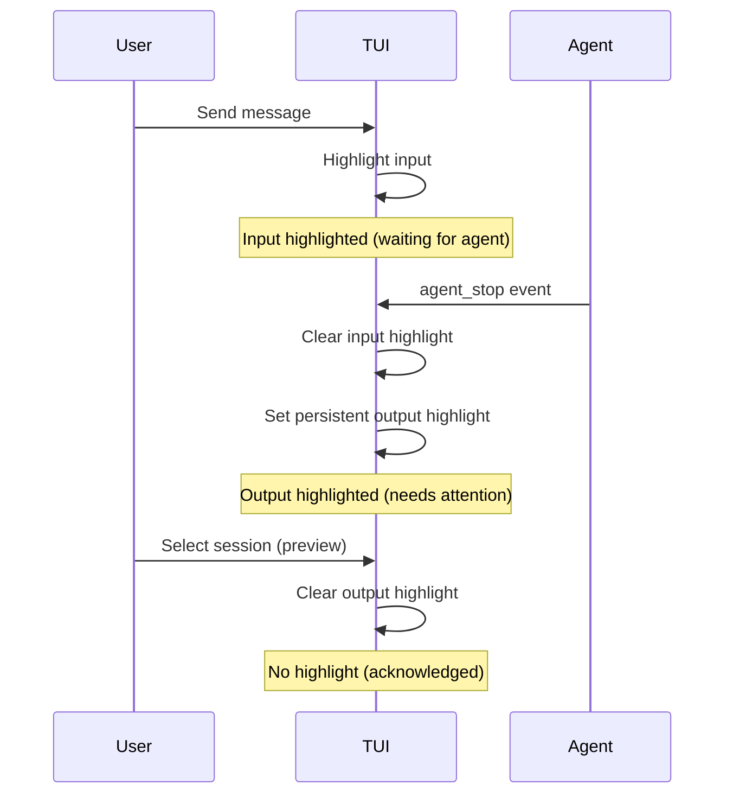
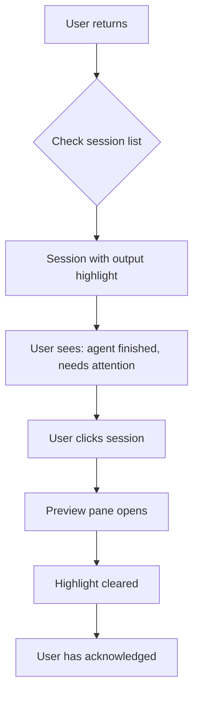

# Session Highlight — Design

## Purpose

The highlight system provides visual cues in the TUI to alert users about session activity requiring attention. It answers: "Which sessions need my attention?"

## Inputs/Outputs

**Inputs:**

- `user_input_sent` event — User sends a message to an agent
- `tool_use` event — Agent starts a tool call (drives the "live activity" lit state)
- `agent_stop` event — Agent completes its turn
- User navigation — Selecting/previewing a session

**Outputs:**

- Visual highlight state per session (input highlighted, output highlighted, or neither)
- Highlight cleared when user acknowledges by viewing the session

## Invariants

1. **One highlight type per session**: A session has either input highlight, output highlight, or no highlight — never both simultaneously.

2. **Input highlight until agent responds**: When user sends input, the input is highlighted. This persists until the agent produces output, signaling the agent is working.

3. **Output highlight on agent completion**: When agent finishes (`agent_stop`), output is highlighted persistently until the user views it.

4. **Viewing clears output highlight**: Selecting a session (preview pane or sticky) acknowledges the output, clearing its highlight.

5. **Live output highlight during active tool**: While `activity_event == "tool_use"` the output line is lit. The highlight follows the live activity state — the next `tool_use` or `agent_stop` advances it.

## Primary flows

### 1. User sends message, agent responds



### 2. Live tool activity

```mermaid
sequenceDiagram
    participant User
    participant TUI
    participant Agent

    User->>TUI: Send message
    TUI->>TUI: Highlight input

    Agent->>TUI: tool_use event
    TUI->>TUI: Clear input highlight
    TUI->>TUI: Output line lit while activity_event == tool_use
    Note over TUI: Live activity highlight

    Agent->>TUI: tool_use (next tool) / agent_stop
    Note over TUI: activity_event advances; highlight follows

    Agent->>TUI: agent_stop event with summary
    TUI->>TUI: Set persistent output highlight
    Note over TUI: Final highlight until viewed (or 3s on preview)
```

### 3. User returns to laptop



## Failure modes

| Scenario                          | Behavior                               | Recovery                                                                          |
| --------------------------------- | -------------------------------------- | --------------------------------------------------------------------------------- |
| Event lost                        | Session may show stale highlight state | Next event corrects state; user can click to clear                                |
| Rapid events                      | Multiple events in quick succession    | Each event processed in order; final state wins                                   |
| TUI restart                       | Highlight state lost                   | State persisted to `~/.teleclaude/tui_todo state (todos.db)`; restored on restart |
| Session deleted while highlighted | Orphaned highlight in state            | Highlight set garbage-collected when session no longer exists                     |
