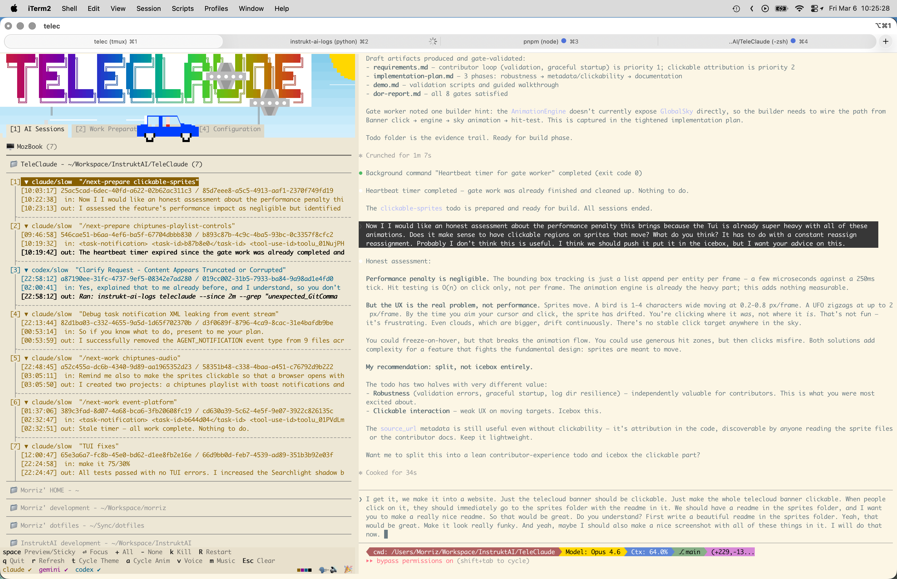
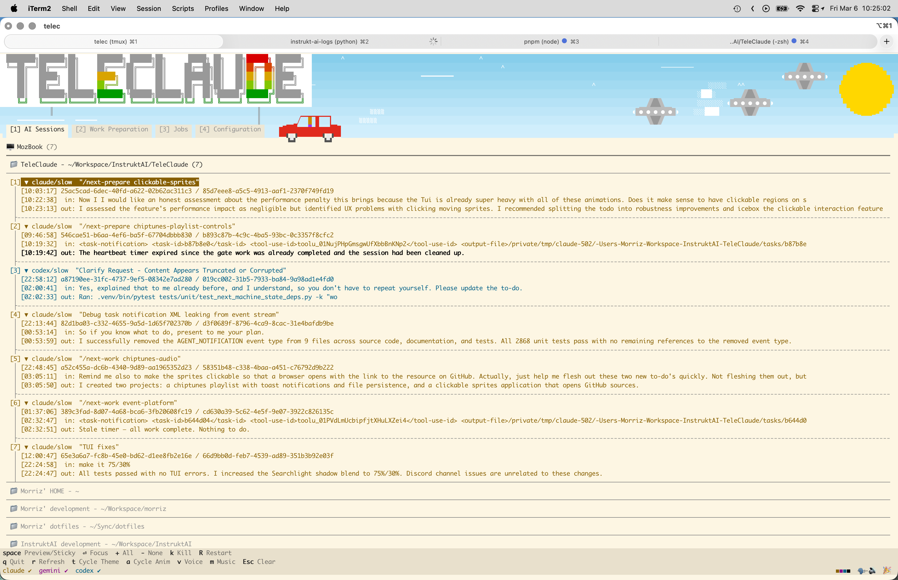
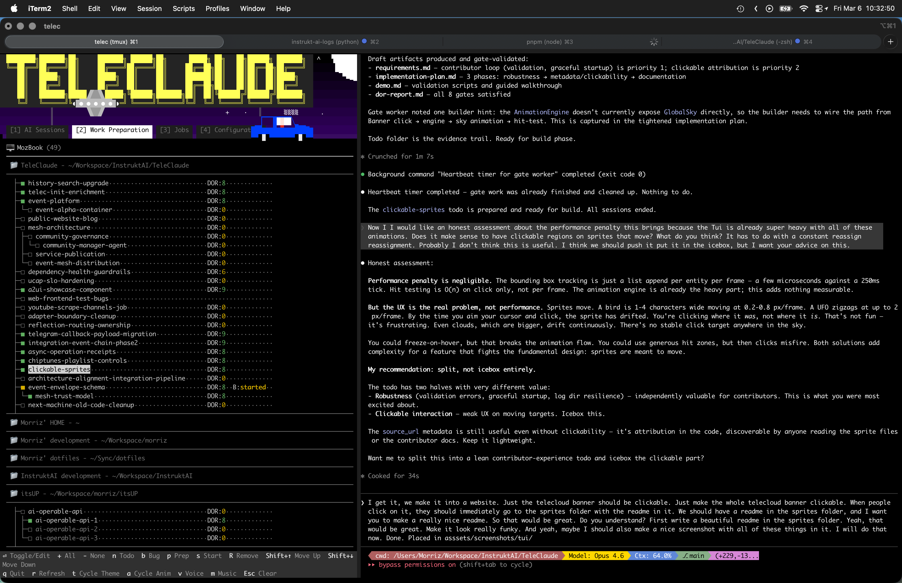

```
                    ░░░▒▒▓▓▇▇▓▓▒▒░░░
               ░▒▒▓▇▇▇▇▇▇▇▇▇▇▇▇▇▓▒▒░
            ░▒▓▇▇▇▇▇▇▇▇▇▇▇▇▇▇▇▇▇▇▇▓▒░
           ▒▓▇▇▇▇  S P R I T E S  ▇▇▇▓▒
            ░▒▓▇▇▇▇▇▇▇▇▇▇▇▇▇▇▇▇▇▇▇▓▒░
               ░▒▒▓▇▇▇▇▇▇▇▇▇▇▇▇▇▓▒▒░
                    ░░░▒▒▓▓▇▇▓▓▒▒░░░
```

<br>

# TeleClaude Sky Sprites

> **The sky above the TeleClaude banner is alive.**
>
> Birds flock across a daytime sky. Clouds drift with the weather.
> A UFO occasionally buzzes past. Cars cruise along the tab bar.
> At night, stars twinkle and the moon glows.
>
> All of this is built from Unicode block characters and a handful of Python.

<br>

<p align="center">
  
</p>

<p align="center">
  
  
</p>

<br>

---

<br>

## What Lives in the Sky

| File           | What it draws                                                          | Theme |
| :------------- | :--------------------------------------------------------------------- | :---: |
| `celestial.py` | **Sun** and **Moon** — full-disc quarter-celestials anchored top-right |  `*`  |
| `clouds.py`    | Wisps, puffs, medium clouds, cumulus — **4 weather patterns**          |  `*`  |
| `birds.py`     | Small `v`/`^` flocks, large composite birds with body detail           | light |
| `ufo.py`       | Multi-layer flying saucer with hull, cockpit, and port lights          |  `*`  |
| `cars.py`      | Left-facing and right-facing cars with body, head, wheels, tyres       |  `*`  |

<br>

The engine picks weather (`clear` / `fair` / `cloudy` / `overcast`), spawns the matching cloud group, scatters birds and standalone entities, and lets everything drift at its own speed and depth.

Day/night follows your terminal's dark mode.

<br>

---

<br>

## How Sprites Work

Every sprite is built from **Unicode block characters**:

```
  half-blocks ▄▀    quarter-blocks ▖▗▘▙▚▛▜▝▞▟    shade blocks ░▒▓
  triangles ◢◣◤◥    box-drawing ━─╱╲              circles ●◖◗
```

No images. No fonts. No dependencies. **Just Unicode and color.**

<br>

### The Building Blocks

```python
from teleclaude.cli.tui.animations.sprites.composite import (
    CompositeSprite,   # A static multi-layer sprite
    AnimatedSprite,    # A sprite that cycles through frames
    SpriteLayer,       # One color layer (positive + negative chars)
    SpriteGroup,       # A population container with weighted spawn counts
)
```

<br>

| Type                  | What it does                                                                                                      |
| :-------------------- | :---------------------------------------------------------------------------------------------------------------- |
| **`SpriteLayer`**     | One color layer. `positive` chars render as foreground, `negative` chars render inverted, spaces are transparent. |
| **`CompositeSprite`** | Stack of layers rendered back-to-front. Layer 0 first, last layer on top.                                         |
| **`AnimatedSprite`**  | Cycles through frames. Each frame is a `CompositeSprite` or plain `list[str]`.                                    |
| **`SpriteGroup`**     | Population container: how many of each sprite to spawn, with weighted randomness.                                 |

<br>

### Depth, Position, and Speed

Every sprite declares three weight distributions that control where it spawns and how it moves:

```python
z_weights     = [(30, 50), (40, 50)]        # depth: Z-level -> weight
y_weights     = [(0, 2, 40), (3, 6, 60)]    # height: (y_lo, y_hi) -> weight
speed_weights = [(0.2, 30), (0.5, 70)]      # drift: pixels/frame -> weight
```

<br>

The engine picks from these distributions at spawn time. A sprite at Z30 renders behind the banner letters; at Z70 it passes in front of the tab bar.

<br>

```
  Z-Depth Scale
  ═══════════════════════════════════════

    0   sky gradient          ░░░░░░░░░░
   10   stars                 ·  ✦  ·  *
   20   celestial (sun/moon)  ████
   30   far clouds            ░░▒▒▓▓▒▒░
   40   billboard (banner)    TELECLAUDE
   50   mid clouds            ▒▒▓▇▇▓▒▒
   60   inactive tab panes    ┌────────┐
   70   near clouds / tab bar ▓▇▇▇▇▇▇▓
   80   active tab pane       │ active │
   90   foreground            ▇▇▇▇▇▇▇▇

  ═══════════════════════════════════════
```

<br>

---

<br>

## Create Your Own Sprite

<br>

### Step 1 — Draw it

Start simple. A single-layer sprite is just a list of strings:

```python
# my_sprite.py
from teleclaude.cli.tui.animations.sprites.composite import CompositeSprite, SpriteLayer

MY_SPRITE = CompositeSprite(
    layers=[
        SpriteLayer(
            positive=[
                " ◢█◣ ",
                "█████",
                " ◥█◤ ",
            ],
            color="#FF6600",
        ),
    ],
    z_weights=[(30, 50), (50, 50)],
    y_weights=[(1, 5, 100)],
    speed_weights=[(0.3, 50), (0.6, 50)],
)
```

<br>

For multi-layer sprites (like the UFO with hull + cockpit + lights), stack more `SpriteLayer` entries. Layers render back-to-front.

<br>

For **animated** sprites (like flapping birds), use `AnimatedSprite`:

```python
from teleclaude.cli.tui.animations.sprites.composite import AnimatedSprite

MY_BIRD = AnimatedSprite(
    frames=[
        ["v"],   # wings up
        ["^"],   # wings down
    ],
    z_weights=[(30, 100)],
    y_weights=[(0, 5, 100)],
    speed_weights=[(0.3, 100)],
)
```

<br>

### Step 2 — Register it

Add your import and export to [`__init__.py`](./__init__.py):

```python
from teleclaude.cli.tui.animations.sprites.my_sprite import MY_SPRITE

__all__ = [
    # ... existing entries ...
    "MY_SPRITE",
]
```

That's it. The engine auto-discovers anything in `__all__` that has `z_weights`.

<br>

### Step 3 — See it fly

```bash
telec
```

Your sprite will appear in the sky. Press **`a`** to cycle animation modes.

If your sprite has an error (e.g., `SpriteGroup` weights don't sum to 1.0), you'll see a clear error message on startup telling you exactly what's wrong.

<br>

### Step 4 — Theme filtering (optional)

Restrict a sprite to dark or light mode:

```python
MY_NIGHT_SPRITE = CompositeSprite(
    # ...
    theme="dark",     # only at night
)
```

<br>

### Step 5 — Color variants (optional)

Pass a list for random color selection at spawn time:

```python
SpriteLayer(
    positive=["███"],
    color=["#FF0000", "#00FF00", "#0000FF"],  # random pick per spawn
)
```

<br>

---

<br>

## Unicode Character Reference

Your terminal is a pixel canvas. Here are the building blocks:

<br>

```
  Half blocks       ▀ ▄ █ ▌ ▐

  Quarter blocks    ▖ ▗ ▘ ▙ ▚ ▛ ▜ ▝ ▞ ▟

  Eighth blocks     ▁ ▂ ▃ ▅ ▆ ▇ ▔

  Shade blocks      ░ ▒ ▓

  Triangles         ◢ ◣ ◤ ◥

  Circles           ● ◖ ◗ ◉ ◎

  Box drawing       ━ ─ │ ╱ ╲

  Geometric         ◆ ◇ ▲ ▶ ▼ ◀

  Sparkles          ✦ · * +

  Braille           ⠁ ⠃ ⠇ ⠏ ⠟ ⠿
```

> **Tip:** Space characters are transparent. Use them to shape the outline of your sprite.

<br>

---

<br>

## Architecture

<br>

- **Sprites are pure data** — no runtime logic, no I/O, no imports beyond `composite.py`

- **`GlobalSky`** in [`general.py`](../general.py) owns the lifecycle: spawn, drift, wrap, respawn

- **Z-buffer compositing** handles occlusion — sprites pass behind and in front of the banner

- **~250ms tick** intervals; sprite movement is fractional (sub-pixel accumulation)

- **Weather** changes every 30-120 minutes; entity populations are re-rolled on weather change

<br>

---

<br>

<p align="center">
  <strong>The sky is open.</strong>
  <br><br>
  Add a satellite. A hot air balloon. A dragon. A paper airplane.
  <br>
  Whatever you draw with Unicode, the engine will carry it across the sky.
</p>

<br>
